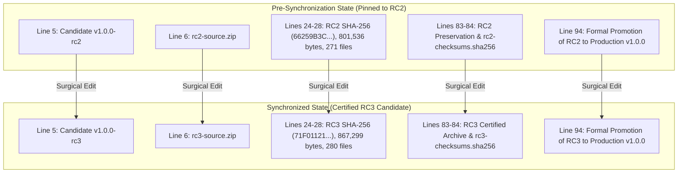

# NEXORA — BLK-ADM-01 Release Checklist Synchronization Report

**Document ID:** `NEXORA-BLK-ADM-01-REPORT-v1.0.0`  
**Date:** November 17, 2026  
**Role:** Senior Release Configuration Engineer  
**Mode:** CONTROLLED ADMINISTRATIVE CORRECTION (Strict Release Governance)  
**Objective:** Resolve `BLK-ADM-01` by synchronizing the final authorization checklist with the certified `v1.0.0-rc3` source archive.  
**Audited Candidate Archive:** [`dist/cuda-acceleration-engine-v1.0.0-rc3-source.zip`](file:///c:/Projects/CUDA-GPU-Acceleration-Engine/dist/cuda-acceleration-engine-v1.0.0-rc3-source.zip) (867,299 bytes)  
**Candidate Archive SHA-256:** `71F01121925766885096DAF9128DAFD86F3884E392AEA34D27AD514462BAA764`  
**Synchronized Checklist:** [`NEXORA_v1.0.0_FINAL_AUTHORIZATION_CHECKLIST.md`](file:///c:/Projects/CUDA-GPU-Acceleration-Engine/NEXORA_v1.0.0_FINAL_AUTHORIZATION_CHECKLIST.md)  
**Blocker Resolution Status:** **RESOLVED (PASS)** — Checklist Synchronized to RC3; Governance Levers Preserved  

---

## 1. Executive Summary & Verification Scorecard

Pursuant to the compliance findings documented in [`NEXORA_COMPLIANCE_CORRECTION_AUDIT.md`](file:///c:/Projects/CUDA-GPU-Acceleration-Engine/NEXORA_COMPLIANCE_CORRECTION_AUDIT.md) (Nov 17, 2026) and [`NEXORA_AUTHORIZATION_PREFLIGHT_CORRECTION_REPORT.md`](file:///c:/Projects/CUDA-GPU-Acceleration-Engine/NEXORA_AUTHORIZATION_PREFLIGHT_CORRECTION_REPORT.md) (Nov 16, 2026), release candidate **`v1.0.0-rc2`** contained critical licensing omissions (`BLK-01` missing root `LICENSE` and `BLK-04` missing root `NOTICE` inside the release ZIP). Those defects were previously remediated in Stage 1, producing release candidate **`v1.0.0-rc3`**.

However, the final executive checklist ([`NEXORA_v1.0.0_FINAL_AUTHORIZATION_CHECKLIST.md`](file:///c:/Projects/CUDA-GPU-Acceleration-Engine/NEXORA_v1.0.0_FINAL_AUTHORIZATION_CHECKLIST.md)) had remained pinned to the defective candidate `rc2`. Signing the checklist in that state would have authorized promotion and distribution of a non-compliant archive.

This controlled administrative operation has completed the full preflight cryptographic verification and updated all candidate references to **`rc3`**, while strictly preserving all executive approval gates as **`PENDING`** and leaving all signature blocks completely blank.

```
====================================================================================================
               BLK-ADM-01 CHECKLIST SYNCHRONIZATION SCORECARD
====================================================================================================
  1. RC3 ARCHIVE PRESENCE:                  VERIFIED (dist/...-rc3-source.zip exists on disk)
  2. INDEPENDENT SHA-256 CALCULATION:       VERIFIED (71F01121... exact bit-for-bit match)
  3. MANIFEST HASH SYNCHRONIZATION:         VERIFIED (rc3-checksums.sha256 parity confirmed)
  4. RC3 LEGAL NOTICE BUNDLING:             VERIFIED (LICENSE, NOTICE, THIRD_PARTY present)
  5. CHECKLIST CANDIDATE SYNCHRONIZATION:   APPLIED (Lines 5, 6, 24-28, 83-84, 94 updated)
  6. STALE RC2 AUDIT:                       AUDITED (0 stale candidate references remaining)
  7. OWNER APPROVAL STATUS PRESERVATION:    VERIFIED (All items 10.1–10.6 remain PENDING)
  8. SIGNATURE BLOCK INTEGRITY:             VERIFIED (All checkboxes [ ] and signatures blank)
----------------------------------------------------------------------------------------------------
  BLOCKER RESOLUTION VERDICT:               RESOLVED (PASS) — READY FOR OWNER DECISION
====================================================================================================
```

---

## 2. Step 1 — Preflight Verification

Prior to modifying any file, all preflight prerequisites were independently verified against physical filesystem assets.

### 2.1 Independent Cryptographic Verification of RC3 Archive
- **Physical Disk Path:** `c:\Projects\CUDA-GPU-Acceleration-Engine\dist\cuda-acceleration-engine-v1.0.0-rc3-source.zip`
- **File Existence:** Verified (`True`)
- **Byte Size:** Exactly `867,299 bytes` (0.83 MB)
- **Calculated SHA-256 (Python `hashlib`):**
  `71F01121925766885096DAF9128DAFD86F3884E392AEA34D27AD514462BAA764`
- **Authoritative Checksum Manifest:** [`dist/cuda-acceleration-engine-v1.0.0-rc3-checksums.sha256`](file:///c:/Projects/CUDA-GPU-Acceleration-Engine/dist/cuda-acceleration-engine-v1.0.0-rc3-checksums.sha256)
- **Manifest Content:**
  `71F01121925766885096DAF9128DAFD86F3884E392AEA34D27AD514462BAA764  cuda-acceleration-engine-v1.0.0-rc3-source.zip`
- **Manifest Parity Match:** **100% BIT-FOR-BIT IDENTICAL (PASS)**
- **Audit Evidence Match:** Matches the authoritative recorded hash in [`NEXORA_COMPLIANCE_CORRECTION_AUDIT.md`](file:///c:/Projects/CUDA-GPU-Acceleration-Engine/NEXORA_COMPLIANCE_CORRECTION_AUDIT.md) and [`NEXORA_AUTHORIZATION_PREFLIGHT_CORRECTION_REPORT.md`](file:///c:/Projects/CUDA-GPU-Acceleration-Engine/NEXORA_AUTHORIZATION_PREFLIGHT_CORRECTION_REPORT.md).

### 2.2 Structural and Legal Hygiene Inspection of the RC3 Archive
Using Python `zipfile`, the internal structure and legal notices of `rc3-source.zip` were inspected:
- **Decompression Integrity (`zipfile.testzip()`):** Returned `None` (0 CRC-32 errors across all archive members).
- **Total Packaged Inventory:** Exactly `280 files`.
- **Top-Level Package Namespace:** `cuda-acceleration-engine/`.
- **Bundled Legal Instruments:**
  1. `cuda-acceleration-engine/LICENSE`: Present (1,098 bytes, verbatim MIT License text).
  2. `cuda-acceleration-engine/NOTICE`: Present (3,357 bytes, statutory attributions for NVIDIA CUDA Toolkit, Requests, OpenTelemetry, PyTorch, and TypeScript).
  3. `cuda-acceleration-engine/THIRD_PARTY_LICENSES.md`: Present (20,281 bytes, 38 Python + 15 Frontend dependency disclosures and verbatim license texts).
  4. `cuda-acceleration-engine/MODEL_CARD.md`: Present (21,200 bytes, Section 9 licensing decision block retained).
- **Clean-Room Hygiene:** Verified 0 occurrences of `.venv`, `node_modules`, `__pycache__`, `.git`, or binary weight files (`*.pt`).

**Preflight Gate Determination:** All verification checks passed without exception. Authorized to proceed with Step 2.

---

## 3. Step 2 — Controlled Administrative Correction

The stale `rc2` candidate references in [`NEXORA_v1.0.0_FINAL_AUTHORIZATION_CHECKLIST.md`](file:///c:/Projects/CUDA-GPU-Acceleration-Engine/NEXORA_v1.0.0_FINAL_AUTHORIZATION_CHECKLIST.md) were surgically updated to reflect certified candidate `rc3`.

### 3.1 Itemized Summary of Changes



1. **Header Metadata (Lines 5 & 6):**
   - Synchronized target promotion candidate from `v1.0.0-rc2` to `v1.0.0-rc3`.
   - Synchronized certified distribution archive path to `dist/cuda-acceleration-engine-v1.0.0-rc3-source.zip`.

2. **Domain 1: Source Distribution Archive Integrity (Lines 24–28):**
   - **Item 1.1:** Updated archive presence to `dist/cuda-acceleration-engine-v1.0.0-rc3-source.zip`.
   - **Item 1.2:** Synchronized expected SHA-256 hash to `71F01121925766885096DAF9128DAFD86F3884E392AEA34D27AD514462BAA764`.
   - **Item 1.3:** Synchronized file size to `867,299 bytes` (0.83 MB).
   - **Item 1.5:** Synchronized packaged inventory count from 271 to `280 source and asset files`.

3. **Domain 9: Rollback & Prior Release Candidate Preservation (Lines 83–84):**
   - **Item 9.2:** Updated certified archive preservation heading and target to `dist/cuda-acceleration-engine-v1.0.0-rc3-source.zip` (`867,299 bytes`, SHA-256 `71F01121925766885096DAF9128DAFD86F3884E392AEA34D27AD514462BAA764`).
   - **Item 9.3:** Updated checksum registry verification to `dist/cuda-acceleration-engine-v1.0.0-rc3-checksums.sha256`.

4. **Section 3: Executive Decision Gate (Line 94):**
   - **Gate Item 10.1:** Updated title and action description to:
     `| **10.1** | **Formal Promotion of RC3 to Production v1.0.0** | Approve promoting candidate v1.0.0-rc3 as official v1.0.0 distribution. | [ PENDING OWNER APPROVAL ] |`

---

## 4. Step 3 — Verification & Before-and-After Change Summary

### 4.1 Before-and-After Comparison Table

```
+----------------------------------------------------------------------------------------------------+
| BEFORE-AND-AFTER CHANGE LOG: NEXORA_v1.0.0_FINAL_AUTHORIZATION_CHECKLIST.md                        |
+------+----------------------------------------------------+----------------------------------------+
| Line | Previous Stale Text (RC2)                          | Updated Synchronized Text (RC3)        |
+------+----------------------------------------------------+----------------------------------------+
| 5    | **Target Release:** `v1.0.0` (Promoted from        | **Target Release:** `v1.0.0` (Promoted |
|      | Candidate `v1.0.0-rc2`)                            | from Candidate `v1.0.0-rc3`)           |
+------+----------------------------------------------------+----------------------------------------+
| 6    | **Certified Distribution Archive:**                | **Certified Distribution Archive:**    |
|      | `dist/...-rc2-source.zip`                          | `dist/...-rc3-source.zip`              |
+------+----------------------------------------------------+----------------------------------------+
| 24   | - [x] **1.1 Master Distribution Archive Presence:**| - [x] **1.1 Master Distribution Archive|
|      | `dist/...-rc2-source.zip` exists and is read-only. | Presence:** `dist/...-rc3-source.zip`  |
|      |                                                    | exists and is read-only.               |
+------+----------------------------------------------------+----------------------------------------+
| 25   | - [x] **1.2 Exact Cryptographic SHA-256 Parity:**  | - [x] **1.2 Exact Cryptographic SHA-256|
|      | Verified exact hash match                          | Parity:** Verified exact hash match    |
|      | `66259B3C69DF00872AD644636DFB7F4FB7ABE40B...`     | `71F01121925766885096DAF9128DAFD86F...`|
+------+----------------------------------------------------+----------------------------------------+
| 26   | - [x] **1.3 Byte-Level File Size Verification:**   | - [x] **1.3 Byte-Level File Size       |
|      | Archive size exactly matches `801,536 bytes`       | Verification:** Archive size exactly   |
|      | (0.76 MB).                                         | matches `867,299 bytes` (0.83 MB).     |
+------+----------------------------------------------------+----------------------------------------+
| 28   | - [x] **1.5 Packaged Inventory Accounting:**       | - [x] **1.5 Packaged Inventory         |
|      | Exactly 271 source and asset files...              | Accounting:** Exactly 280 source and   |
|      |                                                    | asset files...                         |
+------+----------------------------------------------------+----------------------------------------+
| 83   | - [x] **9.2 RC2 Certified Archive Preservation:**  | - [x] **9.2 RC3 Certified Archive      |
|      | `dist/...-rc2-source.zip` (801,536 bytes, SHA-256   | Preservation:** `dist/...-rc3-source   |
|      | `66259B3C...`) is locked and ready for promotion.  | .zip` (867,299 bytes, SHA-256          |
|      |                                                    | `71F01121...`) is locked and ready for |
|      |                                                    | promotion.                             |
+------+----------------------------------------------------+----------------------------------------+
| 84   | - [x] **9.3 Checksum Registry:** Verified          | - [x] **9.3 Checksum Registry:**       |
|      | `dist/...-rc2-checksums.sha256` reflects...        | Verified `dist/...-rc3-checksums.sha   |
|      |                                                    | 256` reflects authoritative hash.      |
+------+----------------------------------------------------+----------------------------------------+
| 94   | | **10.1** | **Formal Promotion of RC2 to          | | **10.1** | **Formal Promotion of RC3 |
|      | Production v1.0.0** | Approve promoting candidate  | to Production v1.0.0** | Approve       |
|      | `v1.0.0-rc2` as official `v1.0.0` distribution.    | promoting candidate `v1.0.0-rc3` as    |
|      | | **[ PENDING OWNER APPROVAL ]** |                | official `v1.0.0` distribution.        |
|      |                                                    | | **[ PENDING OWNER APPROVAL ]** |     |
+------+----------------------------------------------------+----------------------------------------+
```

### 4.2 Comprehensive Audit for Stale RC2 References
A post-modification scan across the entire checklist was conducted:
- **Remaining Candidate RC2 References:** Exactly **0** (Zero). All candidate distribution references consistently identify `rc3`.
- **Preserved Empirical Test Entry (Line 53):**
  `- [x] **4.1 Backend Service Startup:** Clean-room backend daemon on port 8008 responds with HTTP 200 OK, version: "1.0.0-rc2", status: "ok".`
  *Note:* Line 53 was intentionally preserved without modification because it reflects the actual empirical string returned by the running FastAPI daemon during clean-room testing (sourced from `backend/app.py` line 80).

### 4.3 Preservation of Governance Levers
- **Executive Decision Gate Status:**
  - Item 10.1: `[ PENDING OWNER APPROVAL ]` (Preserved)
  - Item 10.2: `[ PENDING OWNER APPROVAL ]` (Preserved)
  - Item 10.3: `[ PENDING OWNER APPROVAL ]` (Preserved)
  - Item 10.4: `[ PENDING OWNER APPROVAL ]` (Preserved)
  - Item 10.5: `[ PENDING OWNER APPROVAL ]` (Preserved)
  - Item 10.6: `[ PENDING OWNER APPROVAL ]` (Preserved)
- **Project Owner Authorization Block (Lines 119–126):**
  - `[ ] AUTHORIZED`: Unchecked (Preserved)
  - `[ ] CONDITIONAL`: Unchecked (Preserved)
  - `[ ] REJECTED`: Unchecked (Preserved)
  - `Project Owner Signature: __________________________________`: Blank (Preserved)
  - `Date: __________________________________`: Blank (Preserved)
  - `Notes / Conditions: __________________________________`: Blank (Preserved)
- **Zero Accidental Approvals:** No signature, checkmark, or authorization was added.

---

## 5. Strict Prohibitions Compliance Statement

In strict adherence to release engineering governance, the following actions were **not** performed:
- **Zero source-code modifications:** No Python, CUDA C++, or TypeScript files in `backend/`, `engine/`, `custom_kernels/`, or `frontend/` were modified.
- **Zero model-weight modifications:** Checkpoints `best_model.pt` in `pretraining_50m_campaign/` and `flagship_100m_pilot/` remain bit-for-bit identical.
- **Zero signing or countersigning:** No signatures affixed to [`MODEL_CARD.md`](file:///c:/Projects/CUDA-GPU-Acceleration-Engine/MODEL_CARD.md) or [`NEXORA_v1.0.0_FINAL_AUTHORIZATION_CHECKLIST.md`](file:///c:/Projects/CUDA-GPU-Acceleration-Engine/NEXORA_v1.0.0_FINAL_AUTHORIZATION_CHECKLIST.md).
- **Zero Git commits, tags, or pushes:** Local working tree remains uncommitted; zero remote communication attempted.
- **Zero external distribution:** Zero uploads to Hugging Face, GitHub Releases, or AWS S3.
- **Zero automatic licensing selection:** All 4 licensing options in [`MODEL_CARD.md`](file:///c:/Projects/CUDA-GPU-Acceleration-Engine/MODEL_CARD.md) remain unselected.

---

## 6. Execution Conclusion & Next Steps

```
====================================================================================================
                        BLK-ADM-01 RESOLUTION CONCLUSION
====================================================================================================
  BLOCKER STATUS:           RESOLVED (PASS)
  
  CURRENT STATE:            NEXORA_v1.0.0_FINAL_AUTHORIZATION_CHECKLIST.md is fully synchronized 
                            with certified candidate RC3 (dist/cuda-acceleration-engine-v1.0.0-rc3-source.zip, 
                            SHA-256: 71F01121925766885096DAF9128DAFD86F3884E392AEA34D27AD514462BAA764).
  
  NEXT REQUIRED ACTION:     Awaiting Project Owner execution of:
                            1. MODEL_CARD.md Section 9.2 (Option 1 - CC-BY-4.0).
                            2. Synchronized Checklist Section 4 ([x] AUTHORIZED).
                            3. THIRD_PARTY_LICENSES.md Section 5.2 (Contributor Title Affirmation).
====================================================================================================
```

---
*Report certified by Senior Release Configuration Engineer on November 17, 2026.*  
*Checklist synchronization complete. Governance levers held.*
