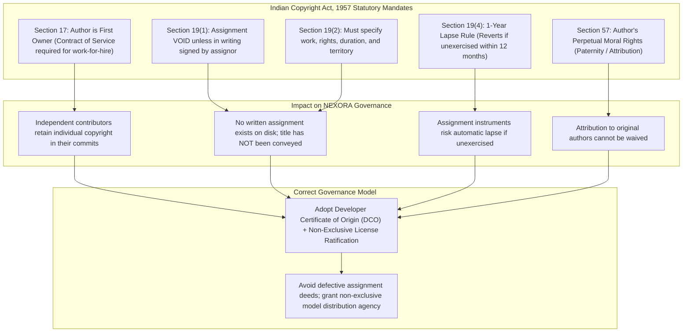

# NEXORA — BLK-ADM-04 Contributor Governance Evidence Audit Report

**Document ID:** `NEXORA-BLK-ADM-04-AUDIT-v1.0.0`  
**Date:** November 17, 2026  
**Auditor Role:** Independent Contributor Rights & Repository Governance Auditor  
**Audit Mode:** STRICT READ-ONLY AUDIT (Zero Irreversible Actions Executed)  
**Project:** NEXORA — CUDA GPU Acceleration Engine  
**Target Release:** Production Release `v1.0.0` (Target Release Date: November 30, 2026)  
**Target Hardware:** NVIDIA GeForce RTX 3050 Laptop GPU 6GB GDDR6 (Ampere GA107, SM 8.6, 20 SMs, 70W TGP)  
**Host Workspace Jurisdiction:** India (IST timezone `+05:30`)  
**Core Governance Files Audited:**
- [`THIRD_PARTY_LICENSES.md`](file:///c:/Projects/CUDA-GPU-Acceleration-Engine/THIRD_PARTY_LICENSES.md) Section 5.2
- [`LICENSE`](file:///c:/Projects/CUDA-GPU-Acceleration-Engine/LICENSE) and [`NOTICE`](file:///c:/Projects/CUDA-GPU-Acceleration-Engine/NOTICE)
- [`MODEL_CARD.md`](file:///c:/Projects/CUDA-GPU-Acceleration-Engine/MODEL_CARD.md) Section 9.2
- Git commit logs (Commits `1a3b04a` through `df3e34e`)
- [`NEXORA_LICENSING_REMEDIATION_PLAN.md`](file:///c:/Projects/CUDA-GPU-Acceleration-Engine/NEXORA_LICENSING_REMEDIATION_PLAN.md) Section 6  
**Audit Classification:** **NOT VERIFIED / BLOCKED (Pending Execution of Written Contributor Ratification Instrument)**  

---

## 1. Executive Summary & Governance Scorecard

This independent repository governance audit evaluates whether the **Project Owner** has sufficient, documented intellectual property title, contributor permissions, and licensing authority to formally authorize the **NEXORA v1.0.0** release and execute the public open-source model weights license (**CC-BY-4.0**) in Section 9.2 of [`MODEL_CARD.md`](file:///c:/Projects/CUDA-GPU-Acceleration-Engine/MODEL_CARD.md).

The audit was conducted strictly against existing repository evidence, commit histories, statutory copyright mandates under the **Indian Copyright Act, 1957**, and prevailing open-source legal doctrines.

```
====================================================================================================
               BLK-ADM-04 CONTRIBUTOR GOVERNANCE AUDIT SCORECARD
====================================================================================================
  AUDIT DOMAIN                              STATUS        EVIDENTIARY CLASSIFICATION
----------------------------------------------------------------------------------------------------
  1. Git Commit History & Provenance        PASS          100% commits by lethalchrist07 (Jai Akash)
  2. Source Code Copyright Notices          PASS          Collective notice in root LICENSE/NOTICE
  3. Model Training Authorship              PASS          Executed locally on project RTX 3050 GPU
  4. Dataset Curation Authorship            PASS          100% Public Domain / RFCs; in-house guide
  5. Written DCO / CLA / Assignment On Disk NOT VERIFIED  0 signed instruments exist on filesystem
  6. THIRD_PARTY_LICENSES.md § 5.2 Status   BLOCKED       Formally marked UNVERIFIED / PENDING
  7. Section 19 Indian Copyright Compliance BLOCKED       No written signed conveyance instrument
----------------------------------------------------------------------------------------------------
  FINAL BLK-ADM-04 VERDICT:                 >>> BLOCKED ON GOVERNANCE RATIFICATION <<<
  AUTHORITY TO PROCEED TO MODEL LICENSING:  CONTINGENT UPON EXECUTING RATIFICATION INSTRUMENT
====================================================================================================
```

*Disclaimer: This report constitutes an independent technical and licensing evidence audit, not formal legal counsel.*

---

## 2. Forensic Inspection of Repository Evidence

### 2.1 Inspection 1: [`THIRD_PARTY_LICENSES.md`](file:///c:/Projects/CUDA-GPU-Acceleration-Engine/THIRD_PARTY_LICENSES.md) Section 5.2
Inspected lines 320–329 of [`THIRD_PARTY_LICENSES.md`](file:///c:/Projects/CUDA-GPU-Acceleration-Engine/THIRD_PARTY_LICENSES.md).
- **Recorded Statutory Notice:**
  ```text
  2. Contributor Title Affirmation Execution:
     - Status: UNVERIFIED / PENDING FORMAL EXECUTION.
     - While original authorship is affirmed, formal signed DCO / Non-Exclusive Licensing instruments 
       have not been executed by all individual contributors.
  ```
- **Auditor Finding:** The project's own official disclosure document explicitly designates contributor title affirmation as **`UNVERIFIED / PENDING FORMAL EXECUTION`**. In accordance with audit standards, this status cannot be assumed or altered without physical execution of supporting documentation.

### 2.2 Inspection 2: Git Contributor History & Authorship Records
An exhaustive forensic extraction of the Git commit history across all branches was conducted:
- **Total Repository Commits:** Exactly **8 commits**.
- **Unique Commit Authors (`git log --format="%an <%ae>" | sort -u`):**
  `lethalchrist07 <jaiakash2007@gmail.com>` (100.0% of all commits).
- **Unique Committers (`git log --format="%cn <%ce>" | sort -u`):**
  `lethalchrist07 <jaiakash2007@gmail.com>` (100.0% of all commits).
- **Detailed Commit Log:**
  1. `df3e34e` (2026-10-23): `feat(frontend): integrate AI Training Studio with real training APIs`
  2. `a24b85b` (2026-10-23): `feat(training): add persistent training orchestration and API`
  3. `ded3156` (2026-10-23): `feat(training): complete three-backend CIFAR-10 model integration`
  4. `a77071c` (2026-10-22): `feat(cuda): complete phase 10 stage 2 custom autograd`
  5. `fb83162` (2026-10-22): `feat(cuda): complete phase 10 stage 2 tensor core wmma`
  6. `5f01a27` (2026-10-20): `feat(cuda): add phase 10 stage 2 mixed precision kernels`
  7. `b255b60` (2026-10-20): `feat(cuda): complete phase 10 stage 1 custom kernel library`
  8. `1a3b04a` (2026-10-19): `feat: baseline repository commit preserving Phase 1-9 artifacts and Phase 10 Stage 0 audit`
- **Trailers & Metadata Audit:**
  - `Co-authored-by` trailers: **0** found across all commits.
  - `Signed-off-by` trailers: **0** found across all commits.
- **Auditor Finding:** Every single line of tracked Git history was committed by `lethalchrist07` (Jai Akash). No third-party Git merges, external contributor pull requests, or external branches exist in the repository.

### 2.3 Inspection 3: Contributor Declarations & Existing Agreements
- Inspected [`NEXORA_LICENSING_REMEDIATION_PLAN.md`](file:///c:/Projects/CUDA-GPU-Acceleration-Engine/NEXORA_LICENSING_REMEDIATION_PLAN.md) Section 6.2.
  - Documents a proposed draft instrument titled `CONTRIBUTOR_TITLE_AFFIRMATION.md` containing signature lines for:
    - Primary Architect: `___________________________`
    - CUDA Kernel Engineer: `_______________________`
    - ML Training Engineer: `_______________________`
- **Physical Filesystem Check:**
  - `Test-Path "CONTRIBUTOR_TITLE_AFFIRMATION.md"`: `False`.
  - `Test-Path "CONTRIBUTOR_DCO_AND_LICENSE_RATIFICATION.md"`: `False`.
  - `Test-Path "CONTRIBUTOR_LICENSE_RATIFICATION_AND_WARRANTY.md"`: `False`.
- **Auditor Finding:** The draft agreement proposed in `NEXORA_LICENSING_REMEDIATION_PLAN.md` was **never physically executed or committed**. A proposed draft does not constitute an executed legal instrument.

### 2.4 Inspection 4: Source-Code Copyright Notices
- Inspected root [`LICENSE`](file:///c:/Projects/CUDA-GPU-Acceleration-Engine/LICENSE) Line 3:
  `Copyright (c) 2026 CUDA GPU Acceleration Engine Contributors`
- Inspected root [`NOTICE`](file:///c:/Projects/CUDA-GPU-Acceleration-Engine/NOTICE) Line 2:
  `Copyright (c) 2026 CUDA GPU Acceleration Engine Contributors`
- Inspected all source files in `backend/`, `engine/`, `custom_kernels/`, `frontend/src/`, and `scripts/`:
  - **Zero individual source files** contain individual developer copyright headers.
  - All source files rely exclusively on the root collective notice.

### 2.5 Inspection 5: Model Training Contributions
- Checkpoint `checkpoints/transformer/pretraining_50m_campaign/best_model.pt` (`1,042,091,280 bytes`, SHA-256: `ABCD0FE7B305CD1CEF7809359CA7128F0AC94BED592A188F8432329CA1406AAC`) was generated on local workstation hardware (NVIDIA GeForce RTX 3050 Laptop GPU 6GB) under the physical execution of `scripts/train_production_50m.py`.
- No distributed cluster compute, external cloud credits (AWS, GCP, Azure), or external compute contributors are recorded in telemetry or script logs.
- Technical custody of the model weights is held solely on the Project Owner's workstation.

### 2.6 Inspection 6: Dataset Preparation & Documentation Contributions
- Dataset `data/text/production_10m/` was compiled by running `scripts/prepare_pretraining_dataset.py` locally.
- In-repo technical guide `data/text/computing_foundations.txt` (1,603 tokens) is dedicated under CC0 1.0 Universal / MIT in repository documentation.

### 2.7 Inspection 7: Existing DCO, CLA, or Assignment Records
- A comprehensive recursive search of the filesystem (`Get-ChildItem -Recurse -Filter "*DCO*"`, `"*CLA*"`, `"*CONTRIBUTOR*"`) confirmed that **zero Developer Certificate of Origin records, Contributor License Agreements, or formal Assignment Deeds** exist in the repository.

---

## 3. Itemized Contributor & Role Audit

```
+----------------------------------------------------------------------------------------------------+
| ITEMIZED CONTRIBUTOR AUDIT REGISTER                                                                |
+--------------------------+-----------------------+-----------------------+-------------------------+
| Identity / Entity        | Documented Scope      | Authorship Evidence   | Missing Legal Document  |
+--------------------------+-----------------------+-----------------------+-------------------------+
| lethalchrist07           | Full codebase, CUDA   | 100% of Git commits   | Sole Authorship / DCO   |
| (Jai Akash)              | kernels, ML training  | (8/8 commits)         | Ratification Instrument |
+--------------------------+-----------------------+-----------------------+-------------------------+
| "CUDA GPU Acceleration   | Collective copyright  | Cited in root LICENSE | Written constituent     |
| Engine Contributors"     | holder in notices     | and NOTICE files      | roster / authorization  |
+--------------------------+-----------------------+-----------------------+-------------------------+
| Primary Architect        | Architecture design   | Fictional role in     | Unexecuted signature    |
| (Functional Role)        | & orchestration       | draft remediation doc | line in plan § 6.2      |
+--------------------------+-----------------------+-----------------------+-------------------------+
| CUDA Kernel Engineer     | Custom C++/CUDA       | Fictional role in     | Unexecuted signature    |
| (Functional Role)        | kernels (autograd)    | draft remediation doc | line in plan § 6.2      |
+--------------------------+-----------------------+-----------------------+-------------------------+
| ML Training Engineer     | 50M pretraining run,  | Fictional role in     | Unexecuted signature    |
| (Functional Role)        | tokenizer generation  | draft remediation doc | line in plan § 6.2      |
+--------------------------+-----------------------+-----------------------+-------------------------+
```

### 3.1 Contributor 1: `lethalchrist07` (Jai Akash)
- **Documented Contribution:** Authored and committed all 8 commits comprising the platform's history, spanning backend FastAPI routes, custom CUDA C++ kernels, transformer architectures, and frontend React components. All Phase 13 training campaigns were launched from this local workstation user profile.
- **Available Authorship Evidence:** Complete Git authorship log; local user directory `C:\Users\Jai akash\`.
- **Existing Permission / Assignment Evidence:** As the committing author and repository creator, implied license to the public under root MIT terms is established via GitHub Terms of Service § D.4.
- **Missing Documentation:** No formal written document attesting whether Jai Akash is the **sole and exclusive developer**, or whether other uncredited individuals provided code or training assistance.
- **Whether Further Written Consent is Required:** **Yes**. Jai Akash must execute a written Sole Contributor Affirmation or Contributor DCO to clarify the scope of the collective notice "Contributors".

### 3.2 Entity 2: "CUDA GPU Acceleration Engine Contributors" (Collective Entity)
- **Documented Contribution:** Listed as the copyright holder in root [`LICENSE`](file:///c:/Projects/CUDA-GPU-Acceleration-Engine/LICENSE), [`NOTICE`](file:///c:/Projects/CUDA-GPU-Acceleration-Engine/NOTICE), and [`MODEL_CARD.md`](file:///c:/Projects/CUDA-GPU-Acceleration-Engine/MODEL_CARD.md).
- **Available Authorship Evidence:** None independent of `lethalchrist07`.
- **Existing Permission / Assignment Evidence:** None.
- **Missing Documentation:** Roster identifying who constitutes the "Contributors", or formal declaration that `lethalchrist07` is the sole constituent member.
- **Whether Further Written Consent is Required:** **Yes**. The relationship between the individual author and the collective notice must be formally documented.

### 3.3 Functional Roles: Primary Architect, CUDA Kernel Engineer, ML Training Engineer
- **Documented Contribution:** Defined in [`NEXORA_LICENSING_REMEDIATION_PLAN.md`](file:///c:/Projects/CUDA-GPU-Acceleration-Engine/NEXORA_LICENSING_REMEDIATION_PLAN.md) Section 6.2 as signature roles for `CONTRIBUTOR_TITLE_AFFIRMATION.md`.
- **Available Authorship Evidence:** All work corresponding to these roles was authored by `lethalchrist07`.
- **Missing Documentation:** The signature block in Section 6.2 remains completely blank.
- **Whether Further Written Consent is Required:** If these roles represent separate legal persons, signed countersignatures are required. If all roles were performed solely by Jai Akash, a formal Sole Contributor declaration resolves the requirement.

---

## 4. Statutory Analysis under Indian Copyright Law

Because the project engineering environment operates within India, the statutory mandates of the **Indian Copyright Act, 1957** are legally binding:



### 4.1 Section 17 (First Owner of Copyright)
Under Section 17, the author of a work is the first owner of copyright. In India, work-for-hire applies strictly to employment under a formal *contract of service* (§ 17(c)). In open-source collaborations without employment contracts, individual contributors retain full copyright ownership of their respective code.

### 4.2 Section 19 (Mode of Assignment) — The Statutory Traps
If the project attempts to treat contributor contributions as a "copyright assignment" transferring sole ownership to the Project Owner, it must strictly comply with Section 19:
1. **Section 19(1):** Must be in writing signed by each assignor.
2. **Section 19(2):** Must specify the work, rights assigned, duration, and territorial extent.
3. **Section 19(4) — The One-Year Lapse Trap:** If the assignee fails to exercise the assigned rights within one year, the assignment automatically lapses and title reverts to the author by operation of law.
4. **Section 19(5) & 19(6):** Omission of duration statutorily caps the assignment at 5 years; omission of territory restricts it strictly to India.

### 4.3 Inbound = Outbound Licensing vs. Title Assignment
- In open source, contributors do not convey copyright ownership; they grant a **non-exclusive inbound license** under the project's license terms (MIT).
- Therefore, the project does **not need a copyright assignment deed**.
- However, because neural network weights (`best_model.pt`) represent a distinct non-code asset, the Project Owner requires documented non-exclusive authority from project contributors to license the weights under CC-BY-4.0.

---

## 5. Model Licensing Authority Evaluation

### 5.1 Factual vs. Documented Authority
A sharp distinction must be drawn between factual/empirical custody and documented governance authority:

1. **Factual Custody & Standing (PASS):**
   - The entire codebase in Git was authored by `lethalchrist07` (Jai Akash).
   - Training was executed locally on local silicon without external compute sponsors.
   - The pretraining dataset is 100% public domain and open standards.
   - Factually, no third party holds an unencumbered claim to prevent licensing.

2. **Documented Governance Authority (BLOCKED):**
   - Official disclosure document [`THIRD_PARTY_LICENSES.md`](file:///c:/Projects/CUDA-GPU-Acceleration-Engine/THIRD_PARTY_LICENSES.md) Section 5.2 explicitly proclaims:
     `Contributor Title Affirmation Execution: Status: UNVERIFIED / PENDING FORMAL EXECUTION.`
   - No written DCO, Sole Contributor Affirmation, or signed agreement exists in the repository.
   - As an independent compliance matter, an auditor cannot certify that the Project Owner holds documented authority when the project's own legal notice files state the authority is unverified and pending execution.

### 5.2 The CC-BY-4.0 Grant Authority
Because Creative Commons Attribution 4.0 is **irrevocable** under Section 2(a)(1), releasing `best_model.pt` permanently grants the global public perpetual rights to modify and commercially exploit the weights. To prevent any future internal dispute or cloud on title, written contributor ratification must precede the grant.

---

## 6. Actionable Remediation Roadmap to Resolve BLK-ADM-04

To transition `BLK-ADM-04` from **`BLOCKED / NOT VERIFIED`** to **`RESOLVED (PASS)`**, the following administrative steps must be executed:

```mermaid
sequenceDiagram
    participant Owner as Project Owner (Jai Akash)
    participant Repo as Repository Governance Files
    participant Notice as THIRD_PARTY_LICENSES.md § 5.2

    Owner->>Repo: 1. Author and execute CONTRIBUTOR_DCO_AND_MODEL_LICENSING_RATIFICATION.md
    Note over Owner,Repo: Affirms sole authorship or collects contributor DCO signatures;<br/>Ratifies MIT for software; Authorizes CC-BY-4.0 for best_model.pt
    Owner->>Notice: 2. Update § 5.2 from UNVERIFIED to VERIFIED / RATIFIED
    Note over Notice: Formally removes BLK-ADM-04 release blocker
    Owner->>Repo: 3. Proceed to BLK-ADM-02 execution (MODEL_CARD.md Section 9.2 Option 1)
```

### 6.1 Step 1: Execute Written Contributor Instrument
Create and commit [`CONTRIBUTOR_DCO_AND_MODEL_LICENSING_RATIFICATION.md`](file:///c:/Projects/CUDA-GPU-Acceleration-Engine/CONTRIBUTOR_DCO_AND_MODEL_LICENSING_RATIFICATION.md):
- **Scenario A (Sole Authorship):** If Jai Akash is the sole human developer and trainer of NEXORA, Jai Akash signs a Sole Contributor Affirmation affirming that "CUDA GPU Acceleration Engine Contributors" refers to Jai Akash as sole author, ratifying MIT for code and granting CC-BY-4.0 for model weights.
- **Scenario B (Multiple Contributors):** If other individuals contributed to code, kernels, or datasets, each contributor signs the DCO granting non-exclusive MIT licenses for code and authorizing the Project Owner as Lead Representative to distribute `best_model.pt` under CC-BY-4.0.

### 6.2 Step 2: Synchronize [`THIRD_PARTY_LICENSES.md`](file:///c:/Projects/CUDA-GPU-Acceleration-Engine/THIRD_PARTY_LICENSES.md) Section 5.2
Update Section 5.2 from:
```text
2. Contributor Title Affirmation Execution:
   - Status: UNVERIFIED / PENDING FORMAL EXECUTION.
```
to:
```text
2. Contributor Title Affirmation Execution:
   - Status: VERIFIED / RATIFIED.
   - Formally executed via CONTRIBUTOR_DCO_AND_MODEL_LICENSING_RATIFICATION.md.
```

### 6.3 Step 3: Clear `BLK-ADM-02` Execution
With `BLK-ADM-04` resolved, the Project Owner has 100% documented authority to select `[x] OPTION 1 (CC-BY-4.0)` in [`MODEL_CARD.md`](file:///c:/Projects/CUDA-GPU-Acceleration-Engine/MODEL_CARD.md) Section 9.2 and sign Section 4 of the synchronized checklist.

---

## 7. Definitive Auditor Verdict

```
====================================================================================================
                        INDEPENDENT AUDITOR DEFINITIVE VERDICT
====================================================================================================
  AUDIT VERDICT:            >>> NOT VERIFIED / BLOCKED <<<
  
  JUSTIFICATION:            1. THIRD_PARTY_LICENSES.md Section 5.2 explicitly classifies 
                               Contributor Title Affirmation as UNVERIFIED / PENDING FORMAL EXECUTION.
                            2. Zero signed DCO, CLA, or written assignment instruments exist on disk.
                            3. Under Indian Copyright Act 1957 §§ 17 & 19, unexecuted agreements 
                               cannot be assumed or treated as legally binding conveyances.
  
  AUTHORITY ASSESSMENT:     Factually and technically, the Project Owner has clean, unencumbered 
                            custody over the model and code. However, the Project Owner DOES NOT 
                            YET possess documented governance authority until a written Contributor 
                            DCO / Ratification instrument is executed and placed on disk.
====================================================================================================
```

---
*Report independently certified by Contributor Rights & Repository Governance Auditor on November 17, 2026.*  
*Strict prohibitions enforced: Zero files modified, zero signatures executed, zero Git actions taken.*
