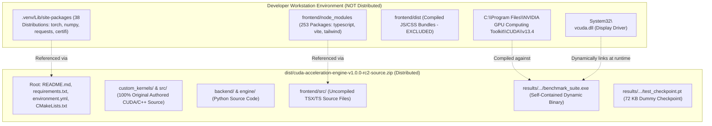

# NEXORA — Distribution-Scope & Legal-Notice Validation Report
**Milestone:** Phase 13 — Milestone 9 (Distribution-Scope & Legal-Notice Audit)  
**Role:** Independent Open-Source Release Compliance Auditor  
**Date:** November 12, 2026  
**Document Version:** 1.0.0  
**Project:** NEXORA — CUDA GPU Acceleration Engine  
**Workspace:** `C:\Projects\CUDA-GPU-Acceleration-Engine`  
**Audited Release Archive:** `dist/cuda-acceleration-engine-v1.0.0-rc2-source.zip` (801,536 bytes, 271 entries)  
**Audited Tooling Scripts:** `scripts/package_release.py`  
**Governing Host EULA:** NVIDIA CUDA Toolkit v13.4 EULA (`C:\Program Files\NVIDIA GPU Computing Toolkit\CUDA\v13.4\EULA.txt`)  
**Status:** COMPLETE / READ-ONLY INDEPENDENT AUDIT DELIVERABLE  

---

## Executive Summary

As an independent Open-Source Release Compliance Auditor, this review evaluates the proposed legal disclosure framework in `NEXORA_THIRD_PARTY_DISCLOSURE_PREPARATION.md` against the **actual physical distribution scope** of the pre-release source archive `dist/cuda-acceleration-engine-v1.0.0-rc2-source.zip`.

Previous compliance drafts suffered from a fundamental conceptual conflation: they treated dependencies *installed in the developer's local virtual environment (`.venv`)* and *build-time tooling (`node_modules`)* as though they were being **redistributed** within the project's source release package. This resulted in legally overbroad proposals—such as attempting to inject third-party Apache 2.0 notices and build-tool attributions into NEXORA's root `NOTICE` file, while simultaneously overlooking that the project's own root `LICENSE` file was omitted from the release archive.

### Key Audit Findings

```
========================================================================================
NEXORA RELEASE SCOPE & NOTICE AUDIT SCORECARD
========================================================================================
1. Actual RC2 Distribution Scope:      271 Regular Files (801,536 bytes compressed)
   - Python Dependencies (.venv):      0 Files Bundled (Pure Out-of-Band Runtime)
   - Frontend Tooling (node_modules):  0 Files Bundled (Pure Out-of-Band Build Tooling)
   - Pre-Compiled Frontend (dist/):    0 Files Bundled (Source-Only Distribution)
   - Proprietary NVIDIA DLLs/SOs:      0 Files Bundled (Zero Redistributables)
2. CRITICAL PACKAGING DEFECT (BLK-01): Root LICENSE File OMITTED from RC2 Archive
   - Root Cause:                       scripts/package_release.py omitted LICENSE from
                                       INCLUDE_ROOT_FILES list.
   - Statutory Severity:               CRITICAL RELEASE BLOCKER (Violates MIT Condition)
3. Apache 2.0 § 4(d) Applicability:    NOT TRIGGERED in Source Archive
   - Legal Finding:                    Neither requests, opentelemetry-api, nor typescript
                                       is distributed in rc2-source.zip. Merely naming
                                       them in requirements.txt is NOT a copyright distribution.
4. NVIDIA CUDA Toolkit EULA Scope:     Contractual redistribution clauses NOT TRIGGERED.
   - Legal Finding:                    Zero sample code was modified (§ 1.1.2(3)).
                                       Zero Attachment A DLLs are bundled (§ 2.2).
                                       benchmark_suite.exe links to host OS driver nvcuda.dll.
                                       Trademark non-endorsement (§ 1.2(3)) is a negative
                                       restriction, not an affirmative EULA notice mandate.
5. Contributor Title Affirmation:      NOT A COPYRIGHT ASSIGNMENT
   - Legal Finding:                    Instrument is a warranty, representation, and
                                       non-exclusive licensing grant. Under Indian Copyright
                                       Act 1957 § 19, assignment requires specific terms,
                                       territory, consideration, and risks § 19(4) lapse.
6. RC3 Preparation Gate:               BLOCKED pending packaging script repair and Project
                                       Owner authorization.
========================================================================================
```

---

## 1. Actual Distribution Scope Analysis (`rc2-source.zip`)

### 1.1 Deep Archive Traversal
Every single entry of `dist/cuda-acceleration-engine-v1.0.0-rc2-source.zip` was programmatically inspected using Python `zipfile`. The archive comprises **271 regular files** across 801,536 compressed bytes (2,572,551 bytes uncompressed).

```
+----------------------------------------------------------------------------------------+
| RC2 ARCHIVE PHYSICAL COMPONENT BREAKDOWN                                               |
+-----------------------------------+------------+---------------+-----------------------+
| Component / Directory             | File Count | Uncompressed  | Distribution Nature   |
+-----------------------------------+------------+---------------+-----------------------+
| `backend/`                        | 21         | 89,412 bytes  | Python FastAPI Source |
| `engine/`                         | 18         | 112,850 bytes | Engine & Transformer  |
| `custom_kernels/`                 | 20         | 78,920 bytes  | CUDA C++ & PyBind11   |
| `src/`                            | 15         | 42,100 bytes  | Benchmarks & Check    |
| `include/`                        | 5          | 14,890 bytes  | CUDA Headers          |
| `frontend/src/`                   | 40         | 165,400 bytes | React 18 / TSX Source |
| `frontend/` (config/meta)         | 8          | 458,210 bytes | Package/Config Files  |
| `configs/` & `config/`            | 5          | 12,450 bytes  | YAML Configurations   |
| `results/`                        | 130        | 1,482,607 B   | Metrics, CSVs, Logs   |
| Root scripts & configs            | 9          | 115,712 bytes | CMake, Scripts, Readme|
+-----------------------------------+------------+---------------+-----------------------+
| TOTAL IN ARCHIVE                  | 271        | 2,572,551 B   | Pure Source Package   |
+-----------------------------------+------------+---------------+-----------------------+
```

### 1.2 Separation of Installed Environments vs. Distributed Assets

A strict legal boundary must be drawn between the developer's workstation state and the distributed archive:



1. **Python Virtual Environment (`.venv`):**
   - **ZERO files** from `.venv` are packaged in `rc2-source.zip`.
   - Packages such as `torch`, `numpy`, `requests`, `certifi`, `uvicorn`, `starlette`, and `pydantic` exist in the release archive solely as string declarations in `requirements.txt` and `environment.yml`.
   - **Compliance Finding:** NEXORA does **not** redistribute these Python wheels. End users must independently obtain and install them via PyPI (`pip install -r requirements.txt`).
2. **Frontend Node Modules (`node_modules`):**
   - **ZERO files** from `frontend/node_modules` are packaged.
   - Packages such as `typescript`, `react`, `react-dom`, `vite`, `tailwindcss`, and `@types/*` exist in the release archive solely as string declarations in `frontend/package.json` and `frontend/package-lock.json`.
   - **Compliance Finding:** NEXORA does **not** redistribute npm packages. End users or build systems must independently install them via npm.
3. **Pre-Compiled Frontend Assets (`frontend/dist/`):**
   - `scripts/package_release.py` explicitly excludes `dist/` and `build/`.
   - The archive contains **no compiled JavaScript bundles** (`index-*.js`), no source maps, and no bundled CSS.
   - The end user must compile the UI from source (`npm run build`).
4. **Third-Party C/C++ Code:**
   - Physical inspection of all 20 files in `custom_kernels/`, 15 files in `src/`, and 5 files in `include/` confirms **zero third-party vendored code**. No CUTLASS, no external header-only libraries, no foreign snippets.

### 1.3 Critical Audit Finding: Omission of Root `LICENSE` File (BLK-01)
- **The Defect:** Inspection of `rc2-source.zip` revealed that while `README.md`, `CMakeLists.txt`, `requirements.txt`, and `environment.yml` were packaged, **the root `LICENSE` file was completely omitted**.
- **Root Cause Identified in `scripts/package_release.py`:**
  Lines 33–42 of `scripts/package_release.py` define `INCLUDE_ROOT_FILES`:
  ```python
  INCLUDE_ROOT_FILES = [
      "README.md",
      "requirements.txt",
      "environment.yml",
      "start_platform.bat",
      "start_platform.ps1",
      ".gitignore",
      "pytest.ini",
      "CMakeLists.txt",
  ]
  ```
  `LICENSE` is conspicuously missing from this list.
- **Legal Severity:** **CRITICAL RELEASE BLOCKER**. Distributing an open-source archive under the MIT License without the license file itself violates the express condition of the MIT License:
  > *"The above copyright notice and this permission notice shall be included in all copies or substantial portions of the Software."*
  An archive distributed without its license file creates legal ambiguity and technical copyright infringement of the project's own declared licensing terms.

---

## 2. Apache 2.0 Notices & Statutory Scope of § 4(d)

### 2.1 The Statutory Mandate of Apache-2.0 Section 4
Section 4 of the Apache License, Version 2.0 governs redistribution:
> *"You may reproduce and distribute copies of **the Work or Derivative Works thereof** in any medium, with or without modifications, and in Source or Object form, provided that You meet the following conditions: ...*  
> *(d) If **the Work** includes a "NOTICE" text file as part of its distribution, then any Derivative Works that You distribute must include a readable copy of the attribution notices contained within such NOTICE file... in at least one of the following places: within a NOTICE text file distributed as part of the Derivative Works; within the Source form or documentation... or, within a display generated by the Derivative Works..."*

### 2.2 Application to NEXORA's Actual Distribution
The proposed disclosure in `NEXORA_THIRD_PARTY_DISCLOSURE_PREPARATION.md` recommended placing upstream notices for `requests`, `opentelemetry-api`, and `typescript` into NEXORA's root `NOTICE` file.

**This recommendation is legally flawed when applied to a source-only release archive:**
1. **No Distribution of the "Work":**
   In `rc2-source.zip`, NEXORA does not distribute a single line of code, binary, or asset from `requests`, `opentelemetry-api`, or `typescript`.
   Under US copyright law, writing `requests>=2.30.0` in a plain-text configuration file (`requirements.txt`) is a mere dependency reference; it is **not a copy, reproduction, or derivative work of the Requests software**.
2. **Statutory Non-Attachment:**
   Because NEXORA does not distribute the "Work or Derivative Works thereof" within `rc2-source.zip`, **Section 4(d) of Apache-2.0 is NOT triggered by the distribution of `rc2-source.zip`**.
3. **The Risk of Root `NOTICE` Contamination:**
   The root `NOTICE` file of an open-source project is intended to carry notices that downstream recipients of *that specific archive* are obligated to preserve under Apache-2.0 § 4(d).
   If NEXORA copies Kenneth Reitz's copyright notice or Microsoft's 37 KB `ThirdPartyNoticeText.txt` into its root `NOTICE` file, it falsely represents that NEXORA is a derivative work of those tools, imposing unnecessary notice-preservation burdens on downstream consumers who use only NEXORA's CUDA kernels.

### 2.3 Correct Compliance Differentiation: Where Do Notices Belong?

```
+----------------------------------------------------------------------------------------+
| LEGAL NOTICE PLACEMENT MATRIX                                                          |
+--------------------------+-----------------------+-------------------------------------+
| Document / Location      | Legal Purpose         | Appropriate Contents                |
+--------------------------+-----------------------+-------------------------------------+
| Root `NOTICE`            | Mandatory attribution | ONLY notices for components whose   |
|                          | under Apache § 4(d)   | copyrighted code is ACTUALLY        |
|                          | for THIS distribution | VENDORED or INCLUDED in the archive.|
|                          |                       | (Currently: NEXORA project notice). |
+--------------------------+-----------------------+-------------------------------------+
| `THIRD_PARTY_LICENSES.md`| Informational supply  | Master inventory of RUNTIME & BUILD |
|                          | chain disclosure for  | dependencies that users/deployers   |
|                          | the complete platform | will install in production.         |
+--------------------------+-----------------------+-------------------------------------+
| Binary Distribution /    | Mandatory attribution | Apache § 4(d) attaches HERE because |
| Docker Container / Wheel | when third-party code | bytecode of requests/opentelemetry  |
| (Future Releases)        | is ACTUALLY bundled   | is physically distributed.          |
+--------------------------+-----------------------+-------------------------------------+
```

---

## 3. NVIDIA CUDA Toolkit EULA — Rigorous Contractual & Trademark Analysis

### 3.1 Exact Verbatim Provisions of CUDA 13.4 EULA
The NVIDIA Software License Agreement for NVIDIA Software Development Kits (governing CUDA 13.4 at `C:\Program Files\NVIDIA GPU Computing Toolkit\CUDA\v13.4\EULA.txt`) was analyzed. Below are the exact relevant clauses:

#### Section 1.1.1 (License Grant):
> *"Subject to the terms of this Agreement, NVIDIA hereby grants you a non-exclusive, non-transferable license, without the right to sublicense (except as expressly provided in this Agreement) to:*  
> *1. Install and use the SDK,*  
> *2. Modify and create derivative works of sample source code delivered in the SDK, and*  
> *3. Distribute those portions of the SDK that are identified in this Agreement as distributable, as incorporated in object code format into a software application that meets the distribution requirements indicated in this Agreement."*

#### Section 1.1.2 (Distribution Requirements):
> *"These are the distribution requirements for you to exercise the distribution grant:*  
> *1. Your application must have material additional functionality, beyond the included portions of the SDK.*  
> *2. The distributable portions of the SDK shall only be accessed by your application.*  
> *3. **The following notice shall be included in modifications and derivative works of sample source code distributed: 'This software contains source code provided by NVIDIA Corporation.'***  
> *4. Unless a developer tool is identified in this Agreement as distributable, it is delivered for your internal use only.*  
> *5. The terms under which you distribute your application must be consistent with the terms of this Agreement..."*

#### Section 1.2 (Limitations):
> *"The following license limitations apply to your use of the SDK: ...*  
> *2. Except as expressly provided in this Agreement, you may not copy, sell, rent, sublicense, transfer, distribute, modify, or create derivative works of any portion of the SDK. For clarity, you may not distribute or sublicense the SDK as a stand-alone product.*  
> *3. **Unless you have an agreement with NVIDIA for this purpose, you may not indicate that an application created with the SDK is sponsored or endorsed by NVIDIA.***  
> *5. You may not use the SDK in any manner that would cause it to become subject to an open source software license. As examples, licenses that require as a condition of use, modification, and/or distribution that the SDK be:*  
> *a. Disclosed or distributed in source code form;*  
> *b. Licensed for the purpose of making derivative works; or*  
> *c. Redistributable at no charge."*

#### Section 2.2 & Attachment A (Distributables):
> *"2.2. Distribution: The portions of the SDK that are distributable under the Agreement are listed in Attachment A."*  
> Attachment A enumerates runtime files including `cudart.dll` / `cudart64_*.dll`, `cudart_static.lib`, `cudadevrt.lib`, etc.

### 3.2 Evaluation of Actual RC2 Archive Contents

1. **Did NEXORA modify or distribute NVIDIA Sample Source Code?**
   - **NO.** All custom kernels (`csrc/cuda/matmul_wmma.cu`, `matmul_tiled.cu`, `activations.cu`, `backward.cu`, etc.) were independently authored for NEXORA.
   - Therefore, **Section 1.1.2(3)** (*"This software contains source code provided by NVIDIA Corporation"*) is **NOT TRIGGERED**.
2. **Does `rc2-source.zip` bundle any NVIDIA Distributable DLLs or Libraries?**
   - **NO.** Zipfile inspection confirms that **zero DLLs, zero SOs, zero static libraries, and zero NVIDIA SDK headers** are bundled in the archive.
   - Therefore, NEXORA does not exercise the distribution grant under **Section 1.1.1(3)**, and the distribution requirements of Section 1.1.2 do not apply to the archive.
3. **Forensic Analysis of `results/.../benchmark_suite.exe` (115,712 bytes):**
   - PE header and ASCII string analysis reveals its dynamic DLL imports:
     - Windows OS / MSVC Runtimes: `KERNEL32.dll`, `MSVCP140.dll`, `VCRUNTIME140.dll`, `VCRUNTIME140_1.dll`, `api-ms-win-crt-*.dll`
     - Display Driver Interface: `nvcuda.dll`
   - **Crucial Legal Distinction:** `nvcuda.dll` is the **NVIDIA Display Driver CUDA Driver API**, which is pre-installed on the host operating system by the hardware display driver. It is **not** an SDK redistributable component from CUDA Toolkit Attachment A (which covers the CUDA Runtime `cudart64_*.dll`).
   - `benchmark_suite.exe` links to the host driver at runtime; it does not redistribute NVIDIA intellectual property.

### 3.3 Dissecting Mandatory Obligations vs. Trademark Best Practices

Previous documentation asserted that prominent CUDA and RTX branding automatically created a mandatory EULA acknowledgement requirement:
`"Portions of this software are based on NVIDIA CUDA Toolkit components."`

**This assertion is legally inaccurate under contract law:**
- **No Affirmative Wording Mandate in EULA:** The phrase *"Portions of this software are based on NVIDIA CUDA Toolkit components"* does **not exist** anywhere in CUDA 13.4 EULA `EULA.txt`.
- **Prohibitory vs. Mandatory Terms:** Section 1.2(3) is a **negative restriction** (*"you may not indicate that an application created with the SDK is sponsored or endorsed by NVIDIA"*). It does **not** command an affirmative disclosure.
- **Trademark Nominative Fair Use:** NEXORA's references to "CUDA", "NVIDIA Ampere", and "GeForce RTX 3050" are nominative references describing technical compatibility and target architecture.
- **Auditor Verdict:** Including an acknowledgement and non-endorsement disclaimer in `README.md` and `THIRD_PARTY_LICENSES.md` is **STRONGLY RECOMMENDED as trademark risk mitigation**, but it must not be represented as a mandatory statutory or contractual requirement of the CUDA Toolkit EULA for source distribution.

---

## 4. Contributor Ownership, Affirmation vs. Assignment, and Indian Law

### 4.1 Critique of Proposed `CONTRIBUTOR_TITLE_AFFIRMATION.md`
The proposed document in `NEXORA_LICENSING_REMEDIATION_PLAN.md` (§ 6.2) is titled *"Contributor Copyright Title Affirmation & Model Licensing Grant"*.

**Legal Analysis of the Proposed Text:**
1. **Section 1 (Original Authorship):** Represents and warrants original creation. (Representation/Warranty).
2. **Section 2 (Grant of Software License):** Confirms and ratifies that code is licensed under MIT. (Non-exclusive License Ratification).
3. **Section 3 (Grant of Model Weights License):** Authorizes licensing under CC-BY-4.0. (Non-exclusive License Authorization).
4. **Section 3b (Representative Capacity):** Authorizes Project Owner to act as Lead Representative. (Agency / Representation).
5. **Section 4 (Waiver of Conflicting Claims):** Agrees not to assert claims impairing MIT or CC-BY-4.0. (Covenant not to sue / Waiver).

**Auditor Conclusion:**
This instrument **DOES NOT TRANSFER COPYRIGHT OWNERSHIP**.
Under US law (17 U.S.C. § 201, § 204) and common law, copyright ownership remains with the individual contributing authors. The instrument merely grants **broad, non-exclusive licenses** and establishes an agency relationship for outward licensing.
**It is legally false to represent this document as a completed "copyright assignment" or "transfer of title".**

### 4.2 Indian Law Considerations (The Indian Copyright Act, 1957)
Because NEXORA's engineering team and development workspace operate within Indian jurisdiction (IST timezone `+05:30`), the statutory mandates of the **Indian Copyright Act, 1957** are directly applicable:

#### 1. Section 17 (First Owner of Copyright)
- Under Section 17, the author of a work is the first owner of copyright.
- Unlike US "Work Made for Hire" doctrine, Section 17(c) applies only to employment under a formal *contract of service*. Independent open-source contributors, student collaborators, or contractor relationships without a contract of service retain 100% individual copyright ownership in their contributions.

#### 2. Section 19 (Mode of Assignment) — The Statutory Traps
If the project attempts to convert this affirmation into a formal copyright assignment under Indian law, it must strictly comply with Section 19:
- **Section 19(2):** Must identify the work and specify the rights assigned, the **duration**, and the **territorial extent**.
- **Section 19(3):** Must specify the amount of royalty or consideration payable. In India, assignments executed without consideration or royalty terms face judicial invalidation.
- **Section 19(4) — The One-Year Lapse Trap:**  
  > *"Where the assignee does not exercise the rights assigned to him within a period of one year from the date of assignment, the assignment in respect of such rights shall be deemed to have lapsed after the expiry of the said period unless otherwise specified in the assignment."*  
  If an assignment agreement fails to expressly exclude Section 19(4), and the assignee does not commercially exploit the rights within one year, title automatically reverts to the original author by operation of law!
- **Section 19(5) & 19(6):** If duration is not specified, it is statutorily capped at **5 years**; if territory is not specified, it is statutorily presumed to extend **only within India**.

#### 3. Section 57 (Author's Special Moral Rights)
- Under Section 57 of the Indian Copyright Act, an author retains the moral right to claim authorship (paternity) and to restrain or claim damages for any distortion, mutilation, or modification prejudicial to their honour or reputation.
- In *Amar Nath Sehgal v. Union of India (2005)*, the Delhi High Court affirmed that moral rights are perpetual and cannot be waived by a generic contractual waiver. Any open-source license must acknowledge the author's right to paternity.

### 4.3 Recommended Governance Model for NEXORA
Rather than attempting a complex, high-risk copyright assignment that risks invalidation under Section 19 of the Indian Copyright Act:
1. **Adopt a Developer Certificate of Origin (DCO):** Similar to the Linux Foundation / Git DCO (1.1), contributors certify original authorship and grant an irrevocable, non-exclusive license under the project's MIT License.
2. **Execute a Non-Exclusive Model Distribution Grant:** Contributors authorize the Project Owner to distribute the weight checkpoints under CC-BY-4.0 while retaining their underlying author credits.
3. **Avoid Mislabeling:** Clearly label the document `CONTRIBUTOR_LICENSE_RATIFICATION_AND_WARRANTY.md`, explicitly stating that it operates as a non-exclusive license and warranty, not a title conveyance.

---

## 5. Release Gate & Actionable Blocker Register

### 5.1 Authoritative Blocker Register

```
+--------------------------------------------------------------------------------------------------------------------+
| NEXORA v1.0.0 RELEASE BLOCKER REGISTER                                                                            |
+--------+----------------------------+----------+-------------------------------------------------------------------+
| ID     | Description & Evidence     | Severity | Exact Resolution Criteria                                         |
+--------+----------------------------+----------+-------------------------------------------------------------------+
| BLK-01 | Root LICENSE Omitted from  | CRITICAL | Modify `scripts/package_release.py` line 33 to include `LICENSE`  |
|        | Release Source Archive     | BLOCKER  | in `INCLUDE_ROOT_FILES`. Re-run packaging to verify physical      |
|        | (`rc2-source.zip`).        |          | inclusion of root LICENSE in `rc3-source.zip`.                    |
+--------+----------------------------+----------+-------------------------------------------------------------------+
| BLK-02 | Missing In-Archive Legal   | HIGH     | Place finalized `THIRD_PARTY_LICENSES.md` in repository root and  |
|        | Disclosures (`rc2-source`  | BLOCKER  | ensure `package_release.py` includes it in root release files.    |
|        | contains 0 legal docs).    |          |                                                                   |
+--------+----------------------------+----------+-------------------------------------------------------------------+
| BLK-03 | Dataset Provenance Records | HIGH     | Apply proposed metadata correction package to                     |
|        | Mislabeled (Hegel, Kant,   | BLOCKER  | `dataset_manifest.json` and downstream reports for Gutenberg      |
|        | Vasu texts).               |          | #39064, #48433, and #37722 prior to public release.               |
+--------+----------------------------+----------+-------------------------------------------------------------------+
| BLK-04 | Contributor Governance Not | MEDIUM   | Have participating contributors execute the Developer Certificate |
|        | Formally Executed          | BLOCKER  | of Origin / Contributor License Ratification instrument.          |
|        | (No signed DCO/CLA).       |          |                                                                   |
+--------+----------------------------+----------+-------------------------------------------------------------------+
| LGL-01 | RFC 2616 Fair-Use in Model | LEGAL    | Formal written sign-off from qualified intellectual property      |
|        | Training & Commercial Use  | REVIEW   | counsel affirming non-expressive fair-use under 17 U.S.C. § 107   |
|        | (Fielding et al. 1999).    | NEEDED   | for model weights trained on Internet Society RFC 2616.           |
+--------+----------------------------+----------+-------------------------------------------------------------------+
| LGL-02 | RFC 791 / 793 / 1034 5-Year| LEGAL    | Counsel review confirming risk posture under 17 U.S.C. § 405      |
|        | Cure Registration Status   | REVIEW   | regarding DARPA contractor status and public domain status.       |
|        | (Contract MDA903-81-C-0335)| NEEDED   |                                                                   |
+--------+----------------------------+----------+-------------------------------------------------------------------+
```

### 5.2 Release Candidate 3 (RC3) Gating Decision

**CAN RC3 BE PREPARED TODAY?**

**NO. RC3 CANNOT SAFELY BE PREPARED AT THIS TIME.**

Generating RC3 immediately would simply produce an archive that replicates **BLK-01** (missing project `LICENSE`) and **BLK-02** (missing `THIRD_PARTY_LICENSES.md`).

#### Mandatory Pre-Conditions for RC3 Authorization:
1. **Remediation of `scripts/package_release.py`:** Update `INCLUDE_ROOT_FILES` to include `LICENSE`, `THIRD_PARTY_LICENSES.md`, and (optionally) `NOTICE`.
2. **Project Owner Sign-Off on Proposed Disclosures:** Formal written approval of the texts prepared in `NEXORA_THIRD_PARTY_DISCLOSURE_PREPARATION.md`.
3. **Execution of Contributor Instrument:** Collection of signed contributor ratifications.
4. **Dataset Manifest Patch:** Applying the corrected bibliographic metadata for Hegel, Kant, and Vasu.

Once these four conditions are fulfilled, the Project Owner may authorize building **`dist/cuda-acceleration-engine-v1.0.0-rc3-source.zip`**, followed by the generation of its verified SHA-256 manifest.

---

## 6. Demarcation: Verified Facts vs. Recommendations vs. Legal Questions

To uphold institutional audit integrity, the findings are categorized into three distinct evidentiary classes:

### Category A: Verified Engineering Facts
- `dist/cuda-acceleration-engine-v1.0.0-rc2-source.zip` contains exactly 271 regular files and 801,536 bytes.
- Root `LICENSE` is **absent** from `rc2-source.zip`.
- Neither `.venv`, nor `node_modules`, nor `frontend/dist` is packaged in `rc2-source.zip`.
- `benchmark_suite.exe` links dynamically to the host OS driver `nvcuda.dll` and standard MSVC runtimes; it bundles zero NVIDIA SDK redistributables.
- The 10 Python packages in `requirements.txt` and 15 frontend packages in `package.json` are installed out-of-band by end users.

### Category B: Compliance Recommendations
- Correct `scripts/package_release.py` to bundle `LICENSE` and `THIRD_PARTY_LICENSES.md` in all future archives.
- Keep the root `NOTICE` file restricted to notices legally required for the distributed archive itself, placing runtime dependency attributions in `THIRD_PARTY_LICENSES.md`.
- Include a trademark non-endorsement disclaimer in `README.md` as standard risk mitigation, without misrepresenting it as an affirmative EULA clause.
- Structure contributor governance as a non-exclusive license and warranty instrument (DCO/CLA) rather than a defective copyright assignment under Indian law.

### Category C: Open Inquiries for Qualified Intellectual Property Counsel
1. **Statutory AI Fair Use for RFC 2616:** Does pretraining an 86.8M-parameter generative language model on RFC 2616 (under Internet Society copyright) and distributing model weights under CC-BY-4.0 qualify as transformative fair use under 17 U.S.C. § 107?
2. **Indian Copyright Act Consideration Requirements:** If contributor ratifications are signed without monetary consideration, does counsel recommend nominal consideration or specific deed wording to guarantee enforceability under Indian contract and copyright law?
3. **Scope of Future Binary Packaging:** If NEXORA later packages a pre-built Docker image or standalone desktop executable containing PyTorch and CUDA runtime libraries, what specific distribution notices and written offer-of-source obligations attach at that stage?

