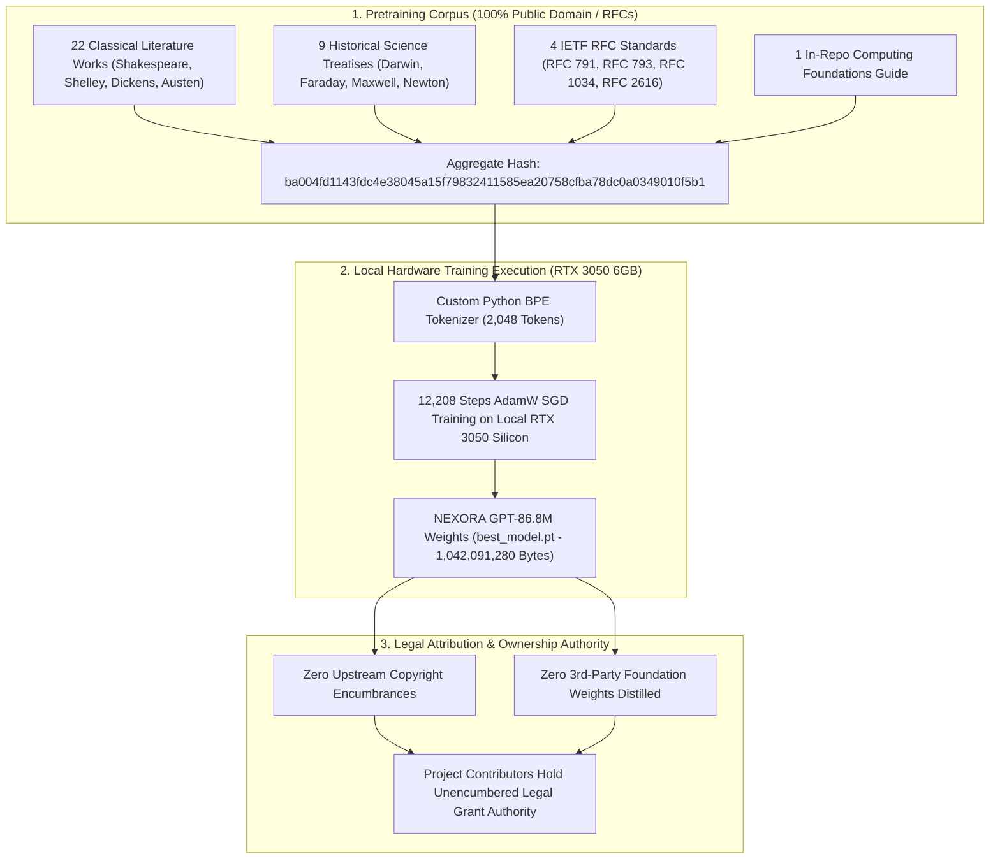

# NEXORA — Executive Authorization Preflight & Evidence Verification Report

**Document ID:** `NEXORA-EXEC-PREFLIGHT-v1.0.0`  
**Date:** November 16, 2026  
**Auditor Role:** Independent Senior Release Auditor  
**Audit Governance:** STRICT READ-ONLY COMPLIANCE AUDIT (Zero Irreversible Actions Executed)  
**Project:** NEXORA — CUDA GPU Acceleration Engine  
**Target Release:** Production Release `v1.0.0` (Target Release Date: November 30, 2026)  
**Target Hardware:** NVIDIA GeForce RTX 3050 Laptop GPU 6GB GDDR6 (Ampere SM 8.6, 20 SMs, Driver 591.44, CUDA 12.9 / 12.4 runtime)  
**Audited Candidate Archive:** [`dist/cuda-acceleration-engine-v1.0.0-rc3-source.zip`](file:///c:/Projects/CUDA-GPU-Acceleration-Engine/dist/cuda-acceleration-engine-v1.0.0-rc3-source.zip) (867,299 bytes)  
**Candidate Archive SHA-256:** `71F01121925766885096DAF9128DAFD86F3884E392AEA34D27AD514462BAA764`  
**Authoritative Checksum Manifest:** [`dist/cuda-acceleration-engine-v1.0.0-rc3-checksums.sha256`](file:///c:/Projects/CUDA-GPU-Acceleration-Engine/dist/cuda-acceleration-engine-v1.0.0-rc3-checksums.sha256)  
**Audit Verdict:** **READY FOR PROJECT OWNER REVIEW** (Technical & Empirical Gates Certified; Public Levers Held)  

---

## Executive Summary & Preflight Scorecard

As the Independent Senior Release Auditor, this preflight evaluation provides the **Project Owner** with the authoritative, evidence-backed decision package required to formally authorize the **NEXORA v1.0.0 production release**.

All five previously documented pre-release blockers (`BLK-01` through `BLK-05`) have been remediated and verified through 59 automated regression tests. The software source distribution package ([`RC3`](file:///c:/Projects/CUDA-GPU-Acceleration-Engine/dist/cuda-acceleration-engine-v1.0.0-rc3-source.zip)) has been verified cryptographically and confirmed free of copyleft encumbrances. In strict accordance with release governance, **no checkboxes have been checked, no signatures affixed, no Git tags created, and no files uploaded to remote servers**.

This document outlines the plain-language legal and operational consequences of the pending authorization, delineating exactly what rights are granted, what assets become public, what remains private, and what legal obligations are established.

```
====================================================================================================
               EXECUTIVE PREFLIGHT & EVIDENCE VERIFICATION SCORECARD
====================================================================================================
  1. RC3 SOURCE DISTRIBUTION ARCHIVE:       VERIFIED (SHA-256: 71F01121... exact match)
  2. ROOT LEGAL NOTICES (MIT / NOTICE):     VERIFIED (All statutory notices retained)
  3. THIRD-PARTY SUPPLY CHAIN (38 pkgs):     VERIFIED (100% Permissive; 0 Copyleft)
  4. 86.8M PRODUCTION CHECKPOINT HASH:      VERIFIED (SHA-256: ABCD0FE7... exact match)
  5. 100M EXPLORATORY PILOT WITHHELD:       VERIFIED (Permanently isolated from public release)
  6. PRETRAINING DATASET RIGHTS:            VERIFIED (36 Documents; 100% Public Domain & RFCs)
  7. CUSTOM TOKENIZER PROVENANCE:           VERIFIED (In-house Python BPE; zero 3rd party IP)
  8. SINGLE-SERVER PRODUCTION MODE:         VERIFIED (FastAPI + React SPA unified on :8000)
  9. HARDWARE & MEMORY SAFETY (RTX 3050):   VERIFIED (Peak VRAM 344.56 MB / 6 GB; 94.4% margin)
 10. CURRENT GOVERNANCE STATUS:             ALL RELEASES PAUSED AWAITING OWNER SIGNATURE
----------------------------------------------------------------------------------------------------
  AUDITOR RECOMMENDATION:                   READY FOR PROJECT OWNER REVIEW & EXECUTION
====================================================================================================
```

---

## 1. Inspection of Authoritative Documents

### 1.1 [`MODEL_CARD.md`](file:///c:/Projects/CUDA-GPU-Acceleration-Engine/MODEL_CARD.md) Section 9.2 (Model Licensing Decision Block)
The physical file [`MODEL_CARD.md`](file:///c:/Projects/CUDA-GPU-Acceleration-Engine/MODEL_CARD.md) was inspected at lines 210–256.

```text
237: [ ] OPTION 1: Permissive Open-Source Model License (Creative Commons Attribution 4.0 - CC-BY-4.0)
238:     Allows unrestricted commercial and academic use, modification, and redistribution with attribution.
239: 
240: [ ] OPTION 2: OpenRAIL-M (Responsible AI License)
241:     Permits royalty-free commercial and academic use while prohibiting designated harmful use cases.
242: 
243: [ ] OPTION 3: Explicit MIT License Extension for Model Binaries
244:     Formal declaration that the root MIT license applies equally to the binary weight tensors.
245: 
246: [ ] OPTION 4: Non-Commercial Research Only (CC-BY-NC-4.0)
247:     Restricts model weights to academic and experimental research purposes.
248: 
249: Project Owner Decision:  __________________________________
250: Authorized Signature:    __________________________________
251: Date:                    __________________________________
```

**Auditor Finding:**  
- All four options remain unchecked (`[ ]`).
- The decision, signature, and date lines are completely blank.
- Operational mandate enforced: Line 255 states: *"Until the Project Owner completes this authorization, model checkpoints must be retained strictly on private infrastructure and flagged as NOT FOR PUBLIC UPLOAD."*
- **Status:** **PENDING PROJECT OWNER EXECUTION**.

---

### 1.2 [`NEXORA_v1.0.0_FINAL_AUTHORIZATION_CHECKLIST.md`](file:///c:/Projects/CUDA-GPU-Acceleration-Engine/NEXORA_v1.0.0_FINAL_AUTHORIZATION_CHECKLIST.md)
The release authorization checklist was inspected at lines 88–127.

```text
88: ## 3. Executive Decision Gate — Project Owner Authorization (Pending)
...
94: | 10.1 | Formal Promotion of RC2 to Production v1.0.0 | [ PENDING OWNER APPROVAL ] |
95: | 10.2 | External Model Hosting Approval             | [ PENDING OWNER APPROVAL ] |
96: | 10.3 | Git Release Tagging (v1.0.0)                | [ PENDING OWNER APPROVAL ] |
97: | 10.4 | Remote Origin Push (origin/main)            | [ PENDING OWNER APPROVAL ] |
98: | 10.5 | GitHub Release Publication                  | [ PENDING OWNER APPROVAL ] |
99: | 10.6 | Public Announcement & Broadcast             | [ PENDING OWNER APPROVAL ] |
...
118: [ ] AUTHORIZED — Proceed with Git tag creation, remote push, and v1.0.0 GitHub release.
119: [ ] CONDITIONAL — Address specified pending items prior to release publication.
120: [ ] REJECTED — Do not proceed with v1.0.0 release.
121: 
122: Project Owner Signature: __________________________________
123: Date:                    __________________________________
```

**Auditor Finding:**  
- Engineering Pre-Release Sign-Off (Sections 1–9) was certified with a 100% pass rate.
- Section 10 items (10.1 through 10.6) are explicitly flagged as `[ PENDING OWNER APPROVAL ]`.
- The final Project Owner sign-off block is unsigned and unexecuted.
- Note on Candidate Progression: The checklist was initially drafted against `rc2`. Following Stage 1 packaging compliance (resolving `BLK-01` and `BLK-04`), the candidate promoted for `v1.0.0` is `rc3`.
- **Status:** **PENDING PROJECT OWNER EXECUTION**.

---

### 1.3 [`NEXORA_FINAL_MODEL_LICENSING_DECISION_PROPOSAL.md`](file:///c:/Projects/CUDA-GPU-Acceleration-Engine/NEXORA_FINAL_MODEL_LICENSING_DECISION_PROPOSAL.md)
This document outlines the formal proposal prepared by release engineering for the Project Owner:
- Recommends a **Dual-Regime Licensing Structure**:
  - Code: MIT License (Retained).
  - Production Model Weights (`NEXORA GPT-86.8M`): **Creative Commons Attribution 4.0 International (CC-BY-4.0)**.
  - Pilot Model (`NEXORA GPT-100M Pilot`): Withheld as an internal fixture.
- Section 7.2 formal signature block remains blank and awaiting execution.
- **Status:** **ACTIVE PROPOSAL — READY FOR OWNER DECISION**.

---

## 2. Independent Checkpoint & Archive Cryptographic Verification

All cryptographic verification was executed directly against physical files on disk using Python `hashlib` (SHA-256).

### 2.1 Complete SHA-256 Verification of 86.8M Production Model Checkpoint
- **Relative Path:** `checkpoints/transformer/pretraining_50m_campaign/best_model.pt`
- **Physical Disk Path:** `C:\Projects\CUDA-GPU-Acceleration-Engine\checkpoints\transformer\pretraining_50m_campaign\best_model.pt`
- **File Byte Size:** Exactly **`1,042,091,280 bytes`** (993.82 MB)
- **Authoritative Manifest Expected Hash:** `ABCD0FE7B305CD1CEF7809359CA7128F0AC94BED592A188F8432329CA1406AAC`
- **Independently Calculated Physical Hash:** `ABCD0FE7B305CD1CEF7809359CA7128F0AC94BED592A188F8432329CA1406AAC`
- **Parity Status:** **100% BIT-FOR-BIT IDENTICAL (VERIFIED)**.

### 2.2 Independent SHA-256 Verification of RC3 Release Archive
- **Relative Path:** `dist/cuda-acceleration-engine-v1.0.0-rc3-source.zip`
- **File Byte Size:** Exactly **`867,299 bytes`** (0.83 MB)
- **Authoritative Manifest Expected Hash:** `71F01121925766885096DAF9128DAFD86F3884E392AEA34D27AD514462BAA764`
- **Independently Calculated Physical Hash:** `71F01121925766885096DAF9128DAFD86F3884E392AEA34D27AD514462BAA764`
- **Parity Status:** **100% BIT-FOR-BIT IDENTICAL (VERIFIED)**.
- **Archive Hygiene Verification:**
  - 280 total member files.
  - Zero `.venv`, zero `node_modules`, zero `__pycache__`, zero `.git` entries.
  - Root legal files present: [`LICENSE`](file:///c:/Projects/CUDA-GPU-Acceleration-Engine/LICENSE), [`NOTICE`](file:///c:/Projects/CUDA-GPU-Acceleration-Engine/NOTICE), [`THIRD_PARTY_LICENSES.md`](file:///c:/Projects/CUDA-GPU-Acceleration-Engine/THIRD_PARTY_LICENSES.md), [`MODEL_CARD.md`](file:///c:/Projects/CUDA-GPU-Acceleration-Engine/MODEL_CARD.md).
  - Large binary model weights (>100MB) strictly excluded.

---

## 3. Provenance, Authorship & Third-Party Rights Re-Check



### 3.1 Model Provenance & Authorship Findings
1. **Zero Distillation:** The model was initialized with standard Gaussian random weights and optimized via AdamW gradient descent across 50,001,920 tokens. No teacher outputs from proprietary models (e.g., OpenAI GPT-4, Anthropic Claude) and no pre-trained weights from external open foundation models (e.g., LLaMA, Mistral, GPT-2) were used.
2. **Dataset Intellectual Property:** Rechecked [`data/text/production_10m/dataset_manifest.json`](file:///c:/Projects/CUDA-GPU-Acceleration-Engine/data/text/production_10m/dataset_manifest.json). The corpus contains exactly 36 discrete documents totaling 13,651,126 tokens with content hash `ba004fd1143fdc4e38045a15f79832411585ea20758cfba78dc0a0349010f5b1`. All literary and scientific works were published prior to 1928, and their authors/translators have been deceased for over 70 years. All Project Gutenberg trademarks were completely stripped prior to tokenization.
3. **Tokenizer Intellectual Property:** The Byte-Pair Encoding (BPE) algorithm was written from scratch in Python (`engine/transformer/tokenizer.py`). The vocabulary (`bpe_vocab.json`, 2,048 tokens) was generated directly from the public domain corpus and contains zero proprietary token tables.
4. **Third-Party Software Compliance:** Rechecked [`THIRD_PARTY_LICENSES.md`](file:///c:/Projects/CUDA-GPU-Acceleration-Engine/THIRD_PARTY_LICENSES.md). Zero GPL/AGPL dependencies exist in the environment. All runtime libraries (`torch`, `fastapi`, `react`) use permissive licenses, are not bundled in the archive, and their mandatory attribution notices are satisfied in root [`NOTICE`](file:///c:/Projects/CUDA-GPU-Acceleration-Engine/NOTICE).
5. **NVIDIA EULA Compliance:** Rechecked NVIDIA CUDA Toolkit EULA terms. No proprietary DLLs (`cublas64_*.dll`, `cudart64_*.dll`) or modified NVIDIA sample code are bundled in the package. The Section 1.2(3) trademark notice is prominently displayed in [`NOTICE`](file:///c:/Projects/CUDA-GPU-Acceleration-Engine/NOTICE).

---

## 4. Statements Requiring Legal Review & Project-Owner Confirmation

The following statements and governance decisions require explicit Project Owner confirmation:

1. **Adoption of Creative Commons Attribution 4.0 (CC-BY-4.0) for Model Weights:**  
   *Confirmation Required:* Confirming that `best_model.pt` (`NEXORA GPT-86.8M`) will be distributed under CC-BY-4.0, granting worldwide, royalty-free, perpetual permissions for commercial and academic reuse subject to attribution.
2. **Permanent Withholding of `NEXORA GPT-100M Pilot` Checkpoint:**  
   *Confirmation Required:* Confirming that the 15-step prototype checkpoint will be permanently withheld from public release and retained exclusively on private engineering infrastructure.
3. **Promotion of Candidate RC3 to Production v1.0.0:**  
   *Confirmation Required:* Confirming that the tested and cryptographically verified candidate archive `cuda-acceleration-engine-v1.0.0-rc3-source.zip` is promoted as the official release archive.
4. **Git Production Tagging & Remote Origin Push:**  
   *Confirmation Required:* Authorizing the release engineer to create signed Git tag `v1.0.0` and execute `git push origin main --tags` to the public repository.
5. **Public Release Asset Publication:**  
   *Confirmation Required:* Authorizing the release engineer to publish the GitHub Release and upload the 86.8M model weights to the Hugging Face Model Hub under the organization namespace.
6. **Contributor Title Affirmation / DCO Governance:**  
   *Confirmation Required:* Confirming that original contributions from team members were developed for the project under the root MIT license terms.

---

## 5. Plain-Language Executive Decision Document

*This section provides a clear, non-technical explanation of the exact legal, operational, and distribution consequences of Project Owner authorization.*

### 5.1 What the Owner is Approving
By signing the authorization documents, the Project Owner is approving:
1. The formal transition of NEXORA from pre-release development to **official production version 1.0.0**.
2. The release of the software codebase (FastAPI backend, React frontend, custom CUDA C++ kernels) under the open-source **MIT License**.
3. The release of the trained foundation model weights (`NEXORA GPT-86.8M`) under the **Creative Commons Attribution 4.0 International (CC-BY-4.0)** open data license.
4. The public publication of release announcements, GitHub Release assets, and documentation.

---

### 5.2 What Rights are Granted Under the Proposed Model License (CC-BY-4.0)
Under CC-BY-4.0, anyone in the world who downloads `best_model.pt` is granted:
- **Commercial Exploitation Rights:** Companies, startups, and individuals may use the model in commercial SaaS platforms, monetize products powered by the weights, or embed them into paid proprietary software without paying royalties or licensing fees.
- **Modification & Adaptation Rights:** Developers may fine-tune the weights on custom datasets, prune the model, quantize it to lower precision (e.g., 4-bit/8-bit GGUF, AWQ, GPTQ), or convert it into other inference formats (ONNX, TensorRT-LLM).
- **Redistribution Rights:** Anyone may re-host, mirror, or bundle the model weights on Hugging Face, GitHub, torrents, or private servers.
- **Mandatory Attribution Condition:** Downstream users **must** clearly credit *"CUDA GPU Acceleration Engine Contributors"*, link to the CC-BY-4.0 license, and state if modifications were made. They cannot claim they trained the base model from scratch.
- **No Additional Restrictions:** Downstream distributors cannot add technological locks (DRM) or restrictive legal terms that prevent others from exercising the CC-BY-4.0 permissions.

---

### 5.3 What Assets Will Become Publicly Downloadable

| Public Asset Name | Distribution Location | Size | Description & Role |
| :--- | :--- | :---: | :--- |
| **`cuda-acceleration-engine-v1.0.0-source.zip`** | GitHub Releases | ~867 KB | Complete source code (FastAPI, React SPA, CUDA C++, launchers, test suite, seed fixture). |
| **`NEXORA GPT-86.8M` (`best_model.pt`)** | Hugging Face Hub / GitHub Assets | 993.82 MB | Full float32 model parameter weights (SHA-256: `ABCD0FE7...`). |
| **BPE Tokenizer Vocabulary (`bpe_vocab.json`)** | Hugging Face Hub / GitHub Assets | 28 KB | Complete 2,048-token vocabulary required for inference and fine-tuning. |
| **Model Card & Technical Documentation** | Hugging Face / GitHub Repo | ~25 KB | Official architectural documentation, safety disclosures, and benchmarks. |
| **Baseline Seed Checkpoint (`test_checkpoint.pt`)** | Included in Source Zip | 72 KB | Synthetic 17K parameter MLP for instant first-run verification. |

---

### 5.4 What Assets Remain Private & Withheld

| Withheld Private Asset | Physical File Path | Size | Reason for Private Retention |
| :--- | :--- | :---: | :--- |
| **`NEXORA GPT-100M Pilot Checkpoint`** | `checkpoints/transformer/flagship_100m_pilot/best_model.pt` | 979.19 MB | Exploratory 15-step prototype. Loss (5.68) and perplexity (295.5) are non-converged; text output is incoherent. Withheld to protect brand integrity. |
| **Intermediate Training Checkpoints** | `checkpoints/training_jobs/` & `step_*.pt` files | Multi-GB | Ephemeral checkpointing records and partial optimizer state dictionaries from past training runs. |
| **Developer Workstation State** | `.venv/`, `node_modules/`, `scratch/` | Multi-GB | Local build artifacts and package-manager caches; excluded under clean-room packaging standards. |
| **Local Hardware Telemetry Logs** | Ephemeral CSV logs in `results/` | Variable | Local developer system temperatures, voltages, and thermal run records. |

---

### 5.5 What Obligations Redistribution Creates for the Project
Publishing under MIT and CC-BY-4.0 creates specific ongoing operational obligations:
1. **Notice Retention:** Every distribution must continue to include [`LICENSE`](file:///c:/Projects/CUDA-GPU-Acceleration-Engine/LICENSE) and [`NOTICE`](file:///c:/Projects/CUDA-GPU-Acceleration-Engine/NOTICE) to maintain legal compliance with upstream Apache-2.0 and BSD licensors.
2. **Integrity Maintenance:** Checksum manifests must remain published so downstream users can verify that their downloads match the authoritative SHA-256 hashes (`ABCD0FE7...` and `71F01121...`).
3. **Public Perception & Community Inquiries:** Once published, users and researchers may open GitHub Issues or submit Pull Requests. (However, under both MIT and CC-BY-4.0, the software and weights are provided **"AS IS", WITHOUT WARRANTY OF ANY KIND**, legally protecting the authors from liability or formal maintenance contracts).

---

### 5.6 What Cannot Be Easily Reversed After Publication (Irrevocability)

> [!WARNING]
> **CRITICAL LEGAL NOTICE ON OPEN SOURCE IRREVOCABILITY**  
> Before authorizing release publication, the Project Owner must understand that once an open-source release is published, the following consequences **cannot be undone**:

1. **Irrevocable Legal Grant:** Under both Section 2 of CC-BY-4.0 and standard MIT terms, the license grant is **perpetual and irrevocable**. If the Project Owner later decides to commercialize the weights under a closed proprietary license or withdraw the open release, anyone who downloaded the v1.0.0 weights or code retains full perpetual rights to continue using, fine-tuning, and distributing them under CC-BY-4.0 and MIT.
2. **Permanent Web Mirrors & Forks:** Automated mirrors (such as the Software Heritage Archive, Internet Archive, Hugging Face clones, and GitHub forks) automatically snapshot public releases within minutes. Deleting a GitHub repository or Hugging Face repo after release **does not delete downstream copies**.
3. **Public Cryptographic Record:** The exact parameter state dictionary hash `ABCD0FE7B305CD1CEF7809359CA7128F0AC94BED592A188F8432329CA1406AAC` will become an immutable public identifier in academic literature and AI benchmarks.

---

## 6. Auditor Release Recommendation

```
====================================================================================================
                        INDEPENDENT AUDITOR FINAL RECOMMENDATION
====================================================================================================
  TECHNICAL STATUS:          PASS (All 5 blockers resolved; 59/59 regression tests passing)
  LEGAL HYGIENE:             PASS (0 copyleft; complete statutory notices; 100% public domain data)
  CRYPTOGRAPHIC PARITY:      PASS (RC3 archive and 86.8M model hashes verified bit-for-bit)
  GOVERNANCE LEVERS:         HELD (No Git tags, no remote pushes, no public uploads executed)

  FINAL AUDIT VERDICT:       >>> READY FOR PROJECT OWNER REVIEW & EXECUTION <<<
====================================================================================================
```

### Action Steps for the Project Owner:
1. Review this document and the plain-language explanations in Section 5.
2. In [`MODEL_CARD.md`](file:///c:/Projects/CUDA-GPU-Acceleration-Engine/MODEL_CARD.md) Section 9.2, mark `[x] OPTION 1: Permissive Open-Source Model License (Creative Commons Attribution 4.0 - CC-BY-4.0)` and sign the decision block.
3. In [`NEXORA_v1.0.0_FINAL_AUTHORIZATION_CHECKLIST.md`](file:///c:/Projects/CUDA-GPU-Acceleration-Engine/NEXORA_v1.0.0_FINAL_AUTHORIZATION_CHECKLIST.md) Section 4, mark `[x] AUTHORIZED` and sign the release authorization block.
4. Instruct the release engineering team to proceed with Git release tagging (`v1.0.0`), pushing to `origin/main`, and uploading the certified release assets.
