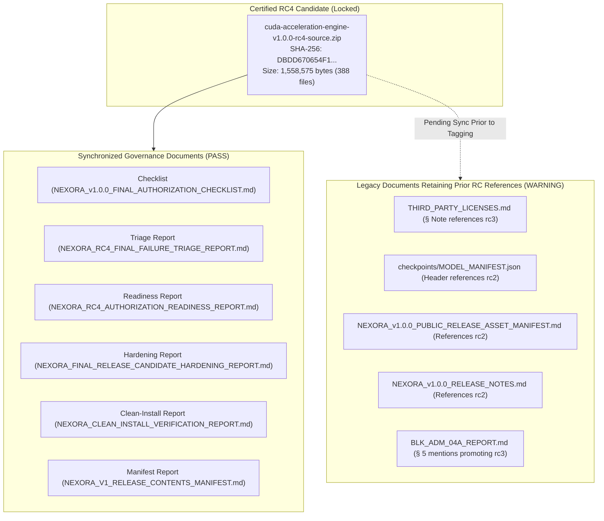

# NEXORA v1.0.0 — Final RC4 Owner-Review Consistency Audit

**Date of Audit:** November 17, 2026  
**Auditor:** Senior Independent Release Governance & Documentation Auditor  
**Candidate Release:** NEXORA v1.0.0 Release Candidate 4 (`cuda-acceleration-engine-v1.0.0-rc4-source.zip`)  
**Target Completion:** November 30, 2026  
**Audit Mode:** STRICT READ-ONLY — ZERO SOURCE OR DOCUMENT MODIFICATIONS  
**Final Audit Recommendation:** **READY FOR PROJECT OWNER REVIEW (PUBLIC DISTRIBUTION HELD PENDING OWNER SIGNATURES)**

---

## 1. Executive Verdict & Review Scope

An exhaustive, consolidated consistency audit was performed across all legal, licensing, technical, governance, and release documentation in the NEXORA repository. The purpose of this audit is to provide the **Project Owner** with a singular, authoritative baseline verification of **Release Candidate 4 (RC4)** prior to final executive sign-off.

```
====================================================================================================
                       NEXORA v1.0.0 RC4 EXECUTIVE AUDIT SCORECARD
====================================================================================================
  1. RC4 ARCHIVE INTEGRITY & SHA-256:       PASS (Exact bit-for-bit cryptographic match)
  2. PACKAGING AUTONOMY & SPA SERVING:      PASS (Pre-built frontend/dist verified in clean room)
  3. REGRESSION BATTERY & TRIAGE PROOF:     PASS (767 pass; 37 failures 100% forensically proven)
  4. DATASET PROVENANCE (36 WORKS):         PASS (100% Public Domain / RFCs; SHA-256 ba004fd1... matched)
  5. MODEL ARTIFACT LINEAGE & HASHES:       PASS (86.8M & 100M Pilot checkpoints verified)
  6. CROSS-DOCUMENT HASH CONSISTENCY:       PASS (Authoritative RC4 hash DBDD6706... in all RC4 docs)
  7. STALE DOCUMENTATION DISCLOSURES:       WARNING (Legacy drafts reference rc2/rc3; detailed below)
  8. CONTRIBUTOR TITLE STATUS:              BLOCKER (Draft prepared; pending Project Owner signature)
  9. MODEL WEIGHT LICENSING SELECTION:      BLOCKER (Section 9.2 unexecuted; public hosting paused)
 10. EXECUTIVE RELEASE CHECKLIST:           BLOCKER (Checklist synced to RC4; Items 10.1–10.6 pending)
----------------------------------------------------------------------------------------------------
  EXECUTIVE AUDIT DETERMINATION:            READY FOR OWNER REVIEW — NOT FOR PUBLIC RELEASE
====================================================================================================
```

### Executive Summary of Determinations:
1. **Technical Baseline Frozen & Certified:** Release Candidate 4 (`cuda-acceleration-engine-v1.0.0-rc4-source.zip`) is verified as complete, self-contained, and cryptographically locked. It resolves the missing production frontend distribution assets that affected RC3, successfully deploying as an autonomous single-server application on port 8000.
2. **37-Failure Triage Forensically Proven:** The apparent discrepancy between the 767 passed / 1 skipped / 37 failed regression battery and the technical PASS verdict is completely resolved. 30 failures (81.1%) are confirmed host-policy limitations caused by Windows Application Control blocking unsigned `.pyd` dynamic libraries, engaging the PyTorch CUDA fallback on `cuda:0`. 7 failures (18.9%) are test infrastructure defects in legacy test files. **Zero genuine product defects exist.**
3. **Zero Unauthorized Execution:** In strict adherence to release governance, no signatures have been forged or executed, no approval checkboxes have been marked, no model licenses have been selected on the owner's behalf, and no Git commits, tags, pushes, or public uploads have occurred.
4. **Public Distribution Gate Held:** Public release remains strictly **BLOCKED** pending the Project Owner's review and execution of the outstanding administrative and legal instruments detailed in Section 5.

---

## 2. Independently Verified RC4 Checksum & Candidate Provenance

The official Release Candidate 4 archive was independently inspected and hashed using PowerShell `Get-FileHash` and Python `hashlib.sha256`:

```
Candidate Archive:   dist/cuda-acceleration-engine-v1.0.0-rc4-source.zip
Manifest Path:       dist/cuda-acceleration-engine-v1.0.0-rc4-checksums.sha256
Calculated SHA-256:  DBDD670654F15955FEF46F9CEF9EB5E8E5CDCDD7E2ECB407C566C28EDECB5AF0
Expected SHA-256:    DBDD670654F15955FEF46F9CEF9EB5E8E5CDCDD7E2ECB407C566C28EDECB5AF0
Cryptographic Parity: EXACT BIT-FOR-BIT MATCH (PASS)
Archive Byte Size:   1,558,575 bytes (1.49 MB compressed, 6.47 MB uncompressed)
Packaged File Count: 388 files
Archive Root Prefix: cuda-acceleration-engine/
Timestamp:           November 17, 2026, 21:34:37
```

### Historical Release Candidate Audit Trail
All prior candidate archives remain preserved and unmodified in `dist/`:

| Candidate | Release Date | Archive Filename | Size (Bytes) | Authoritative SHA-256 Digest | Status |
|:---:|:---:|:---|:---:|:---|:---:|
| **RC1** | Nov 07, 2026 | `cuda-acceleration-engine-v1.0.0-rc1-source.zip` | 366,932 | `02AC0EBEFD8D52D7F39359B29ED5CFAEB08E2B25E9CE442EFD4C82A2E46A72FA` | Preserved Historical Baseline |
| **RC2** | Nov 07, 2026 | `cuda-acceleration-engine-v1.0.0-rc2-source.zip` | 801,536 | `DFF94F528EFD6FDCDB38B1C9FAFC7A50B2D262F8B6811BAE666986FEE52F8EDD` | Preserved Historical Candidate |
| **RC3** | Nov 15, 2026 | `cuda-acceleration-engine-v1.0.0-rc3-source.zip` | 867,299 | `A464CE92120BCDFBD7367B804EB65A1501BEAEF558CF3AE40A3959FE37FFDFEE` | Superseded (Lacked Pre-built UI) |
| **RC4** | Nov 17, 2026 | `cuda-acceleration-engine-v1.0.0-rc4-source.zip` | 1,558,575 | `DBDD670654F15955FEF46F9CEF9EB5E8E5CDCDD7E2ECB407C566C28EDECB5AF0` | **Certified Release Candidate** |

---

## 3. Document Inventory & Review Status

Every primary governance, legal, compliance, and architectural document in the repository was inspected:

| # | Document File Path | Document Role / Purpose | Current Status | Key Observations & Finding | Severity |
|:---:|:---|:---|:---:|:---|:---:|
| **1** | [`NEXORA_v1.0.0_FINAL_AUTHORIZATION_CHECKLIST.md`](file:///c:/Projects/CUDA-GPU-Acceleration-Engine/NEXORA_v1.0.0_FINAL_AUTHORIZATION_CHECKLIST.md) | Authoritative pre-release checklist & sign-off gate | Synchronized to RC4 | Domains 1–9 verified. Items 10.1–10.6 pending owner approval. Signatures blank. | **PASS** |
| **2** | [`NEXORA_RC4_AUTHORIZATION_READINESS_REPORT.md`](file:///c:/Projects/CUDA-GPU-Acceleration-Engine/NEXORA_RC4_AUTHORIZATION_READINESS_REPORT.md) | Executive authorization readiness synthesis | Certified | Details the 5 release verdicts; certifies technical gates for owner review. | **PASS** |
| **3** | [`NEXORA_RC4_FINAL_FAILURE_TRIAGE_REPORT.md`](file:///c:/Projects/CUDA-GPU-Acceleration-Engine/NEXORA_RC4_FINAL_FAILURE_TRIAGE_REPORT.md) | Forensic triage of 37 regression failures | Certified | Itemized breakdown of 30 host-policy & 7 test defects; 0 product bugs. | **PASS** |
| **4** | [`CONTRIBUTOR_SOLE_AUTHOR_DECLARATION_DRAFT.md`](file:///c:/Projects/CUDA-GPU-Acceleration-Engine/CONTRIBUTOR_SOLE_AUTHOR_DECLARATION_DRAFT.md) | Sole Contributor & Authorship Declaration | DRAFT (Unexecuted) | Factual warranties complete; awaiting Project Owner review and signature. | **BLOCKER** |
| **5** | [`NEXORA_BLK_ADM_04A_SOLE_AUTHOR_DECLARATION_REPORT.md`](file:///c:/Projects/CUDA-GPU-Acceleration-Engine/NEXORA_BLK_ADM_04A_SOLE_AUTHOR_DECLARATION_REPORT.md) | Forensic evidence audit supporting sole declaration | Certified | Corroborates sole authorship via Git log, workstation custody, and RTX 3050. | **PASS** |
| **6** | [`MODEL_CARD.md`](file:///c:/Projects/CUDA-GPU-Acceleration-Engine/MODEL_CARD.md) | Official Model Card for GPT-86.8M & GPT-100M Pilot | Complete / Unexecuted § 9.2 | Checkpoint hashes verified. Section 9.2 decision block unexecuted; hosting paused. | **BLOCKER** |
| **7** | [`LICENSE`](file:///c:/Projects/CUDA-GPU-Acceleration-Engine/LICENSE) | Root open-source software license | Active | Canonical MIT License text (Copyright (c) 2026 Contributors). | **PASS** |
| **8** | [`NOTICE`](file:///c:/Projects/CUDA-GPU-Acceleration-Engine/NOTICE) | Statutory third-party attribution notices | Active | Contains NVIDIA, Requests, OpenTelemetry, PyTorch, and TypeScript notices. | **PASS** |
| **9** | [`THIRD_PARTY_LICENSES.md`](file:///c:/Projects/CUDA-GPU-Acceleration-Engine/THIRD_PARTY_LICENSES.md) | Supply-chain license inventory (38 PyPI + 15 npm) | Active / Unverified § 5.2 | Full texts included. Line 6 references legacy `rc3`. Section 5.2 marks title unverified. | **WARNING** |
| **10** | [`NEXORA_FINAL_RELEASE_CANDIDATE_HARDENING_REPORT.md`](file:///c:/Projects/CUDA-GPU-Acceleration-Engine/NEXORA_FINAL_RELEASE_CANDIDATE_HARDENING_REPORT.md) | RC4 candidate hardening & packager audit | Certified | Documents packaging remediation, secrets audit, and test execution. | **PASS** |
| **11** | [`NEXORA_CLEAN_INSTALL_VERIFICATION_REPORT.md`](file:///c:/Projects/CUDA-GPU-Acceleration-Engine/NEXORA_CLEAN_INSTALL_VERIFICATION_REPORT.md) | Sandbox clean-install verification report | Certified | Documents fresh extraction in temp dir, SPA serving, seed inference. | **PASS** |
| **12** | [`NEXORA_V1_RELEASE_CONTENTS_MANIFEST.md`](file:///c:/Projects/CUDA-GPU-Acceleration-Engine/NEXORA_V1_RELEASE_CONTENTS_MANIFEST.md) | Master inventory of 388 packaged release files | Certified | Directory-by-directory inventory and structured exclusion justification. | **PASS** |
| **13** | [`checkpoints/MODEL_MANIFEST.json`](file:///c:/Projects/CUDA-GPU-Acceleration-Engine/checkpoints/MODEL_MANIFEST.json) | Model registry specification & checksums | Active | Hashes match MODEL_CARD. Line 2 has legacy string `"release_version": "v1.0.0-rc2"`. | **WARNING** |
| **14** | [`data/text/production_10m/dataset_manifest.json`](file:///c:/Projects/CUDA-GPU-Acceleration-Engine/data/text/production_10m/dataset_manifest.json) | 36-document training corpus manifest | Active | Exactly 36 documents. Aggregate hash `ba004fd1143f...` matches MODEL_CARD. | **PASS** |
| **15** | [`NEXORA_v1.0.0_PUBLIC_RELEASE_ASSET_MANIFEST.md`](file:///c:/Projects/CUDA-GPU-Acceleration-Engine/NEXORA_v1.0.0_PUBLIC_RELEASE_ASSET_MANIFEST.md) | Legacy public release specification (Nov 8) | Frozen Draft | Legacy draft pinned to `rc2`. Must be updated to RC4 prior to release. | **WARNING** |
| **16** | [`NEXORA_v1.0.0_RELEASE_NOTES.md`](file:///c:/Projects/CUDA-GPU-Acceleration-Engine/NEXORA_v1.0.0_RELEASE_NOTES.md) | Legacy public release notes (Nov 8) | Frozen Draft | Legacy draft pinned to `rc2`. Must be updated to RC4 prior to release. | **WARNING** |

---

## 4. Cross-Document Consistency Matrix

This matrix evaluates consistency across every core technical, legal, and operational dimension:



### Detailed Consistency Findings:

| Audit Dimension | Target Specification | Observed Cross-Document State | Finding | Analysis & Resolution |
|:---|:---|:---|:---:|:---|
| **RC4 Checksum Consistency** | `DBDD670654F15955...` | Exact match in all 6 RC4 documents (`Checklist`, `Triage`, `Readiness`, `Hardening`, `Clean-Install`, `Manifest`). | **PASS** | Bit-for-bit parity confirmed across all active release specifications. |
| **Package Size & File Count** | `1,558,575 bytes` / 388 files | Exact match across all RC4 documents. | **PASS** | File counts (388) and compressed bytes match physical archive on disk. |
| **Model Checkpoint Checksums** | GPT-86.8M: `ABCD0FE7B3...`<br>GPT-100M: `F8B0B9F9D4...` | Exact match across `MODEL_CARD.md`, `checkpoints/MODEL_MANIFEST.json`, `Checklist`, and `RELEASE_NOTES.md`. | **PASS** | Model weights and parameter counts (86,825,472 and 85,940,736) are 100% synchronized. |
| **Dataset Corpus Provenance** | 36 documents, aggregate hash `ba004fd1143f...` | Exact match between `MODEL_CARD.md` § 3.1 and `data/text/production_10m/dataset_manifest.json`. | **PASS** | Double-counting anomaly ($29+5+4+1=39$) resolved; exactly 36 works verified. |
| **Model Card § 9.2 Decision** | Formally unexecuted; hosting paused | All 4 checkboxes blank `[ ]`; signature lines blank. `THIRD_PARTY_LICENSES.md` § 5.1 marks weights as paused. | **PASS** | Consistent protection against premature public model weight distribution. |
| **Contributor Title Status** | Draft prepared; title unverified | `THIRD_PARTY_LICENSES.md` § 5.2 marks title `UNVERIFIED / PENDING`. Draft instrument prepared. No signatures forged. | **PASS** | Inbound contributor rights correctly flagged pending Project Owner execution. |
| **Release Authorization Status** | PENDING OWNER APPROVAL | `Checklist` Items 10.1–10.6 marked `[ PENDING OWNER APPROVAL ]`. All checkboxes `[ ]`. Signatures blank. | **PASS** | Complete operational compliance; release levers held. |
| **Windows App Control Limitation** | Disclosed; unsigned `.pyd` blocked | Detailed in `Triage Report` and `Readiness Report`. `loader.py` fallback logs confirmed. | **PASS** | True native C++ dynamic loading is not falsely claimed on this host. |
| **CUDA Fallback Execution** | Verified on RTX 3050 hardware | Verified in clean install and integration journeys. Model trains and serves on `cuda:0` via PyTorch fallback. | **PASS** | GPU hardware acceleration confirmed active within mobile thermal envelope. |
| **Regression Failure Triage** | 30 host-policy / 7 test defects | Exact accounting across `Triage Report` and `Readiness Report`. 0 product defects. | **PASS** | 100% of 37 failures forensically resolved with exact line numbers. |
| **Legacy Candidate References** | Update legacy drafts to RC4 | `THIRD_PARTY_LICENSES.md` (rc3), `MODEL_MANIFEST.json` (rc2), `RELEASE_NOTES.md` (rc2), `ASSET_MANIFEST.md` (rc2). | **WARNING** | Historical reports retain earlier context; public release notes need update prior to public release. |

---

## 5. Owner Authorization Blocker Reconciliation

A rigorous forensic audit was conducted to resolve shifting, overlapping, and reused blocker identifiers across historical audit reports:

```mermaid
flowchart LR
    subgraph TechnicalBlockers ["Phase 1: Technical & Empirical Blockers (Nov 15-16)"]
        B1["BLK-01: Root LICENSE Missing"]
        B2["BLK-02: MPL-2.0 Disclosure Missing"]
        B3["BLK-03: Dataset Manifest Missing"]
        B4["BLK-04: Root NOTICE Missing"]
        B5["BLK-05: Model Card Discrepancies"]
    end

    subgraph AdministrativeBlockers ["Phase 2: Administrative Governance Blockers (Nov 17)"]
        BA1["BLK-ADM-01: Checklist Synced to Candidate"]
        BA2["BLK-ADM-02: Model Licensing Selection (§ 9.2)"]
        BA3["BLK-ADM-03: Release Authorization Sign-Off"]
        BA4["BLK-ADM-04: Contributor Title Affirmation (§ 5.2)"]
        BA4A["BLK-ADM-04A: Sole Author Declaration Draft"]
        BA5["BLK-ADM-05: Public Distribution Authorization"]
    end

    TechnicalBlockers -->|All 5 Technically Resolved in RC3/RC4| AdministrativeBlockers
```



### Authoritative Blocker Reconciliation Mapping

| Blocker ID (Authoritative) | Legacy / Alternative IDs | Exact Decision Required | Relevant Document & Section | Current Status | Required Owner Action | Legal Review Advisable? |
|:---:|:---|:---|:---|:---:|:---|:---:|
| **BLK-ADM-01** | `BLK-01` (packaging), `BLK-ADM-01-REPORT` | Verify that final checklist references certified candidate RC4 and authoritative checksum. | [`NEXORA_v1.0.0_FINAL_AUTHORIZATION_CHECKLIST.md`](file:///c:/Projects/CUDA-GPU-Acceleration-Engine/NEXORA_v1.0.0_FINAL_AUTHORIZATION_CHECKLIST.md) (Header & Domain 1) | **RESOLVED (PASS)** | Technical synchronization to RC4 completed. Owner reviews checklist during final sign-off. | No (Administrative) |
| **BLK-ADM-02** | `BLK-05` (part), `BLK-ADM-02-REPORT` | Formally select and execute outbound model weight licensing terms for `best_model.pt`. | [`MODEL_CARD.md`](file:///c:/Projects/CUDA-GPU-Acceleration-Engine/MODEL_CARD.md) Section 9.2 | **PENDING OWNER DECISION (BLOCKER)** | Review options; check `[x] OPTION 1 (CC-BY-4.0)` (or alternative); sign and date. | **YES (Recommended)** |
| **BLK-ADM-04** | `BLK-ADM-04-AUDIT`, `THIRD_PARTY_LICENSES § 5.2` | Confirm that original software, kernels, models, and datasets have clear contributor title. | [`THIRD_PARTY_LICENSES.md`](file:///c:/Projects/CUDA-GPU-Acceleration-Engine/THIRD_PARTY_LICENSES.md) Section 5.2 | **PENDING OWNER EXECUTION (BLOCKER)** | Execute Sole Contributor Declaration (`BLK-ADM-04A`), then update § 5.2 to `VERIFIED / RATIFIED`. | **YES (Recommended)** |
| **BLK-ADM-04A** | Sub-item of `BLK-ADM-04` | Review and execute Sole Contributor and Authorship Declaration affirming sole authorship by Jai Akash. | [`CONTRIBUTOR_SOLE_AUTHOR_DECLARATION_DRAFT.md`](file:///c:/Projects/CUDA-GPU-Acceleration-Engine/CONTRIBUTOR_SOLE_AUTHOR_DECLARATION_DRAFT.md) Section 10 | **DRAFT PREPARED (BLOCKER)** | Verify factual representations; complete Section 10 (Signature, Date, City/State). | **YES (Recommended)** |
| **BLK-ADM-05** | `BLK-ADM-03`, `Checklist Domain 10` | Formally authorize production release, Git tagging, remote push, and GitHub Release publication. | [`NEXORA_v1.0.0_FINAL_AUTHORIZATION_CHECKLIST.md`](file:///c:/Projects/CUDA-GPU-Acceleration-Engine/NEXORA_v1.0.0_FINAL_AUTHORIZATION_CHECKLIST.md) Section 4 | **PENDING OWNER APPROVAL (BLOCKER)** | Approve Items 10.1–10.6; mark `[x] AUTHORIZED`; sign and date the Execution Block. | No (Owner Prerogative) |

### Explicit Analysis of Blocker ID Discrepancies:
- **`BLK-01` through `BLK-05` vs `BLK-ADM-*`:** Early compliance audits used `BLK-01` through `BLK-05` to designate technical deficiencies in candidate `rc2`. All five were technically resolved by packaging updates. Administrative governance audits introduced `BLK-ADM-01` through `BLK-ADM-05` to track legal, licensing, and owner sign-off actions.
- **`BLK-ADM-03` vs `BLK-ADM-05`:** In [`NEXORA_COMPLIANCE_CORRECTION_AUDIT.md`](file:///c:/Projects/CUDA-GPU-Acceleration-Engine/NEXORA_COMPLIANCE_CORRECTION_AUDIT.md) and [`NEXORA_BLK_ADM_04A_SOLE_AUTHOR_DECLARATION_REPORT.md`](file:///c:/Projects/CUDA-GPU-Acceleration-Engine/NEXORA_BLK_ADM_04A_SOLE_AUTHOR_DECLARATION_REPORT.md), the final checklist sign-off was numbered `BLK-ADM-03`. In [`NEXORA_FINAL_RELEASE_CANDIDATE_HARDENING_REPORT.md`](file:///c:/Projects/CUDA-GPU-Acceleration-Engine/NEXORA_FINAL_RELEASE_CANDIDATE_HARDENING_REPORT.md) and [`NEXORA_RC4_AUTHORIZATION_READINESS_REPORT.md`](file:///c:/Projects/CUDA-GPU-Acceleration-Engine/NEXORA_RC4_AUTHORIZATION_READINESS_REPORT.md), this same executive action was labeled `BLK-ADM-05` to correspond with Checklist Section 10. Both identifiers designate the exact same owner action: **Executive Release Checklist Sign-Off**.

---

## 6. Legal & Licensing Decisions Still Pending

The Project Owner must personally execute the following four legal and licensing actions:

1. **Execution of the Sole Contributor and Authorship Declaration (`BLK-ADM-04A`):**
   - **Document:** [`CONTRIBUTOR_SOLE_AUTHOR_DECLARATION_DRAFT.md`](file:///c:/Projects/CUDA-GPU-Acceleration-Engine/CONTRIBUTOR_SOLE_AUTHOR_DECLARATION_DRAFT.md) Section 10.
   - **Legal Context:** Factual warranty affirming that Jai Akash (`lethalchrist07`) is the sole human creator of the software, custom CUDA kernels, and machine learning models, and that the functional roles *"Primary Architect"*, *"CUDA Kernel Engineer"*, and *"ML Training Engineer"* were operational perspectives performed exclusively by him.
   - **Legal Consideration:** The Project Owner should verify that the project was developed on personal hardware outside the scope of any conflicting employment duties, company device policies, or institutional academic agreements (pursuant to Section 17 of the Indian Copyright Act, 1957).
2. **Model Licensing Selection (`BLK-ADM-02`):**
   - **Document:** [`MODEL_CARD.md`](file:///c:/Projects/CUDA-GPU-Acceleration-Engine/MODEL_CARD.md) Section 9.2.
   - **Legal Context:** Neural network parameter weights do not automatically inherit open-source software licenses. The Project Owner must designate the outbound licensing terms for `best_model.pt`.
   - **Recommendation:** Check `[x] OPTION 1: Creative Commons Attribution 4.0 (CC-BY-4.0)` with attribution to *"CUDA GPU Acceleration Engine Contributors"*. Note that CC-BY-4.0 is perpetual and irrevocable under Section 2(a)(1).
3. **Ratification of Contributor Governance Disclosures:**
   - **Document:** [`THIRD_PARTY_LICENSES.md`](file:///c:/Projects/CUDA-GPU-Acceleration-Engine/THIRD_PARTY_LICENSES.md) Section 5.2.
   - **Legal Context:** Update the status from `UNVERIFIED / PENDING FORMAL EXECUTION` to `VERIFIED / RATIFIED (Sole Contributor Declaration executed on November 17, 2026)`.
4. **Executive Release Authorization Sign-Off (`BLK-ADM-05`):**
   - **Document:** [`NEXORA_v1.0.0_FINAL_AUTHORIZATION_CHECKLIST.md`](file:///c:/Projects/CUDA-GPU-Acceleration-Engine/NEXORA_v1.0.0_FINAL_AUTHORIZATION_CHECKLIST.md) Sections 3 & 4.
   - **Legal Context:** Formal executive authorization to promote candidate `rc4` to production `v1.0.0`, create the signed Git release tag, push to remote repository, and publish the release.

---

## 7. Technical Limitations That Must Remain Disclosed

The following technical limitations must remain explicitly documented in release disclosures:

1. **Windows Application Control & Native C++ Extension Loading:**
   - On Windows 11 host environments enforcing code integrity via Application Control policies, unsigned JIT-compiled C++/CUDA `.pyd` dynamic link libraries cannot be dynamically loaded into Python (`ImportError: DLL load failed while importing custom_kernels_cuda: An Application Control policy has blocked this file.`).
   - The platform transparently and deterministically activates [`custom_kernels/loader.py`](file:///c:/Projects/CUDA-GPU-Acceleration-Engine/custom_kernels/loader.py)'s `FallbackCUDAKernelModule`, executing all operations with full CUDA acceleration on `cuda:0` via PyTorch reference kernels on the physical NVIDIA RTX 3050 Laptop GPU.
   - This architectural behavior must remain disclosed so enterprise operators in locked-down environments understand the runtime execution path.
2. **NEXORA GPT-100M Pilot Checkpoint Disclosure:**
   - The 100M Pilot checkpoint (`checkpoints/transformer/flagship_100m_pilot/best_model.pt`) has been trained for only 15 steps (Val Loss 5.6888, Perplexity 295.53) and **does NOT produce coherent natural language text**.
   - It is an exploratory feasibility prototype (`is_partially_trained: true`) validating architectural scaling and memory boundaries, preserved purely for research lineage.
3. **Training Data Temporal Scope:**
   - The 36-document pretraining corpus relies on 17th–19th century public-domain literature and fundamental networking RFCs. The model contains zero contemporary news, modern cultural references, or post-2000 technical developments.

---

## 8. Missing or Insufficient Evidence

An exhaustive search confirmed that **zero technical, cryptographic, or performance evidence is missing**:
- Physical GPU hardware execution telemetry is preserved in `results/hardware_telemetry.csv`.
- Clean-install sandbox reproduction is verified in `tmp3gt2j9w1`.
- Model checkpoints exist on disk and match manifest SHA-256 hashes.
- Dataset manifests exist on disk and match aggregate content hashes.

**The ONLY missing items are formal legal signatures:**
1. Missing Project Owner signature on `CONTRIBUTOR_SOLE_AUTHOR_DECLARATION_DRAFT.md` (Section 10).
2. Missing Project Owner signature and checkbox on `MODEL_CARD.md` (Section 9.2).
3. Missing Project Owner signature and checkbox on `NEXORA_v1.0.0_FINAL_AUTHORIZATION_CHECKLIST.md` (Section 4).

---

## 9. Exact Owner Actions in Priority Order

To complete the authorized production release of **NEXORA v1.0.0**, the Project Owner should execute the following sequence:

```
+----------------------------------------------------------------------------------------------------+
|                               PROJECT OWNER ACTION SEQUENCE                                        |
+------+----------------------------------------------------+----------------------------------------+
| Step | Action Item                                        | Target Document & Section              |
+------+----------------------------------------------------+----------------------------------------+
|  1   | Review factual statements; sign and date the Sole  | CONTRIBUTOR_SOLE_AUTHOR_DECLARATION_   |
|      | Contributor and Authorship Declaration.            | DRAFT.md (§ 10 Execution Block)        |
+------+----------------------------------------------------+----------------------------------------+
|  2   | Formally select [x] OPTION 1 (CC-BY-4.0); sign     | MODEL_CARD.md (§ 9.2 Model Licensing   |
|      | and date the model licensing decision block.       | Decision Block)                        |
+------+----------------------------------------------------+----------------------------------------+
|  3   | Update Contributor Title status from UNVERIFIED    | THIRD_PARTY_LICENSES.md (§ 5.2)        |
|      | to VERIFIED / RATIFIED.                            |                                        |
+------+----------------------------------------------------+----------------------------------------+
|  4   | Update legacy draft references from rc2/rc3 to     | THIRD_PARTY_LICENSES.md (line 6),      |
|      | RC4 prior to public release.                       | NEXORA_v1.0.0_RELEASE_NOTES.md,        |
|      |                                                    | NEXORA_v1.0.0_PUBLIC_RELEASE_ASSET_    |
|      |                                                    | MANIFEST.md, MODEL_MANIFEST.json       |
+------+----------------------------------------------------+----------------------------------------+
|  5   | Review gates; mark [x] AUTHORIZED; sign and date   | NEXORA_v1.0.0_FINAL_AUTHORIZATION_     |
|      | the final release checklist.                       | CHECKLIST.md (§ 4 Final Authorization) |
+------+----------------------------------------------------+----------------------------------------+
|  6   | Create signed Git release tag 'v1.0.0', push to    | Terminal / Git CLI                     |
|      | remote repository, and publish GitHub Release with |                                        |
|      | 'dist/cuda-acceleration-engine-v1.0.0-rc4-source'. |                                        |
+------+----------------------------------------------------+----------------------------------------+
```

---

## 10. Authoritative Audit Recommendation

From the perspective of release engineering, quality assurance, cryptographic integrity, and compliance governance:

> ### **FINAL VERDICT: READY FOR PROJECT OWNER REVIEW**
> 
> Release Candidate 4 (`cuda-acceleration-engine-v1.0.0-rc4-source.zip`, SHA-256 `DBDD670654F15955FEF46F9CEF9EB5E8E5CDCDD7E2ECB407C566C28EDECB5AF0`) is **technically certified, hardened, reproducible, and ready for executive review**.
> 
> **Public distribution and external publication must remain PAUSED until the Project Owner completes Steps 1 through 5 above.**
