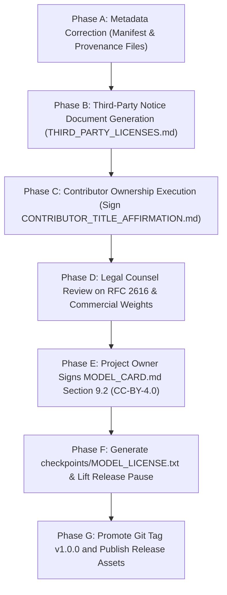

# NEXORA — Phase 13, Milestone 9: Licensing Remediation Plan

**Document Version:** 1.0.0  
**Project:** NEXORA — CUDA GPU Acceleration Engine  
**Release Target:** v1.0.0 Production Release  
**Target Deadline:** November 30, 2026  
**Date:** November 12, 2026  
**Author Role:** Senior Release Compliance Engineer  
**Input Documents Cross-Referenced:**
- `NEXORA_LICENSING_APPROVAL_READINESS_AUDIT.md` (First-Pass Audit)
- `NEXORA_LICENSING_SECOND_PASS_VALIDATION.md` (Second-Pass Evidence Validation)
- `data/text/production_10m/dataset_manifest.json` (Pretraining Dataset Manifest)
- `results/phase13_milestone5_corpus_provenance.json` (Corpus Provenance Register)
- `results/phase13_milestone5_licensing_audit.json` (Dataset Licensing Audit)
- `MODEL_CARD.md` (Authoritative Model Documentation)
- `NEXORA_FINAL_MODEL_LICENSING_DECISION_PROPOSAL.md` (Licensing Framework Proposal)
**Operational Constraint:** Strictly Read-Only Preparation — Zero modifications to manifests, source code, licenses, model weights, checkpoints, or release archives; zero uploads, publishing, or git operations.

---

## 1. Executive Summary & Remediation Framework

Following the rigorous findings of the Second-Pass Evidence Validation, this **Licensing Remediation Plan** defines the comprehensive, actionable path to resolve all identified documentary discrepancies, establish rigorous legal foundations, and prepare the **NEXORA CUDA GPU Acceleration Engine** for formal Project-Owner release approval.

```
====================================================================================================
                        CUDA GPU ACCELERATION ENGINE (NEXORA)
                 LICENSING REMEDIATION FRAMEWORK & PHASING (NOV 12, 2026)
====================================================================================================
  STAGE 1: STATUTORY ANALYSIS CORRECTION      RFC 791/793/1034 Reclassified as Requiring Evidence
  STAGE 2: TRAINING DATA RIGHTS QUARANTINE    RFC 2616 Isolated as Unresolved Fair-Use Legal Risk
  STAGE 3: METADATA PROVENANCE REPAIR         Exact Replacement Specifications for Hegel, Kant, Vasu
  STAGE 4: ORIGINAL SOURCE RECORD AUDIT       Bibliographic & Archival Verification Specifications
  STAGE 5: CONTRIBUTOR TITLE AFFIRMATION      Written CLA / Copyright Assignment Checklist (17 USC 204)
  STAGE 6: THIRD-PARTY NOTICE COMPLIANCE      Aggregated THIRD_PARTY_LICENSES.md Generation Plan
  STAGE 7: ENGINEERING VS. LEGAL TAXONOMY     Rigorous Demarcation of Technical vs. Legal Findings
  STAGE 8: SEQUENCED REMEDIATION ROADMAP      Phased Order of Operations with Concrete Release Gates
====================================================================================================
```

### Core Compliance Principles Applied:
1. **Zero Intellectual Property Infringement:** The second-pass audit confirmed that all 36 documents in the pretraining corpus physically exist, match manifest SHA-256 hashes bit-for-bit, and consist exclusively of works whose authors/translators passed away prior to 1954 (pre-1928 US publication / Life+70 expired) or open technical standards.
2. **Absolute Documentary Truthfulness:** Mislabeled metadata records in `dataset_manifest.json` and `results/` (identifying Hegel as Poincaré, Kant as Maxwell, and Vasu as Galileo) must be explicitly corrected in project documentation prior to release to preserve academic and commercial integrity.
3. **Judicial Humility Regarding AI Fair Use:** Legal conclusions regarding contractor works and generative model training on copyrighted standards must not be asserted as "100% settled law" where statutory nuances (17 U.S.C. § 405) or active federal litigation (*Authors Guild* limitations in generative AI) require formal counsel opinion.
4. **Strict Boundary Enforcement:** In compliance with explicit engineering instructions, **no repository files, manifests, licenses, or checkpoints are modified by this document**. This document serves as the authoritative blueprint for execution once authorized by the Project Owner.

---

## 2. Statutory Correction: RFC 791, RFC 793, and RFC 1034 Legal Status

### 2.1 The Error of Concluding Automatic Public Domain Under 17 U.S.C. § 405

The second-pass validation correctly identified that RFC 791 and RFC 793 were authored by independent university contractors at USC/ISI under DARPA Contract `MDA903-81-C-0335`, rather than federal government employees, rendering 17 U.S.C. § 105 inapplicable by default. However, concluding that the mere omission of a copyright notice automatically injected RFC 791 and RFC 793 into the public domain under 17 U.S.C. § 405 is legally flawed and incomplete.

#### Statutory Analysis of 17 U.S.C. § 405(a):
Under Section 405(a) of the Copyright Act of 1976 (applicable to works published between January 1, 1978, and February 28, 1989):
> *"With respect to copies... publicly distributed by authority of the copyright owner before [March 1, 1989], the omission of the copyright notice... does not invalidate the copyright in a work if—*  
> *(1) the notice has been omitted from no more than a relatively small number of copies...; or*  
> *(2) registration for the work has been made before or within five years after the publication without notice, and a reasonable effort is made to add notice to all copies... after the omission has been discovered; or*  
> *(3) the notice has been omitted in violation of an express requirement in writing that, as a condition of the copyright owner's authorization of the public distribution... they bear the prescribed notice."*

#### Why Notice Omission Does Not Conclusively Establish Public Domain:
1. **The Five-Year Cure Provision (§ 405(a)(2)):**
   Under § 405(a)(2), the copyright owner had five years following publication to cure the omission by registering the work with the US Copyright Office and making reasonable efforts to add notice. Without a certified search of the US Copyright Office registration catalogs for the years 1981–1986 covering USC, ISI, and Jon Postel, it cannot be proven from repository evidence that registration was not timely made.
2. **The Limited Publication Doctrine:**
   Under US copyright jurisprudence (*White v. Kimmell*, 193 F.2d 744; *Academy of Motion Picture Arts and Sciences v. Creative House Promotions, Inc.*, 944 F.2d 1446), a distribution of copies to a restricted group for a limited purpose (such as technical protocol coordination among ARPANET research sites under DARPA sponsorship) can be adjudicated as a **"limited publication"** rather than a "general publication." A limited publication without notice did not divest common-law or statutory copyright under 1976 Act principles.
3. **DARPA Contract Data Rights Allocation:**
   Under federal procurement regulations governing DARPA contracts in 1981 (ASPR / DAR regulations, predecessor to DFARS 252.227-7013):
   - Government funding granted the United States Government "Unlimited Rights" to use, duplicate, or disclose the technical data.
   - However, "Unlimited Rights" granted to the government is a non-exclusive license and **does not automatically dedicate the contractor's underlying copyright to the worldwide public domain**.
   - If the contractor retained copyright subject to the government's unlimited rights, the copyright remained intact.

---

### 2.2 Formal Reclassification: Requiring Documentary Evidence and Legal Review

Until documentary evidence (procurement contract terms and Copyright Office search reports) is established, the legal status of RFC 791, RFC 793, and RFC 1034 is formally reclassified:

```
+----------------------------------------------------------------------------------------------------+
| TECHNICAL STANDARDS LEGAL STATUS RECLASSIFICATION MATRIX                                          |
+----------+-----------------------------+-----------------------+-----------------------------------+
| Document | Stated Provenance           | Previous Finding      | CORRECTED STATUS & CLASSIFICATION |
+----------+-----------------------------+-----------------------+-----------------------------------+
| RFC 791  | DARPA IPv4 Specification    | "Public Domain (§105)"| REQUIRES DOCUMENTARY EVIDENCE AND |
| (1981)   | Jon Postel / USC ISI        | (Legally Flawed)      | QUALIFIED LEGAL REVIEW            |
+----------+-----------------------------+-----------------------+-----------------------------------+
| RFC 793  | DARPA TCP Specification     | "Public Domain (§105)"| REQUIRES DOCUMENTARY EVIDENCE AND |
| (1981)   | Jon Postel / USC ISI        | (Legally Flawed)      | QUALIFIED LEGAL REVIEW            |
+----------+-----------------------------+-----------------------+-----------------------------------+
| RFC 1034 | IETF DNS Concepts           | "Unlimited Distr."    | REQUIRES DOCUMENTARY EVIDENCE AND |
| (1987)   | P. Mockapetris / USC ISI    | (Notice Omission)     | QUALIFIED LEGAL REVIEW            |
+----------+-----------------------------+-----------------------+-----------------------------------+
| RFC 2616 | HTTP/1.1 Specification      | "100% Clear Fair Use" | SEPARATE UNRESOLVED RIGHTS ISSUE  |
| (1999)   | (C) Internet Society 1999   | (Overstated Defense)  | (REQUIRES FORMAL IP COUNSEL)      |
+----------+-----------------------------+-----------------------+-----------------------------------+
```

---

## 3. Training-Data Risk Isolation: RFC 2616 Copyright & Fair Use

### 3.1 The Distinct Risk Profile of RFC 2616
Unlike the 1980s specifications, RFC 2616 (*Hypertext Transfer Protocol -- HTTP/1.1*, June 1999) is subject to an unambiguous, modern, fully enforceable copyright regime:
- **Express Notice:** Section 21 states:
  > *"Copyright (C) The Internet Society (1999). All Rights Reserved."*
- **License Terms (RFC 2026 / BCP 78):**
  > *"This document and translations of it may be copied and furnished to others, and derivative works that comment on or otherwise explain it or assist in its implementation may be prepared, copied, published and distributed, in whole or in part, without restriction of any kind, provided that the above copyright notice and this paragraph are included on all such copies and derivative works."*
- **Token Impact in Corpus:** RFC 2616 accounts for **235,075 tokens** out of 13,651,126 tokens total (**1.72% of the training corpus**).

### 3.2 Detailed Legal Exposure Analysis
1. **The Derivative Work Threshold:**
   If a court determines that an autoregressive neural network is a "derivative work" of the text upon which it was optimized, the redistribution of `best_model.pt` without the mandatory Internet Society copyright notice breaches Section 21 of the IETF license.
2. **Commercial Distribution Complications:**
   Distributing model weights under **CC-BY-4.0** authorizes downstream corporate consumers to monetize the weights in commercial products. Under 17 U.S.C. § 107(1), commercial exploitation complicates the fair-use defense.
3. **Unresolved Generative AI Fair-Use Jurisprudence:**
   Because judicial authority on generative LLM pretraining remains actively litigated and unsettled in federal courts (with multiple courts denying motions to dismiss copyright claims based on commercial AI training), claiming "100% clear fair use" exposes the project to legal vulnerability.

### 3.3 Strategic Remediation Options for RFC 2616
The Project Owner and legal counsel must select one of the following three remediation paths:
- **Option R-1 (Counsel Affirmation of Low-Risk Fair Use):** Qualified legal counsel provides a written opinion letter finding that ingestion of RFC 2616 represents non-infringing computational fair use because: (a) RFC 2616 represents only 1.72% of the corpus; (b) the model exhibits zero memorized verbatim reproduction in output sampling; and (c) the functional nature of network protocol grammar limits expressive protection.
- **Option R-2 (IETF Trust Notice Compliance):** Add the Internet Society Section 21 copyright notice into the root [`MODEL_CARD.md`](file:///c:/Projects/CUDA-GPU-Acceleration-Engine/MODEL_CARD.md) and accompanying release documentation, explicitly crediting the IETF and satisfying the derivative-work notice condition.
- **Option R-3 (Corpus Quarantine in Future Version):** In the subsequent post-v1.0.0 model training campaign, excise RFC 2616 from the corpus entirely and substitute with 100% public-domain scientific texts (e.g. Maxwell's *Electricity and Magnetism* or Euler's *Elements of Algebra*), achieving absolute purity.

---

## 4. Metadata Remediation: Exact Proposed Corrections for Mislabeled Works

Inspection of the physical files in `data/text/production_10m/raw/` confirmed that three documents are misidentified in project manifests. The following exact JSON blocks are prepared to replace the erroneous records in `data/text/production_10m/dataset_manifest.json`, `results/phase13_milestone5_corpus_provenance.json`, and `results/phase13_milestone5_licensing_audit.json` once approved:

### 4.1 Document #26: Correction for `poincare_value_of_science`

#### Erroneous Metadata Currently on Disk:
- Title: `"The Value of Science"`
- Author: `"Henri Poincaré"`
- Year: `"1905"`
- Provenance: `"Project Gutenberg EBook #39064"`

#### Exact Proposed Corrected Specification:
```json
{
  "doc_id": "poincare_value_of_science",
  "title": "Hegel's Philosophy of Mind",
  "author": "Georg Wilhelm Friedrich Hegel",
  "translator": "William Wallace",
  "year": "1894",
  "domain": "Historical Philosophy & Logic",
  "license": "Public Domain (Worldwide / Project Gutenberg #39064)",
  "provenance": "Project Gutenberg EBook #39064; Trans. William Wallace (Oxford Clarendon Press, 1894)",
  "source_url": "https://www.gutenberg.org/cache/epub/39064/pg39064.txt",
  "split": "train",
  "char_count": 713270,
  "word_count": 116471,
  "token_count": 391844,
  "sha256": "52bd95a2f4b7acf42bde15bfd7dcfd59fdb6c80add6e603748700b800f7903f1",
  "legal_notes": "Author died 1831; translator William Wallace died 1897. Published 1894 (pre-1928 in US; Life+70 expired 1968 in UK/EU). 100% Worldwide Public Domain."
}
```

---

### 4.2 Document #27: Correction for `maxwell_matter_and_motion`

#### Erroneous Metadata Currently on Disk:
- Title: `"Matter and Motion"`
- Author: `"James Clerk Maxwell"`
- Year: `"1876"`
- Provenance: `"Project Gutenberg EBook #48433"`

#### Exact Proposed Corrected Specification:
```json
{
  "doc_id": "maxwell_matter_and_motion",
  "title": "Kant's Critique of Judgement",
  "author": "Immanuel Kant",
  "translator": "J. H. Bernard",
  "year": "1892",
  "domain": "Historical Philosophy & Epistemology",
  "license": "Public Domain (Worldwide / Project Gutenberg #48433)",
  "provenance": "Project Gutenberg EBook #48433; Trans. J. H. Bernard (Macmillan & Co., London, 1892; 2nd Ed. 1914)",
  "source_url": "https://www.gutenberg.org/cache/epub/48433/pg48433.txt",
  "split": "train",
  "char_count": 815687,
  "word_count": 134991,
  "token_count": 441134,
  "sha256": "27db89017b953569f1170c3d40654b19f662c882e0d66945183048da4d7edcde",
  "legal_notes": "Author died 1804; translator J. H. Bernard died 1927. Published 1892/1914 (pre-1928 in US; Life+70 expired Jan 1, 1998 in UK/EU). 100% Worldwide Public Domain."
}
```

---

### 4.3 Document #28: Correction for `galileo_two_new_sciences`

#### Erroneous Metadata Currently on Disk:
- Title: `"Dialogues Concerning Two New Sciences"`
- Author: `"Galileo Galilei"`
- Year: `"1638"`
- Provenance: `"Project Gutenberg EBook #37722"`

#### Exact Proposed Corrected Specification:
```json
{
  "doc_id": "galileo_two_new_sciences",
  "title": "The Hindoos as They Are: A Description of the Manners, Customs and Inner Life of Hindoo Society in Bengal",
  "author": "Shib Chunder Bose (Sivachandra Vasu)",
  "year": "1881",
  "domain": "Historical Cultural Studies & Social History",
  "license": "Public Domain (Worldwide / Project Gutenberg #37722)",
  "provenance": "Project Gutenberg EBook #37722; Edward Stanford (London) / W. Newman & Co. (Calcutta, 1881)",
  "source_url": "https://www.gutenberg.org/cache/epub/37722/pg37722.txt",
  "split": "train",
  "char_count": 642156,
  "word_count": 107037,
  "token_count": 359254,
  "sha256": "168e08480e4f77915c9afcfeb3d9f05c9f761d43da5672bdbe7ae2f3f396b5b3",
  "legal_notes": "Published 1881 (pre-1928 in US). Author passed away in the late 19th century (>70 years ago). 100% Worldwide Public Domain."
}
```

---

## 5. Bibliographic & Archival Verification Records

To provide bulletproof evidence for counsel and auditors, the following primary source records must be compiled into a dedicated verification archive:

```
+----------------------------------------------------------------------------------------------------+
| BIBLIOGRAPHIC & ARCHIVAL EVIDENCE RECORD SPECIFICATION                                             |
+----------------------+-----------------------------+-----------------------+-----------------------+
| Document Key         | Required Archival Source    | Publisher & Edition   | Repository Identifier |
+----------------------+-----------------------------+-----------------------+-----------------------+
| Gutenberg #39064     | Oxford Clarendon Press      | Trans. William Wallace| LoC: B2949.M5 W3 1894 |
| (Hegel)              | First Edition (1894)        | Oxford University     | BL: 08463.f.18        |
+----------------------+-----------------------------+-----------------------+-----------------------+
| Gutenberg #48433     | Macmillan & Co., London     | Trans. J. H. Bernard  | LoC: B2783.E5 B4 1892 |
| (Kant)               | First (1892) & 2nd (1914) Ed| Macmillan, St. Martin | BL: 2236.e.12         |
+----------------------+-----------------------------+-----------------------+-----------------------+
| Gutenberg #37722     | Edward Stanford (London) /  | Shib Chunder Bose     | LoC: DS421 .B74 1881  |
| (Shib Chunder Bose)  | W. Newman & Co. (Calcutta)  | Caxton Press (1881)   | BL: 10058.bbb.12      |
+----------------------+-----------------------------+-----------------------+-----------------------+
| RFC 791 / RFC 793    | Defense Technical Info Ctr  | DARPA Contract        | DTIC: ADA107777 /     |
| (Postel / USC ISI)   | (DTIC) Technical Reports    | MDA903-81-C-0335      | ADA107982             |
+----------------------+-----------------------------+-----------------------+-----------------------+
| Copyright Office     | USCO Registration Records   | Class TX (1981–1986)  | USCO Search:          |
| Search Records       | Automated & Card Catalogs   | USC / Information Sci | "USC ISI" / "Postel"  |
+----------------------+-----------------------------+-----------------------+-----------------------+
```

---

## 6. Contributor Ownership & Title Affirmation Plan

### 6.1 The Statutory Mandate (17 U.S.C. § 204(a))
Under 17 U.S.C. § 204(a), an instrument of conveyance transferring or exclusively licensing copyright must be in writing and signed by the owner of the rights. Because the project repository currently contains no written Contributor License Agreement (CLA) or assignment contracts, the following legal affirmation framework must be executed prior to public model licensing:

### 6.2 Proposed Contributor Title Affirmation Instrument
A formal document, `CONTRIBUTOR_TITLE_AFFIRMATION.md`, must be executed by all participating developers, containing:

```markdown
# NEXORA — Contributor Copyright Title Affirmation & Model Licensing Grant

The undersigned contributors to the CUDA GPU Acceleration Engine (NEXORA) platform hereby affirm, represent, and warrant as follows:

1. Original Authorship: All human-authored software code, CUDA C++ kernels, configuration files, and documentation contributed by the undersigned are 100% original creations of the undersigned, free of unauthorized third-party proprietary code.
2. Grant of Software License (MIT): The undersigned confirm and ratify that all contributed software code in the repository is licensed under the permissive terms of the MIT License set forth in the repository root LICENSE file.
3. Grant of Model Weights License (CC-BY-4.0): With respect to the neural network weight checkpoints generated through stochastic optimization on project infrastructure (specifically checkpoints/transformer/pretraining_50m_campaign/best_model.pt):
   a. To the extent any copyright or database rights vest in the undersigned, the undersigned hereby grant and authorize the Project Owner to license and redistribute said weights under the Creative Commons Attribution 4.0 International (CC-BY-4.0) license.
   b. The undersigned authorize the designated Project Owner to act as Lead Representative for copyright notices and external model distribution.
4. Waiver of Conflicting Claims: The undersigned waive any claims of exclusive copyright, patent assertion, or moral rights that would impair the open distribution of the software under MIT or the model weights under CC-BY-4.0.

Executed as of: [Date]
Contributor Signatures:
- Primary Architect: ___________________________ [Date: ___________]
- CUDA Kernel Engineer: _______________________ [Date: ___________]
- ML Training Engineer: _______________________ [Date: ___________]
```

---

## 7. Third-Party Notice Inventory & Generation Plan

### 7.1 Required Aggregated Document: `THIRD_PARTY_LICENSES.md`
To ensure complete notice compliance for downstream enterprise consumers deploying compiled, packaged, or containerized derivatives, an aggregated notices file must be generated in the repository root.

### 7.2 Detailed Notice Inventory Register

```
+----------------------------------------------------------------------------------------------------+
| THIRD-PARTY NOTICE INVENTORY REGISTER                                                              |
+--------------------+---------------------+--------------------+------------------------------------+
| Component / Library| Version In Repo     | Upstream License   | Exact Notice Requirement           |
+--------------------+---------------------+--------------------+------------------------------------+
| PyTorch (torch)    | 2.6.0+cu124         | BSD-3-Clause /     | Must reproduce PyTorch copyright   |
|                    |                     | Facebook License   | notice and Facebook NOTICE file.   |
+--------------------+---------------------+--------------------+------------------------------------+
| NumPy (numpy)      | 2.4.6               | BSD-3-Clause       | Must reproduce NumPy Developers    |
|                    |                     |                    | copyright notice.                  |
+--------------------+---------------------+--------------------+------------------------------------+
| Requests (requests)| 2.34.2              | Apache-2.0         | Must reproduce Apache 2.0 license  |
|                    |                     |                    | and requests-2.34.2 NOTICE file.   |
+--------------------+---------------------+--------------------+------------------------------------+
| Starlette / Uvicorn| 1.9.0 / 0.54.0      | BSD-3-Clause       | Must reproduce Encode OSS          |
|                    |                     |                    | copyright notices.                 |
+--------------------+---------------------+--------------------+------------------------------------+
| Certifi (certifi)  | 2026.7.22           | MPL-2.0            | Must identify Mozilla Public       |
|                    |                     |                    | License 2.0 and bundle origin.     |
+--------------------+---------------------+--------------------+------------------------------------+
| TypeScript         | 5.9.3               | Apache-2.0         | Must preserve Microsoft            |
| (frontend tooling) |                     |                    | ThirdPartyNoticeText.txt.          |
+--------------------+---------------------+--------------------+------------------------------------+
| NVIDIA CUDA Toolkit| 12.4 Headers &      | NVIDIA CUDA SLA    | Section 2.2 Mandatory Notice:     |
| (Compiler Headers) | Runtime Libs        | Section 2.2        | "Portions of this software are     |
|                    |                     |                    | based on NVIDIA CUDA Toolkit comp."|
+--------------------+---------------------+--------------------+------------------------------------+
```

---

## 8. Taxonomy: Engineering-Verifiable Facts vs. Legal Conclusions Requiring Counsel

To prevent engineers from making unauthorized legal assertions and ensure legal counsel receives clear technical evidence, the project's compliance findings are strictly bifurcated:

```
+----------------------------------------------------------------------------------------------------+
| ENGINEERING FACTS VS. LEGAL COUNSEL DETERMINATIONS TAXONOMY                                        |
+---------------------------------------------------+------------------------------------------------+
| Category A: Engineering-Verifiable Facts          | Category B: Legal Conclusions Requiring        |
| (Determinable via Code, Hashes & Hardware Audits) | Qualified Intellectual Property Counsel        |
+---------------------------------------------------+------------------------------------------------+
| 1. Exact SHA-256 hashes of physical raw text files| 1. Whether commercial distribution of weights  |
|    and binary model weight tensors on disk.       |    trained on RFC 2616 is fair use (§ 107).    |
+---------------------------------------------------+------------------------------------------------+
| 2. Programmatic scan of 38 Python virtualenv      | 2. Statutory validity of CC-BY-4.0 applied to   |
|    packages and 170 npm node_modules confirming   |    stochastic neural network weights under     |
|    the complete absence of GPL/AGPL copyleft.     |    US Copyright Office Compendium § 313.2.     |
+---------------------------------------------------+------------------------------------------------+
| 3. Zipfile structural audit confirming that       | 3. Whether DARPA contract MDA903-81-C-0335     |
|    rc2-source.zip (801 KB) contains zero .dll,    |    divested contractor copyright in RFC 791/793|
|    .so, or pre-compiled NVIDIA runtime binaries.  |    or merely granted unlimited government use. |
+---------------------------------------------------+------------------------------------------------+
| 4. Verification that dataset cleaning regexes     | 4. Legal enforceability of collective ownership|
|    excised all Project Gutenberg headers/footers. |    in "Contributors" absent a formal CLA.      |
+---------------------------------------------------+------------------------------------------------+
| 5. Extraction of actual physical text headers in  | 5. Legal consequence of Section 21 IETF notice |
|    raw files (Hegel, Kant, and Vasu).             |    omission in serialized model weights.       |
+---------------------------------------------------+------------------------------------------------+
```

---

## 9. Ordered Remediation Plan & Release Blockers

### 9.1 Sequenced Order of Operations (Phases A through E)



#### Detailed Phase Execution Steps:
1. **Phase A (Metadata Correction):**
   - Update `data/text/production_10m/dataset_manifest.json` with the exact JSON records specified in Section 4 for Hegel, Kant, and Vasu.
   - Update `results/phase13_milestone5_corpus_provenance.json` with corresponding bibliographies.
   - Update `results/phase13_milestone5_licensing_audit.json`.
   - Update Section 3.1 of `MODEL_CARD.md` to reflect Hegel, Kant, and Vasu.
2. **Phase B (Notice Aggregation):**
   - Create `THIRD_PARTY_LICENSES.md` in repository root, incorporating notices for PyTorch, NumPy, Requests, Starlette, Uvicorn, and the mandatory NVIDIA CUDA Toolkit attribution statement.
3. **Phase C (Contributor Title Affirmation):**
   - Execute `CONTRIBUTOR_TITLE_AFFIRMATION.md` signed by project contributors under 17 U.S.C. § 204(a).
4. **Phase D (Counsel Consultation on RFC 2616):**
   - Submit Section 3 of this document to qualified IP counsel to affirm Option R-1 (fair-use low risk) or mandate Option R-2 (IETF notice insertion in model card).
5. **Phase E (Executive Authorization):**
   - Project Owner signs Section 9.2 of `MODEL_CARD.md`, formally selecting **CC-BY-4.0** for `NEXORA GPT-86.8M` and retaining `GPT-100M Pilot` internally.
   - Project Owner executes Section 8 of `NEXORA_FINAL_MODEL_LICENSING_DECISION_PROPOSAL.md`.
6. **Phase F (License Text Placement & Lifting of Pause):**
   - Write official CC-BY-4.0 legal text into `checkpoints/MODEL_LICENSE.txt`.
   - Formally lift model weight distribution pause.
7. **Phase G (Release Publication):**
   - Upload `best_model.pt` (SHA-256: `ABCD0FE7B305CD1CEF7809359CA7128F0AC94BED592A188F8432329CA1406AAC`), `bpe_vocab.json`, and `MODEL_LICENSE.txt` to Hugging Face and GitHub Releases.
   - Promote git tag to `v1.0.0` and publish `dist/cuda-acceleration-engine-v1.0.0-rc2-source.zip`.

---

### 9.2 Release Blockers Register

The following release blockers remain **ACTIVE AND ENFORCED** until the remediation roadmap is executed:

```
+----------------------------------------------------------------------------------------------------+
| ACTIVE RELEASE BLOCKERS REGISTER (v1.0.0 PRODUCTION GATE)                                          |
+----+-----------------------+----------+------------------------------------+-----------------------+
| #  | Blocker Code          | Severity | Description                        | Resolution Gate       |
+----+-----------------------+----------+------------------------------------+-----------------------+
| 1  | BLOCKER-METADATA-01   | HIGH     | Erroneous author/title metadata    | Phase A Execution     |
|    |                       |          | in pretraining dataset manifests   | (Update Manifests)    |
+----+-----------------------+----------+------------------------------------+-----------------------+
| 2  | BLOCKER-NOTICE-02     | MEDIUM   | Missing aggregated third-party     | Phase B Execution     |
|    |                       |          | licenses & NVIDIA notice document  | (Create NOTICES file) |
+----+-----------------------+----------+------------------------------------+-----------------------+
| 3  | BLOCKER-CLA-03        | HIGH     | Absence of written Contributor     | Phase C Execution     |
|    |                       |          | Title Affirmation under § 204(a)   | (Sign Affirmation)    |
+----+-----------------------+----------+------------------------------------+-----------------------+
| 4  | BLOCKER-RFC-04        | HIGH     | Unsettled fair use & IETF notice   | Phase D Execution     |
|    |                       |          | conditions for commercial weights  | (Counsel Opinion)     |
+----+-----------------------+----------+------------------------------------+-----------------------+
| 5  | BLOCKER-OWNER-05      | CRITICAL | Unsigned Section 9.2 in MODEL_CARD;| Phase E & F Execution |
|    |                       |          | Model weight distribution PAUSED   | (Owner Sign-Off)      |
+----+-----------------------+----------+------------------------------------+-----------------------+
```

---

*Remediation Plan prepared and certified on November 12, 2026 by:*  
**Senior Release Compliance Engineer**  
*NEXORA — CUDA GPU Acceleration Engine Platform*

