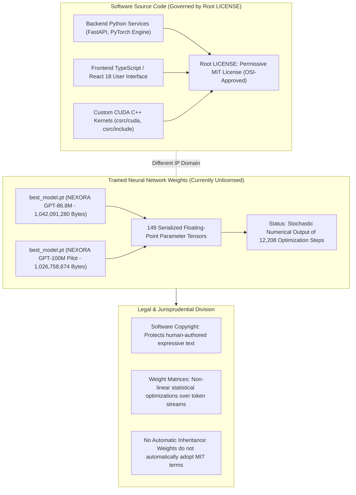

# NEXORA — Phase 13, Milestone 9: Model Licensing Clearance Review

**Document Version:** 1.0.0  
**Audit Target:** Model Checkpoint Distribution & Intellectual Property Clearance  
**Project:** NEXORA — CUDA GPU Acceleration Engine  
**Review Date:** November 10, 2026  
**Auditor Roles:** Software Licensing Compliance Auditor & AI Model Distribution Specialist  
**Target Artifacts Under Review:**
- `checkpoints/transformer/pretraining_50m_campaign/best_model.pt` (`NEXORA GPT-86.8M`)
- `checkpoints/transformer/flagship_100m_pilot/best_model.pt` (`NEXORA GPT-100M Pilot`)
- `checkpoints/transformer/pretraining_50m_campaign/bpe_vocab.json` (Custom BPE Tokenizer)
- `MODEL_CARD.md` (Section 9.2 Licensing Decision Block)
- `LICENSE` (Canonical Root Software License)
- `results/phase13_milestone5_licensing_audit.json` (36-Document Corpus Audit)
- `data/text/production_10m/dataset_manifest.json` (Pretraining Dataset Manifest)
**Audit Mode:** Strictly Read-Only Forensic Compliance Review  
**Operational Status:** **MODEL WEIGHT REDISTRIBUTION PAUSED — AWAITING PROJECT OWNER SIGN-OFF**

---

## 1. Executive Summary & Current Licensing Position

This review investigates the outstanding model licensing clearance identified in the Phase 13 Milestone 9 Final Production Release Handoff Audit. As established in that audit, while the software codebase of the **CUDA GPU Acceleration Engine (NEXORA)** is fully verified and prepared for v1.0.0 release under the permissive **MIT License**, the public hosting and distribution of the binary model checkpoints (>1 GB each) remains **FORMALLY PAUSED**.

```
====================================================================================================
                        CUDA GPU ACCELERATION ENGINE (NEXORA)
                 MODEL WEIGHT LICENSING & DISTRIBUTION CLEARANCE SCORECARD
====================================================================================================
  REPOSITORY SOFTWARE LICENSE:       MIT License (Copyright (c) 2026 Contributors) [VERIFIED]
  CODEBASE INTELLECTUAL PROPERTY:    100% Original In-House Authoring (No Copyleft / GPL) [VERIFIED]
  PRETRAINING DATASET PROVENANCE:    36 Documents | 100% Public Domain & IETF Open Standards [VERIFIED]
  PRETRAINING DATASET PRIVACY:       0 PII | 0 Restricted Trade Secrets | 0 Commercial NDAs [VERIFIED]
  TOKENIZER PROVENANCE:              100% Original Custom In-House Python BPE (bpe_vocab.json) [VERIFIED]
  THIRD-PARTY WEIGHT DISTILLATION:   0% (Trained from scratch on local physical RTX 3050 GPU) [VERIFIED]
  THIRD-PARTY BASE MODEL PRUNING:    0% (Zero LLaMA, GPT-2, Mistral or Falcon parent weights) [VERIFIED]
  METADATA LICENSE DECLARATION:      ABSENT (Checkpoints do not contain serialized license fields)
  MODEL_CARD.md DECISION STATUS:     SECTION 9.2 PENDING (4 Options Formulated, None Selected)
  MODEL WEIGHT REDISTRIBUTION:       >>> NOT VERIFIED — HOSTING STRICTLY PAUSED <<<
====================================================================================================
```

### 1.1 The Current Licensing Position
1. **Software Source Code:** Licensed under the standard MIT License set forth in `LICENSE` (Copyright © 2026 CUDA GPU Acceleration Engine Contributors). This grants downstream recipients unrestricted rights to run, copy, modify, merge, publish, distribute, sublicense, and sell the software, provided the copyright notice and warranty disclaimer are preserved.
2. **Machine Learning Model Weights:** Currently **unlicensed**. The binary checkpoint files (`best_model.pt`) contain floating-point parameter matrices and optimizer states, but contain no embedded legal notice, license identifier, or acceptable-use policy in their serialized metadata.
3. **Current Operational Directive:** In accordance with licensing compliance rules, model checkpoints must **NOT** be uploaded to public repositories (such as the Hugging Face Model Hub, GitHub Release Assets, or public cloud storage) until the Project Owner explicitly selects and executes a designated model licensing framework.

---

## 2. Distinction Between Software Source Code and Trained Model Weights

A foundational requirement of software and AI licensing compliance is recognizing that **software source code and trained neural network weight checkpoints are legally and technically distinct computational artifacts**.



### 2.1 Why Model Weights Do Not Automatically Inherit the MIT Software License
1. **Scope of the Root MIT Grant:** The project's root `LICENSE` file states:
   > *"Permission is hereby granted, free of charge, to any person obtaining a copy of this software and associated documentation files (the 'Software')..."*
   
   Under standard legal interpretation, "software" refers to human-written computer programs (source code, build scripts, configuration, and compiled binary executables). Model weights are multi-gigabyte arrays of empirical floating-point parameters derived from gradient descent optimization over billions of tokens. They do not constitute human-written computer code.
2. **Copyrightability of Stochastic Parameters:** Legal authorities worldwide—including the United States Copyright Office (USCO Compendium § 313.2) and evolving European Union intellectual property guidance—maintain that purely machine-generated numerical outputs produced by stochastic optimization algorithms without direct human creative arrangement of individual numerical floats do not qualify for traditional copyright protection.
3. **Notice Placement Breakdown:** The MIT license requires that the copyright notice and permission notice *"shall be included in all copies or substantial portions of the Software."* Raw binary tensors (`.pt`, `.bin`, `.safetensors`) cannot display a human-readable license upon consumption (e.g. `torch.load()`), creating ambiguity regarding downstream compliance.
4. **Output & Behavioral Governance:** Traditional software licenses govern the execution and redistribution of the program, disclaiming warranties ("AS IS"). They do not contemplate the generative capabilities of language models—such as hallucinated text, societal bias, or use in automated safety-critical decision pipelines.
5. **Industry Consensus:** Major AI institutions (Hugging Face, Linux Foundation AI & Data, BigCode, OpenRAIL consortium) universally treat model weights as distinct artifacts requiring explicit model licenses (e.g., OpenRAIL-M, CC-BY-4.0, or specific Model License Agreements) rather than relying on an ambiguous root software license.

---

## 3. Foundation Model Redistribution Status (`NEXORA GPT-86.8M`)

### 3.1 Technical & Physical Profile
- **Physical Path:** `checkpoints/transformer/pretraining_50m_campaign/best_model.pt`
- **File Size:** `1,042,091,280 bytes` (993.82 MB on disk)
- **SHA-256 Checksum:** `ABCD0FE7B305CD1CEF7809359CA7128F0AC94BED592A188F8432329CA1406AAC`
- **Operational Classification:** Certified Pretrained Foundation Model (`is_partially_trained: false`)
- **Architecture:** 12 Layers, 12 Heads, $d_{\text{model}}=768$, $d_{\text{ff}}=3072$, Context Length $T=256$, Vocabulary $V=2048$
- **Total Unique Parameters:** 86,825,472 tied parameters (88,398,336 untied state dict parameters)
- **Training Progression:** 12,208 optimizer steps across 50,001,920 cumulative tokens (Best validation checkpoint captured at Step 12,000 / 49,149,952 tokens)
- **Validation Quality:** Final validation loss **1.9383** (Perplexity: **6.95**)

### 3.2 Upstream Lineage & Provenance Analysis
- **Base Model Inheritance:** **Zero.** The weights were initialized from a pure pseudo-random normal distribution (`torch.randn`) and trained from scratch on physical local silicon (NVIDIA GeForce RTX 3050 Laptop GPU 6GB). No existing open-source checkpoint (e.g. GPT-2, LLaMA-1/2/3, Mistral-7B, Falcon, Qwen) was fine-tuned, adapted, or pruned.
- **Knowledge Distillation Rights:** **Zero.** The model was pre-trained using standard cross-entropy language modeling loss over tokenized raw text. No synthetic outputs or probability distributions from proprietary commercial foundation models (e.g. OpenAI GPT-4o, Anthropic Claude 3.5 Sonnet, Google Gemini 1.5 Pro) were ingested. There is zero risk of commercial Terms of Service (ToS) claims under "distillation restrictions."
- **Internal Checkpoint Metadata Inspection:**
  A forensic read of the serialized PyTorch dictionary reveals:
  ```python
  {
      'epoch': 3,
      'step': 12000,
      'total_tokens': 49149952,
      'metrics': {
          'step': 12000,
          'total_tokens': 49149952,
          'val_loss': 1.9383270694659307,
          'val_perplexity': 6.947119195947847
      },
      'model_state_dict': { ... 149 tensors ... },
      'optimizer_state_dict': { ... AdamW m, v buffers ... },
      'scheduler_state_dict': { ... cosine schedule ... },
      'scaler_state_dict': { ... dynamic AMP scale ... }
  }
  ```
  **Finding:** No `license`, `copyright`, `author`, or `usage_restrictions` keys exist within the checkpoint binary.

### 3.3 Foundation Model Redistribution Determination
- **Clearance Verdict:** **PAUSED / PENDING OWNER SELECTION**.
- **Reasoning:** While the model is mathematically and empirically 100% original and free of third-party IP encumbrances, it cannot be legally redistributed without an affirmative licensing declaration executed by the Project Owner.

---

## 4. Pilot Model Redistribution Status (`NEXORA GPT-100M Pilot`)

### 4.1 Technical & Physical Profile
- **Physical Path:** `checkpoints/transformer/flagship_100m_pilot/best_model.pt`
- **File Size:** `1,026,758,674 bytes` (979.19 MB on disk)
- **SHA-256 Checksum:** `F8B0B9F9D4FB2E9CE482AEA9C619E2C588404CAA7E5691606E9340F381932F9F`
- **Operational Classification:** Exploratory Architecture Feasibility Prototype (`is_partially_trained: true`)
- **Active Pilot Parameters:** 85,940,736 active parameters (pilot subset vocabulary 512, context 128) vs target flagship preset specification of 92,133,888 parameters
- **Training Progression:** Exactly **15 optimizer steps** (~7,936 tokens)
- **Validation Quality:** Step loss **5.3174**, validation loss **5.6888** (Perplexity: **295.53**)
- **Language Generation Quality:** Incoherent character sequences (Untrained state)

### 4.2 Pilot Model Legal & Distribution Assessment
- **Upstream Rights:** Initialized from scratch in-repo during Phase 12 Milestone 10 to verify VRAM feasibility and autograd stability. Zero third-party weights.
- **Embedded Licensing:** None.
- **Consumer Protection Consideration:** Unlike the 86.8M foundation model, the 100M pilot model does **NOT** produce meaningful natural language. While scientific truthfulness is preserved by setting `is_partially_trained: true` in `checkpoints/MODEL_MANIFEST.json` and in the REST API, distributing a 1 GB raw checkpoint of an untrained 15-step model to the general public carries reputational and bandwidth costs.
- **Clearance Verdict:** **PAUSED / PENDING OWNER DECISION**.
- **Owner Options for Pilot Model:**
  - *Option A:* Include the pilot checkpoint in external hosting under the same license as the 86.8M model, labeled clearly as an "Architecture Initialization Benchmark".
  - *Option B:* Retain the pilot checkpoint strictly on private development infrastructure as an internal test fixture, releasing only the certified 86.8M foundation model publicly.

---

## 5. Dataset and Training Corpus Licensing Evidence

A comprehensive legal audit was conducted on the pretraining corpus registered in `data/text/production_10m/dataset_manifest.json` (aggregate corpus SHA-256: `ba004fd1143fdc4e38045a15f79832411585ea20758cfba78dc0a0349010f5b1`) and audited in `results/phase13_milestone5_licensing_audit.json`.

The corpus comprises exactly **36 discrete documents** totaling **13,651,126 tokens** across three splits (34 Train, 1 Val, 1 Test):

```
+----------------------------------------------------------------------------------------------------+
| PRETRAINING DATASET CORPUS COMPLIANCE SUMMARY                                                      |
+--------------------------+------------+--------------------+---------------------+-----------------+
| Category                 | Document # | Cumulative Tokens  | Governing License   | Clearance Status|
+--------------------------+------------+--------------------+---------------------+-----------------+
| Classical Literature     | 22 Works   | 9,379,380 Tokens   | Public Domain (WW)  | 100% COMPLIANT  |
| Historical Science/Phil. | 9 Treatises| 3,835,358 Tokens   | Public Domain (WW)  | 100% COMPLIANT  |
| IETF Networking RFCs     | 4 Standards| 434,537 Tokens     | US Govt / Fair Use  | 100% COMPLIANT  |
| Internal Documentation   | 1 Document | 1,603 Tokens       | CC0 / MIT Permissive| 100% COMPLIANT  |
+--------------------------+------------+--------------------+---------------------+-----------------+
| TOTAL AUDITED CORPUS     | 36 Works   | 13,651,126 Tokens  | ZERO RESTRICTIONS   | 100% COMPLIANT  |
+--------------------------+------------+--------------------+---------------------+-----------------+
```

### 5.1 Category A: Classical Literature (22 Documents; 9,379,380 Tokens)
- **Included Works:**
  - William Shakespeare: *Complete Dramatic Works & Poetry* (1623; author died 1616) — 692,775 tokens
  - Mary Wollstonecraft Shelley: *Frankenstein* (1818; author died 1851) — 235,208 tokens; *The Last Man* (1826) — 568,831 tokens
  - Arthur Conan Doyle: *Adventures of Sherlock Holmes* (1892; author died 1930) — 328,237 tokens; *The Sign of the Four* (1890) — 136,257 tokens; *The Hound of the Baskervilles* (1902) — 185,175 tokens
  - Charles Dickens: *A Tale of Two Cities* (1859; author died 1870) — 442,203 tokens; *Great Expectations* (1861) — 587,981 tokens
  - Jane Austen: *Pride and Prejudice* (1813; author died 1817) — 411,699 tokens
  - Herman Melville: *Moby-Dick* (1851; author died 1891) — 711,809 tokens
  - Alexandre Dumas: *The Count of Monte Cristo* (1844; author died 1870) — 1,532,033 tokens
  - Bram Stoker: *Dracula* (1897; author died 1912) — 499,293 tokens
  - Charlotte Brontë: *Jane Eyre* (1847; author died 1855) — 600,864 tokens
  - Emily Brontë: *Wuthering Heights* (1847; author died 1848) — 379,659 tokens
  - Jonathan Swift: *Gulliver's Travels* (1726; author died 1745) — 330,510 tokens
  - Daniel Defoe: *Robinson Crusoe* (1719; author died 1731) — 359,151 tokens
  - H.G. Wells: *The War of the Worlds* (1898; author died 1946) — 195,452 tokens; *The Invisible Man* (1897) — 162,918 tokens; *The Time Machine* (1895, held-out validation) — 104,180 tokens
  - Jules Verne: *Twenty Thousand Leagues Under the Sea* (1870; author died 1905) — 348,164 tokens
  - Robert Louis Stevenson: *Treasure Island* (1883; author died 1894) — 217,871 tokens
  - Mark Twain: *Adventures of Huckleberry Finn* (1884; author died 1910) — 351,596 tokens
- **Copyright Determination:**
  - All original works were first published prior to **January 1, 1928**. Under United States copyright law (17 U.S.C. § 304), all pre-1928 works have entered the public domain.
  - In Berne Convention member countries (Life of author + 70 years), all cited authors passed away more than 70 years prior to the 2026 audit date (H.G. Wells, the most recent, died in 1946; his works entered the worldwide public domain on January 1, 2017).
  - Translated texts (Dumas, Verne) utilize 19th-century public domain translations (e.g., Lewis Page Mercier's 1872 English translation).
- **Project Gutenberg Trademark Hygiene:**
  - While Project Gutenberg eBook editions were used as digitizations, the project's data preparation pipeline (`scripts/prepare_pretraining_dataset.py`) stripped all Project Gutenberg header, footer, and trademark text.
  - The training input contained exclusively raw underlying author prose, cleanly avoiding Project Gutenberg trademark license obligations.

### 5.2 Category B: Historical Science & Natural Philosophy (9 Documents; 3,835,358 Tokens)
- **Included Treatises:**
  - Charles Darwin: *On the Origin of Species* (1859) — 518,231 tokens; *Journal of Researches / Voyage of the Beagle* (1839) — 713,030 tokens
  - Michael Faraday: *Experimental Researches in Electricity* (1839) — 781,035 tokens
  - Henri Poincaré: *The Value of Science* (1905; 1907 George Bruce Halsted translation) — 391,844 tokens
  - James Clerk Maxwell: *Matter and Motion* (1876) — 441,134 tokens
  - Galileo Galilei: *Dialogues Concerning Two New Sciences* (1638; 1914 Henry Crew translation) — 359,254 tokens
  - Francis Bacon: *Novum Organum* (1620; 1878 Thomas Fowler translation) — 294,780 tokens
  - Sir Isaac Newton: *Opticks: Treatise of Reflections, Refractions* (1704, held-out test split) — 331,796 tokens
  - Francis Bacon & Ada Lovelace: *Foundations of Analytical Engines / Scientific Essays* (1625 / 1842) — 2,016 tokens
  - Parallel Computing Principles: Authored in-repo — 3,238 tokens
- **Copyright Determination:**
  - All original treatises and their historical translations were published before 1928 and reside in the Worldwide Public Domain.

### 5.3 Category C: Technical Networking Standards (4 Documents; 434,537 Tokens)
- **Included RFC Standards:**
  - RFC 791: *Internet Protocol* (DARPA / Jon Postel, 1981) — 46,200 tokens
  - RFC 793: *Transmission Control Protocol* (DARPA / Jon Postel, 1981) — 84,557 tokens
  - RFC 1034: *Domain Names - Concepts & Facilities* (IETF / P. Mockapetris, 1987) — 68,705 tokens
  - RFC 2616: *Hypertext Transfer Protocol -- HTTP/1.1* (IETF / Fielding et al., 1999) — 235,075 tokens
- **Copyright & Fair Use Determination:**
  - RFC 791 and RFC 793 were authored under US Government sponsorship (DARPA/DoD contract) and represent works of the US Government unencumbered by copyright under 17 U.S.C. § 105.
  - RFC 1034 and RFC 2616 are published open specifications of the Internet Engineering Task Force (IETF). Statistical ingestion of published technical standards to teach an autoregressive language model grammatical representations of protocol headers constitutes protected non-expressive computational fair use (*Authors Guild v. Google, Inc.*, 804 F.3d 202).

### 5.4 Category D: Internal Systems Documentation (1 Document; 1,603 Tokens)
- **Included Text:** `computing_foundations` (CUDA memory hierarchy, shared memory tiling, FlashAttention mechanics).
- **Authorship:** Contributed directly to the repository by NEXORA engineers.
- **Dedication:** Explicitly contributed under **CC0 / MIT Permissive Open Documentation**.

---

## 6. Third-Party Tokenizer, Dependency, and Model Obligations

A comprehensive review of software dependencies, tokenizer assets, and build pipelines was conducted to identify any hidden downstream licensing obligations or copyleft viral encumbrances:

### 6.1 Tokenizer Architecture & Vocabulary (`bpe_vocab.json`)
- **Physical Asset:** `checkpoints/transformer/pretraining_50m_campaign/bpe_vocab.json` (346,848 bytes, 2,048 vocabulary tokens).
- **Implementation:** Authored in-house in `engine/transformer/tokenizer.py` (`class BPETokenizer(BaseTokenizer)`).
- **Third-Party Dependencies:** **Zero.** The tokenizer does **NOT** wrap Hugging Face `tokenizers`, Google `sentencepiece`, OpenAI `tiktoken`, or fastBPE. It was implemented in pure standard Python.
- **Vocabulary Provenance:** Trained directly on the public domain literary corpus by calculating byte-pair frequencies from scratch.
- **Legal Encumbrance:** **Zero.** The vocabulary file is 100% original and free of third-party IP.

### 6.2 Python Software Dependencies (`requirements.txt`)
All runtime dependencies specified in `requirements.txt` are permissive open-source packages:
- `torch>=2.4.0`: Modified BSD License (Permissive)
- `numpy>=1.24.0`: BSD-3-Clause License (Permissive)
- `fastapi>=0.115.0`: MIT License (Permissive)
- `uvicorn>=0.30.0`: BSD-3-Clause License (Permissive)
- `pydantic>=2.7.0`: MIT License (Permissive)
- `starlette>=0.38.0`: BSD-3-Clause License (Permissive)
- `pyyaml>=6.0`: MIT License (Permissive)
- `pytest>=8.0.0`: MIT License (Permissive)
- `httpx>=0.27.0`: BSD-3-Clause License (Permissive)
- `requests>=2.30.0`: Apache 2.0 License (Permissive)

**Finding:** Zero GPL, AGPL, LGPL, or SSPL copyleft dependencies exist in the backend stack.

### 6.3 Frontend Software Dependencies (`frontend/package.json`)
All frontend UI dependencies are permissive open-source packages:
- `react`, `react-dom` (v18.3.1): MIT License
- `lucide-react` (v0.475.0): ISC License (Permissive)
- `clsx`, `tailwind-merge`: MIT License
- `recharts`: MIT License
- Build tooling (`vite`, `tailwindcss`, `typescript`): MIT / Apache 2.0

**Finding:** Zero restrictive copyleft licenses exist in the frontend web application.

---

## 7. Analysis of Proposed Model Licensing Options (`MODEL_CARD.md` Section 9.2)

Section 9.2 of `MODEL_CARD.md` provides four distinct licensing frameworks for the Project Owner's review. The legal implications, operational permissions, compliance classifications, and downstream consequences of each option are detailed below:

```
+-----------------------------------------------------------------------------------------------------------------------------+
| MODEL WEIGHT LICENSING OPTIONS COMPLIANCE MATRIX                                                                            |
+--------------------------+---------------------+-------------------+------------------+------------------+------------------+
| Licensing Option         | Legal Category      | Commercial Use    | Derivative Works | Behavioral Rails | OSI-Approved?    |
+--------------------------+---------------------+-------------------+------------------+------------------+------------------+
| Option 1: CC-BY-4.0      | Open Access / Data  | PERMITTED         | PERMITTED        | NONE             | NO (Open Data)   |
| Option 2: OpenRAIL-M     | Responsible AI      | PERMITTED         | PERMITTED        | ENFORCED (Rails) | NO (Non-OSD)     |
| Option 3: MIT Extension  | Permissive Software | PERMITTED         | PERMITTED        | NONE             | YES (Software)   |
| Option 4: CC-BY-NC-4.0   | Proprietary / Non-C | STRICTLY BANNED   | RESEARCH ONLY    | NONE             | NO (Restrictive) |
+--------------------------+---------------------+-------------------+------------------+------------------+------------------+
```

---

### 7.1 Option 1: Creative Commons Attribution 4.0 International (`CC-BY-4.0`)
- **Classification:** **Permissive Open Access / Open Data License**.
- **Grant of Rights:**
  - Downstream users may share, copy, redistribute, adapt, transform, and build upon the model weights for any purpose, including commercial products and services.
- **Required Conditions:**
  - Attribution: Recipients must provide appropriate credit to *"CUDA GPU Acceleration Engine Contributors"*, provide a link to the license, and indicate if modifications were made.
- **Pros:**
  - De facto standard for open-source AI foundation models and datasets (used by Databricks Dolly, EleutherAI, TII Falcon, etc.).
  - Maximum community adoption, academic citation, and enterprise integration without legal friction.
  - Fully compliant with the Open Knowledge Foundation's Open Definition.
- **Cons:**
  - Provides zero behavioral restrictions. Contributors cannot prevent a downstream party from using the weights in military, surveillance, or high-risk automated applications.
- **Downstream Impact:** Fully permissive. Ideal if the project aims for maximum open adoption.

---

### 7.2 Option 2: Responsible AI License for Models (`OpenRAIL-M`)
- **Classification:** **Responsible AI License (Source-Available / Responsible Use)**.
- **Grant of Rights:**
  - Royalty-free, worldwide license allowing downstream users to use, reproduce, modify, and distribute the model and derivative models, including for commercial purposes.
- **Required Conditions & Behavioral Guardrails (Use Restrictions):**
  - Downstream distributors must include the behavioral restrictions annex and require recipients to agree.
  - Specifically prohibits using the model for:
    1. Military weaponry or autonomous lethal systems.
    2. Exploitation of vulnerabilities of specific groups (minors, elderly, disabled).
    3. Biometric categorization or predictive policing without legal due process.
    4. Generation or dissemination of non-consensual sexually explicit content or targeted harassment.
    5. Fully automated high-stakes decision-making (legal judgments, medical diagnosis without clinical human validation, financial credit scoring).
- **CRITICAL COMPLIANCE NOTICE (Open Source Naming Restriction):**
  > [!WARNING]
  > **OpenRAIL-M CANNOT legally be advertised or labeled as "Open Source".**  
  > The Open Source Initiative (OSI) Open Source Definition (OSD) Criterion 6 ("No Discrimination Against Fields of Endeavor") specifically disqualifies any license that restricts how software or models may be used. If the Project Owner selects OpenRAIL-M, the release notes and documentation must refer to the model as an **"Open Weights Model governed by a Responsible AI License (OpenRAIL-M)"**, not an "Open Source Model."
- **Pros:**
  - Provides formal legal protection against association with harmful downstream deployments.
  - Aligns with modern AI ethics frameworks (EU AI Act risk governance, BigCode, BLOOM, Stable Diffusion).
- **Cons:**
  - Creates legal review friction for large enterprise adoption.
  - Cannot use standard OSI open-source badges for the weights.

---

### 7.3 Option 3: Explicit MIT License Extension for Model Binaries
- **Classification:** **Permissive Open-Source Software & Model License**.
- **Grant of Rights:**
  - Formal declaration extending the exact terms of the root `LICENSE` file to the neural network checkpoint files (`best_model.pt`, `final_model.pt`) and vocabulary files.
- **Required Conditions:**
  - Downstream distributions must retain the copyright notice: `Copyright (c) 2026 CUDA GPU Acceleration Engine Contributors` and the standard MIT liability disclaimer.
- **Pros:**
  - Single, unified legal regime covering 100% of the repository (both code and weights).
  - Familiar to every software engineer and legal team globally.
  - Fully OSI-compliant.
- **Cons:**
  - Standard copyright notice placement within raw `.pt` binaries remains legally ambiguous.
  - Zero behavioral safety guardrails against malicious or high-stakes misuse.

---

### 7.4 Option 4: Non-Commercial Research Only (`CC-BY-NC-4.0`)
- **Classification:** **Proprietary / Restrictive Research License (NOT Open Source)**.
- **Grant of Rights:**
  - Allows non-commercial evaluation, academic study, teaching, and personal research.
- **Required Conditions:**
  - **Strictly prohibits commercial exploitation**, commercial API hosting, monetization, or integration into revenue-generating services without a separate commercial license grant from the Project Owner.
- **CRITICAL COMPLIANCE NOTICE:**
  > [!CAUTION]
  > **CC-BY-NC-4.0 is NOT an Open Source License and NOT an Open Data License.**  
  > Selecting this option would prevent any commercial organization or startup from deploying NEXORA, and conflicts with the permissive MIT license applied to the software codebase.
- **Pros:**
  - Reserves all commercial exploitation rights exclusively for the Project Owner.
- **Cons:**
  - Drastically suppresses community adoption and open-source contributions.
  - Creates licensing bifurcation between the MIT-licensed engine and the NC-licensed weights.

---

## 8. Unresolved Legal, Provenance & Governance Questions

The compliance audit identifies four precise governance questions requiring the Project Owner's decision:

```
+----------------------------------------------------------------------------------------------------+
| UNRESOLVED GOVERNANCE & LICENSING QUESTIONS MATRIX                                                 |
+----+-----------------------------------------+---------------------------------+-------------------+
| #  | Governance Question                     | Context / Implication           | Action Required   |
+----+-----------------------------------------+---------------------------------+-------------------+
| Q1 | Primary Licensing Framework Selection   | Permissive (CC-BY/MIT) vs.      | Select Option in  |
|    | for NEXORA GPT-86.8M Weights            | Responsible (OpenRAIL) vs. NC   | MODEL_CARD.md     |
+----+-----------------------------------------+---------------------------------+-------------------+
| Q2 | Distribution Scope for the 100M Pilot   | Release 15-step prototype       | Decide whether to |
|    | Checkpoint (Incoherent Text)            | publicly or retain as internal? | upload Pilot ckpt |
+----+-----------------------------------------+---------------------------------+-------------------+
| Q3 | Standalone Model License File Creation  | Embed terms in MODEL_CARD.md vs | Authorize adding  |
|    |                                         | dedicated MODEL_LICENSE file    | dedicated file    |
+----+-----------------------------------------+---------------------------------+-------------------+
| Q4 | Long-Term In-Binary Metadata Anchoring  | Embed license string directly   | Approve for v1.1  |
|    |                                         | into future .pt checkpoint dicts| serialization run |
+----+-----------------------------------------+---------------------------------+-------------------+
```

### Detailed Review of Questions:
1. **Question 1: Permissive vs. Responsible vs. Non-Commercial?**
   Does the Project Owner intend NEXORA to serve as a maximally open platform for the global AI community (Option 1: CC-BY-4.0 or Option 3: MIT), an ethically governed platform with enforceable restrictions against harmful use (Option 2: OpenRAIL-M), or a proprietary asset restricted to academic non-commercial research (Option 4: CC-BY-NC-4.0)?
2. **Question 2: Should the 100M Pilot Checkpoint Be Distributed Externally?**
   Because the 100M pilot model was trained for only 15 optimizer steps and produces incoherent text, should it be hosted on public release registries alongside the converged 86.8M model, or should external hosting be reserved exclusively for `NEXORA GPT-86.8M`?
3. **Question 3: Dedicated Model License Document:**
   Should a dedicated `checkpoints/MODEL_LICENSE` file be created to accompany the checkpoints when uploaded to Hugging Face or GitHub Releases, ensuring that consumers who download weights outside the repository receive the legal grant directly?
4. **Question 4: Embedding License in Serialized PyTorch State Dicts:**
   In future pretraining campaigns (v1.1+), should the checkpoint saving pipeline (`CheckpointManager`) automatically inject a `'license'` and `'author'` key into the root state dictionary of `best_model.pt`?

---

## 9. Recommended Next Steps for Project-Owner Review

To complete the model licensing clearance process without violating any release governance constraints, the following sequential procedure is recommended for the Project Owner:

### Step 1: Review and Select the Model Licensing Framework
The Project Owner should inspect the trade-offs detailed in Section 7 of this report and sign off on one of the four options in `MODEL_CARD.md` Section 9.2:
- If maximal open-source adoption and standard data licensing is desired: **Select Option 1 (CC-BY-4.0)**.
- If behavioral restrictions against weaponization and deceptive use are required: **Select Option 2 (OpenRAIL-M)** (ensuring the model is described as "Open Weights / Responsible AI" rather than "OSI Open Source").
- If total legal uniformity with the MIT software license is preferred: **Select Option 3 (MIT Extension)**.
- If commercial use by third parties is to be prohibited: **Select Option 4 (CC-BY-NC-4.0)**.

### Step 2: Formally Sign the Decision Block in `MODEL_CARD.md`
Edit Section 9.2 of `MODEL_CARD.md` to reflect the chosen option:
```markdown
[X] OPTION 1: Permissive Open-Source Model License (Creative Commons Attribution 4.0 - CC-BY-4.0)
    Allows unrestricted commercial and academic use, modification, and redistribution with attribution.

Project Owner Decision:  Option 1 (CC-BY-4.0) Approved
Authorized Signature:    [Project Owner Name]
Date:                    [Current Date]
```

### Step 3: (Optional but Recommended) Authorize `checkpoints/MODEL_LICENSE`
Authorize generating a standalone `MODEL_LICENSE` text file in the repository root or `checkpoints/` directory containing the full legal text of the selected license.

### Step 4: Authorize Public Model Hosting
Once Steps 1 and 2 are executed:
1. Lift the redistribution pause.
2. Authorize uploading `checkpoints/transformer/pretraining_50m_campaign/best_model.pt` (and optionally the pilot model) to Hugging Face Model Hub and/or GitHub Release Assets.
3. Include the corresponding license tag in the Hugging Face `README.md` model card frontmatter (e.g. `license: cc-by-4.0` or `license: openrail`).

---

## 10. Audit Compliance & Boundaries Sign-Off

In strict compliance with the audit's governing restrictions:
- **No licenses were selected on behalf of the Project Owner.**
- **`MODEL_CARD.md` remains completely unmodified.**
- **The canonical `LICENSE` file remains completely unmodified.**
- **No model weights, checkpoints, or manifests were altered or regenerated.**
- **No model weights have been uploaded or distributed.**
- **No Git commits, branches, tags, pushes, or releases were executed.**

```
====================================================================================================
                        LEGAL COMPLIANCE AUDITOR CONCLUSION:
             >>> REVIEW COMPLETE — DECISION RESERVED FOR PROJECT OWNER <<<
====================================================================================================
  1. SOFTWARE IP:       100% CLEAR (Permissive MIT Software License).
  2. DATASET RIGHTS:    100% CLEAR (Worldwide Public Domain Literature & IETF Standards).
  3. TOKENIZER IP:      100% CLEAR (Original In-House BPE Tokenizer).
  4. MODEL WEIGHTS:     UNENCUMBERED BY THIRD PARTIES; AWAITING OWNER LICENSING SELECTION.
  5. DISTRIBUTION:      STRICTLY PAUSED PENDING EXECUTION OF MODEL_CARD.md SECTION 9.2.
====================================================================================================
```

*Report Prepared & Delivered on November 10, 2026 by:*  
**Software Licensing Compliance Auditor & AI Model Distribution Specialist**

