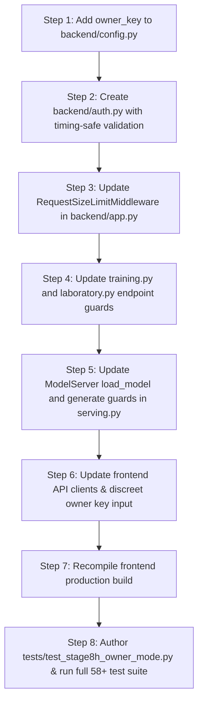

# NEXORA v1.0.0 — Stage 8H: Secure Owner Mode Implementation Plan

**Date:** 2026-11-28  
**Active Branch:** `feature/demo-mode-security`  
**Baseline HEAD:** `167e7600f27e9873f895b281c175465d3b0291a6`  
**Objective:** Implement a secure Owner Mode permitting authorized remote GPU training, model launching, and inference while keeping Public Demo mode restricted.

---

## 1. Architecture Inspection & Root Cause Analysis

### A. Current Security Architecture
In Stage 7B through 8G, NEXORA implemented an all-or-nothing security model controlled by `CUDA_ENGINE_DEMO_MODE=1`:
- **Blanket Public Restriction:** The backend process treats all incoming network requests identically as anonymous, unauthenticated public visitors.
- **Missing Authentication Layer:** There is currently no server-side mechanism to distinguish between a public observer and the project owner.
- **Consequence:** When the owner connects remotely via ngrok or Cloudflare, every privileged action (training job submission, full model loading, unclamped text generation, active job inspection) is unconditionally blocked.

### B. Inventory of Enforced Restrictions Preventing Remote Owner Operations

| Endpoint / Subsystem | Code Location | Enforced Restriction | Impact on Owner |
| :--- | :--- | :--- | :--- |
| `POST /api/training/jobs` | `backend/routes/training.py:139` | Unconditional HTTP 403 Forbidden | Cannot start training jobs remotely |
| `POST /api/training/jobs/{id}/cancel` | `backend/routes/training.py:292` | Unconditional HTTP 403 Forbidden | Cannot abort runaway training jobs |
| `POST /api/training/adaptive/recommend` | `backend/routes/training.py:88` | Unconditional HTTP 403 Forbidden | Cannot compute adaptive batch/learning configurations |
| `GET /api/training/jobs` | `backend/routes/training.py:215` | Returns static `jobs: []`, `total: 0` | Cannot monitor historical or queued training jobs |
| `GET /api/training/jobs/{id}` | `backend/routes/training.py:239` | Returns HTTP 404 Not Found | Cannot monitor live epoch/loss progress |
| `GET /api/training/jobs/{id}/metrics` | `backend/routes/training.py:260` | Returns HTTP 404 Not Found | Telemetry charts cannot fetch active metrics |
| `POST /api/laboratory/experiments` | `backend/routes/laboratory.py:156` | Unconditional HTTP 403 Forbidden | Comparative laboratory benchmarking blocked |
| `POST /api/laboratory/adaptive-select` | `backend/routes/laboratory.py:466` | Unconditional HTTP 403 Forbidden | Adaptive kernel path mutation blocked |
| `POST /api/models/load` | `backend/app.py:296` | Checkpoint path rejected; whitelist restricted | Cannot load custom or unreleased checkpoints |
| `POST /api/models/unload` | `backend/app.py:327` | Unconditional HTTP 403 Forbidden | Cannot flush VRAM between workloads |
| `POST /api/models/generate` | `backend/app.py:368` & `serving.py:616` | Max 256 prompt chars; max 48 tokens; concurrency lock=1 | LLM generation strictly clamped |
| `RequestSizeLimitMiddleware` | `backend/app.py:89` | Request body hard-capped at 32 KB | Cannot upload dataset batches or large configs |

---

## 2. Proposed Architecture: Dual-Role Authorization Model

To allow full owner capabilities without weakening public demo safety, NEXORA will introduce a **Dual-Role Authorization System** verified per-request on the server:

```
                          [ Incoming HTTP Request ]
                                     |
                       Has valid X-Owner-Key or
                     Authorization: Bearer header?
                                /         \
                             YES           NO
                             /               \
                 [ Verified Owner ]     [ Public Demo ]
                 - Full Training Access - 403 on Mutations
                 - Full Model Loading   - Demo Model Whitelist
                 - Unclamped Generation - Clamped Generation (48 tok)
                 - Full Job Telemetry   - Redacted Job History
                 - 50 MB Request Limit  - 32 KB Request Limit
                 - Hardware Safeguards  - Hardware Safeguards
```

### A. Core Server-Side Authentication Design
1. **Host-Side Secret Provisioning:**
   - Server reads `CUDA_ENGINE_OWNER_KEY` from the local environment.
   - **Fail-Safe Closed:** If `CUDA_ENGINE_OWNER_KEY` is not set or empty, Owner Mode is completely disabled. No remote request can gain elevated privileges.
   - **Secret Protection:** The key is never committed to Git, never logged, never returned in API payloads, and never bundled into frontend assets.
2. **Per-Request Header Inspection:**
   - Request may pass the owner key via:
     - `X-Owner-Key: <secret>`
     - `Authorization: Bearer <secret>`
3. **Timing-Attack Resistance:**
   - Token validation uses `secrets.compare_digest(provided_token.encode("utf-8"), configured_owner_key.encode("utf-8"))` to prevent timing side-channel attacks.
4. **Zero-Session Architecture:**
   - Stateless validation: every single mutating or sensitive request is validated independently at the endpoint dependency boundary.

---

## 3. Strict Security Controls & Invariant Safeguards

Even when authenticated as Owner, the following critical safety and system invariants remain strictly enforced:

> [!IMPORTANT]
> ### Invariant Safeguards (Active for Both Owner & Public)
> 1. **GPU Contention Guard:** If an asynchronous GPU training job is actively training (`active_gpu_job_id is not None`), GPU inference remains blocked with HTTP 409 to prevent VRAM collision on the 6 GB RTX 3050. Inference automatically routes to CPU.
> 2. **Thermal Shutdown Threshold:** Hardware monitor actively reads NVML temperature. If GPU die temperature exceeds safety limits (75°C warning / 82°C hard limit), GPU job execution is suspended.
> 3. **Minimum VRAM Reserve:** A minimum of 1024 MB free VRAM is verified before allocating model weights on CUDA.
> 4. **Filesystem Path Traversal Protection:** All checkpoint resolutions must resolve within `PROJECT_ROOT / "checkpoints"` or `PROJECT_ROOT`. Arbitrary system paths (`../../`, `C:\Windows`, etc.) remain blocked with HTTP 403.
> 5. **Safe Weight Loading:** PyTorch safe loading (`weights_only=True`) is mandatory across all checkpoint loads to prevent arbitrary code execution via Python pickle exploits.
> 6. **Host Confidentiality:** Host hardware paths, internal environment variables, database credentials, and system usernames remain completely redacted from telemetry responses.

---

## 4. Frontend Integration Design (Discreet & Zero Redesign)

In accordance with Requirement 8 (*Do not modify frontend UI unless required for secure integration*):
1. **Dynamic Header Injection:**
   - In `frontend/src/services/api.ts` and `frontend/src/services/trainingApi.ts`, add a helper `getOwnerKey()`:
     - Reads `sessionStorage.getItem('nexora_owner_key')` or `localStorage.getItem('nexora_owner_key')`.
     - If present, automatically attaches `'X-Owner-Key': ownerKey` to every outbound `fetch()` request.
2. **Discreet Authentication Access:**
   - In `CommandBar.tsx` / `Sidebar.tsx`, the status pill displays `Mode: Public Demo` for public visitors.
   - Clicking the Mode pill (or typing `Ctrl+Shift+O` / `owner` in CommandBar) opens a compact, dark-themed **Owner Access Dialog** with a password input.
   - Upon entering the key, the frontend calls `GET /api/health` with the header. If the backend returns `mode: "owner"`, the key is stored in `sessionStorage` and the status badge turns emerald green: **`Mode: Owner (Full Access)`**.
   - If cleared or invalid, the badge remains **`Mode: Public Demo`** with zero impact on public demo viewers.

---

## 5. Detailed Step-by-Step Implementation Sequence



### Detailed Steps:
1. **`backend/config.py`:**
   - Add `owner_key: str = field(default_factory=lambda: os.getenv("CUDA_ENGINE_OWNER_KEY", "").strip())`.
2. **`backend/auth.py`:**
   - Create lightweight auth helper:
     ```python
     def is_owner_authorized(request: Request) -> bool:
         settings = get_settings()
         if not settings.owner_key:
             return False
         auth_hdr = request.headers.get("x-owner-key") or request.headers.get("authorization", "")
         if auth_hdr.lower().startswith("bearer "):
             auth_hdr = auth_hdr[7:].strip()
         return secrets.compare_digest(auth_hdr.encode("utf-8"), settings.owner_key.encode("utf-8"))
     ```
3. **`backend/app.py`:**
   - In `RequestSizeLimitMiddleware`: Allow owner-authorized requests to pass payloads up to 50 MB, while keeping unauthenticated public visitors at 32 KB.
   - In `health`: Return `mode: "owner"` when authorized, `mode: "public-demo"` when public demo is active.
   - In `load_model`, `unload_model`, and `generate_text`: Bypass demo whitelist and token clamps ONLY when `is_owner_authorized(request)` is True.
4. **`backend/routes/training.py` & `backend/routes/laboratory.py`:**
   - Replace blanket `if get_settings().demo_mode:` with:
     ```python
     if get_settings().demo_mode and not is_owner_authorized(request):
     ```
   - Public visitors receive the existing 403 Forbidden / redacted responses; the verified owner receives full read-write execution.
5. **`frontend/src/services/api.ts` & `trainingApi.ts`:**
   - Attach `X-Owner-Key` when available in `sessionStorage` or `localStorage`.
6. **Frontend Rebuild:**
   - Recompile `frontend/dist` with Vite.
7. **Automated Verification Suite:**
   - Create `tests/test_stage8h_owner_mode.py` testing:
     - Public requests without token: 100% demo restricted (403 on mutations, clamped generation, empty job lists).
     - Requests with wrong token: 100% demo restricted.
     - Requests with valid owner token: training creation succeeds (201), real jobs returned, model loading permitted, full generation tokens permitted.
     - Contention guards and thermal safety hold for both owner and public.
     - Full regression run of all 58 existing tests.

---

## 6. Security Impact & Governance Verification

- **No Public Security Degradation:** All existing Public Demo protections (whitelists, thermal gates, 32 KB limit, request clamps) remain identical for all unauthenticated users.
- **Fail-Safe Closed:** Default state without `CUDA_ENGINE_OWNER_KEY` maintains 100% read-only public demo isolation.
- **Git State:** Read-only planning turn. Zero commits, zero pushes, zero deployments.
