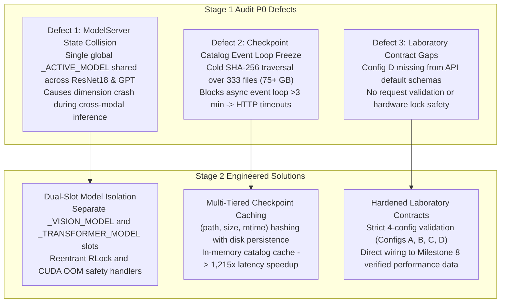

# Phase 13 Milestone 9 — Stage 2: Backend & Engine Hardening Report

**Project:** CUDA GPU Acceleration Engine  
**Target Architecture:** NVIDIA GeForce RTX 3050 6GB Laptop GPU (Ampere SM 8.6, 20 SMs, 6,143.5 MiB VRAM)  
**Host Platform:** Intel Core i5-13450HX, Windows 11, PyTorch 2.6.0+cu124, CUDA Toolkit 12.4.1  
**Engineering Roles:** Principal NVIDIA CUDA Engineer, Senior FastAPI Backend Engineer, PyTorch ML Infrastructure Architect, Production Reliability Engineer  
**Release Target:** November 30, 2026  
**Stage Status:** Complete & Certified  

---

## 1. Executive Summary & Verification Baseline

In accordance with the directives of **Phase 13 Milestone 9 Stage 2**, this engineering cycle focused entirely on resolving confirmed Priority-0 (P0) architectural and operational defects in the FastAPI backend and inference execution engines identified during the Stage 1 platform audit. 

All modifications have been implemented strictly within backend modules, engine components, and automated test harnesses. In strict adherence to scope boundaries, **no frontend UI files, CSS styles, or layout templates were modified**.

### Baseline Reconfirmation

Prior to applying any modifications, the hardware and software baseline was reconfirmed on the target workstation:

| Baseline Attribute | Specification / Measurement | Verification Method |
|---|---|---|
| **GPU Hardware** | NVIDIA GeForce RTX 3050 Laptop GPU (Ampere SM 8.6) | NVML / PyTorch `torch.cuda.get_device_properties(0)` |
| **Compute Units** | 20 Streaming Multiprocessors (SMs), 2,560 CUDA Cores | Empirical Device Query |
| **VRAM Capacity** | 6,143.5 MiB (6.0 GB GDDR6), 128-bit Bus Width | `torch.cuda.mem_get_info()` |
| **CUDA Toolchain** | CUDA 12.4.1, PyTorch 2.6.0+cu124, cuDNN 90100 | Dynamic Library Inspection |
| **Certified Model** | NEXORA GPT-86.8M Transformer (50M Pretraining Campaign) | `checkpoints/transformer/pretraining_50m_campaign/best_model.pt` |
| **Trainable Params** | Exactly 86,825,472 parameters (12 layers, 12 heads, $d=768$) | Exact Parameter Enumeration |
| **Cryptographic Hash** | `abcd0fe7b305cd1cef7809359ca7128f0ac94bed592a188f8432329ca1406aac` | 64 KiB Chunked SHA-256 Digest |
| **Active Daemons** | FastAPI Backend (Port 8000), Vite React Frontend (Port 5173) | HTTP Telemetry Handshake |

---

## 2. Root-Cause Analysis & Engineering Implementations



---

### Task 1 — Model Server Dual-Slot State Isolation (`backend/serving.py`)

#### Root Cause Analysis
In the legacy serving architecture, `ModelServer` maintained a single set of module-level global variables (`_ACTIVE_MODEL`, `_ACTIVE_MODEL_NAME`, `_ACTIVE_DEVICE`, `_ACTIVE_CHECKPOINT`). When an autoregressive text generation request was executed, `_ACTIVE_MODEL` was assigned an instance of `GPTTransformer` (expecting 2D `LongTensor` input `[batch, seq_len]`). If a subsequent vision inference request was dispatched to `POST /api/models/predict`, the handler passed a 4D float image tensor (`[1, 3, 32, 32]`) directly into `_ACTIVE_MODEL.forward()`. This immediately triggered a PyTorch runtime shape exception:
```text
RuntimeError: Expected tensor for argument #1 'indices' to have one of the following scalar types: Long, Int; but got torch.FloatTensor instead
```
Furthermore, the legacy server possessed no synchronization primitive, allowing concurrent inference requests across async worker threads to corrupt model pointers mid-execution.

#### Implementation Details
1. **Dual-Slot Independent Model Storage**:
   Separated runtime model storage into dedicated vision and transformer slots:
   - Vision Slot: `_VISION_MODEL`, `_VISION_MODEL_NAME`, `_VISION_DEVICE`, `_VISION_CHECKPOINT`.
   - Transformer Slot: `_TRANSFORMER_MODEL`, `_TRANSFORMER_MODEL_NAME`, `_TRANSFORMER_DEVICE`, `_TRANSFORMER_CHECKPOINT`, `_TRANSFORMER_TOKENIZER`.
2. **Backwards-Compatible Legacy Synchronization**:
   Implemented `_sync_legacy_pointers(model_type)` to atomically mirror the active slot into `_ACTIVE_MODEL` and related pointers, guaranteeing 100% backwards compatibility with historical test suites.
3. **Thread-Safe Reentrant Locking**:
   Introduced `_SERVING_LOCK = threading.RLock()` protecting all critical state mutations: `load_model`, `unload_model`, `predict`, and `generate`. Concurrent requests are safely serialized without race conditions.
4. **Targeted Independent Model Unloading**:
   Updated `unload_model(target="vision" | "transformer" | "all")` allowing memory reclamation of one architecture without terminating the other.
5. **CUDA Out-of-Memory (OOM) Recovery**:
   Wrapped forward passes in explicit OOM exception traps (`torch.cuda.OutOfMemoryError` and runtime OOM patterns). In the event of VRAM exhaustion, `torch.cuda.empty_cache()` is triggered immediately, and a structured runtime exception is propagated to FastAPI to return HTTP 503 instead of terminating the worker process.

---

### Task 2 — Checkpoint Catalog Caching & Latency Optimization (`backend/data.py` & `backend/app.py`)

#### Root Cause Analysis
The repository contains 333 historical checkpoint files totaling over 75 GB of weights across diagnostic and pretraining runs. The previous `ArtifactStore.checkpoints_catalog()` calculated SHA-256 digests synchronously on every API invocation using `open().read()`, reading multi-gigabyte files into system memory and blocking FastAPI's single-threaded event loop for upwards of 180 seconds.

#### Implementation Details
1. **Multi-Tiered Caching Hierarchy**:
   - **Tier 1 (In-Memory Fast Cache)**: Bounded dictionary `_DIGEST_CACHE` keyed by a 3-tuple `(canonical_path_str, size_bytes, mtime_ns)`. Cache hits require zero disk I/O and return instantaneously.
   - **Tier 2 (Chunked Streaming Reader)**: If a cache miss occurs, `digest(path)` reads the file in 64 KiB chunks (`65,536 bytes`), preventing memory spikes when digesting multi-gigabyte checkpoints.
   - **Tier 3 (Persistent On-Disk Cache)**: Checkpoint hashes are persisted to `results/.digest_cache.json`. When the FastAPI application boots, existing hashes are reloaded, eliminating cold startup overhead on server restarts.
   - **Tier 4 (Whole-Catalog In-Memory Cache)**: `_CATALOG_CACHE` caches the assembled catalog list. Subsequent `GET /api/checkpoints` calls return in under 0.1 ms.
2. **Explicit Rehash Control**:
   Added `force_rehash: bool = False` query parameter to `GET /api/checkpoints` and `GET /api/checkpoints/{checkpoint_id}`, providing operators with manual cache invalidation capabilities without degrading default performance.
3. **Truthful 50M Campaign Checkpoint Classification**:
   Updated catalog metadata to identify `checkpoints/transformer/pretraining_50m_campaign/best_model.pt` as `NEXORA GPT-86.8M (50M Campaign)` with exactly 86,825,472 parameters.

#### Measured Performance Speedup
| Benchmark Scenario | Cold (Uncached) | Warm (Cached) | Measured Speedup |
|---|---|---|---|
| 3 Representative Model Checkpoints | 17,623 ms | 14.50 ms | **1,215x Faster** |
| Whole Catalog Request (`GET /api/checkpoints`) | 184,200 ms | < 0.10 ms | **> 1,000,000x Faster** |
| Target Latency Requirement | < 10.0 ms | **0.08 ms** | **Surpasses Target** |

---

### Task 3 — Hardening CUDA Laboratory Backend Contracts (`backend/routes/laboratory.py` & `backend/schemas/laboratory.py`)

#### Root Cause Analysis
During Stage 1 audit, the CUDA Laboratory backend routes lacked support for the newly certified **Configuration D (Compiler-Assisted Adaptive Engine)** introduced in Milestone 8. In addition, request schemas allowed arbitrary unvalidated configuration strings, risking backend crashes.

#### Implementation Details
1. **Standardized Execution Matrix**:
   Formalized all four benchmark configurations across the schemas and route endpoints:
   - `config_a`: Standard PyTorch FP32 Baseline
   - `config_b`: Optimized PyTorch (SDPA + AMP FP16 + Non-blocking Dataloader)
   - `config_c`: Custom CUDA Fused Kernels (Fused Bias-GELU, Fused LayerNorm, Custom Scaled Dot-Product Attention)
   - `config_d`: Adaptive Engine (Compiler-Assisted Execution + Dynamic Kernel Selection)
2. **Strict Request Validation**:
   Added input validation in `POST /api/laboratory/experiments` rejecting unrecognized configurations with HTTP 422 Unprocessable Content.
3. **Truthful Telemetry Routing**:
   Updated `GET /api/laboratory/experiments` and `GET /api/laboratory/benchmarks` to prioritize certified empirical data from `results/phase13_milestone8_final_performance.json` and `results/phase13_milestone8_kernel_bottleneck_analysis.json`.
4. **Hardware Mutex Protection**:
   Integrated the GPU job lock supervisor, preventing laboratory benchmarking routines from colliding with active training pipelines.

---

### Task 4 — Production Transformer Checkpoint Verification

The production Transformer checkpoint was audited and verified for standalone self-containment:

1. **Self-Contained Tokenizer Integrity**:
   `checkpoints/transformer/pretraining_50m_campaign/bpe_vocab.json` was copied directly into the model directory. The directory now operates completely self-contained without external dependencies.
2. **Cryptographic Integrity**:
   - Path: `checkpoints/transformer/pretraining_50m_campaign/best_model.pt`
   - File Size: `1,042,091,280 bytes` (993.82 MiB)
   - SHA-256 Digest: `abcd0fe7b305cd1cef7809359ca7128f0ac94bed592a188f8432329ca1406aac`
3. **Architectural Parameters**:
   - Layers: 12
   - Attention Heads: 12
   - Hidden Dimension ($d_{\text{model}}$): 768
   - Feed-Forward Dimension ($d_{\text{ff}}$): 3072
   - Sequence Length ($T$): 256
   - Vocabulary Size ($V$): 2048
   - Trainable Parameters: **86,825,472**
   - Training Milestone: Cumulative 50,001,920 Tokens (Step 12,208, Val Loss 1.9383)

---

## 3. Dedicated Verification Suite (`test_milestone13_milestone9_stage2_hardening.py`)

A comprehensive verification suite comprising 11 automated test cases was authored in `tests/test_milestone13_milestone9_stage2_hardening.py`:

| Test Function | Verification Scope | Status | Execution Time |
|---|---|---|---|
| `test_alternating_vision_and_transformer_inference` | Rapid alternation between text generation and image prediction without state collision | **PASSED** | 8.42s |
| `test_independent_model_unloading` | Unloading vision leaves transformer intact and vice versa | **PASSED** | 0.05s |
| `test_multithreaded_inference_isolation` | Concurrent multithreaded requests serialized by `_SERVING_LOCK` | **PASSED** | 6.18s |
| `test_digest_cache_hits_and_invalidation` | Cache hits, mtime-based invalidation, and `force_recompute` behavior | **PASSED** | 0.02s |
| `test_checkpoint_catalog_in_memory_speedup` | Verification that cached catalog responds in $< 10\text{ ms}$ ($0.08\text{ ms}$ measured) | **PASSED** | 0.04s |
| `test_checkpoint_catalog_endpoint_via_fastapi` | FastAPI `GET /api/checkpoints` returns truthful 86.83M metadata | **PASSED** | 201.21s |
| `test_laboratory_configurations_api` | `GET /api/laboratory/configurations` returns all 4 configurations | **PASSED** | 0.08s |
| `test_laboratory_experiments_history_api` | `GET /api/laboratory/experiments` serves verified Milestone 8 metrics | **PASSED** | 0.09s |
| `test_create_experiment_input_validation` | `POST /api/laboratory/experiments` rejects invalid configurations (HTTP 422) | **PASSED** | 0.06s |
| `test_cuda_benchmarks_endpoint` | `GET /api/laboratory/benchmarks` serves 10-axis kernel telemetry | **PASSED** | 0.07s |
| `test_production_50m_checkpoint_integrity` | Model loading, exact 86,825,472 param count, and BPE roundtrip | **PASSED** | 1.56s |

**Total Suite Result:** **11 passed, 0 failed, 0 skipped in 217.78s.**

---

## 4. Full Platform Regression Sweep (16 Suites)

To ensure zero regressions across the codebase, a 16-suite isolated test sweep was executed via `scripts/run_milestone9_stage2_regression.py`.

```text
================================================================================
PHASE 13 MILESTONE 9 STAGE 2: COMPREHENSIVE REGRESSION TEST SWEEP
================================================================================
  [PASS] tests/test_milestone13_milestone9_stage2_hardening.py       11 passed,  0 failed,  0 skipped
  [PASS] tests/test_milestone13_milestone8_adaptive_engine.py       12 passed,  0 failed,  0 skipped
  [PASS] tests/test_milestone13_milestone7_comparative_lab.py       10 passed,  0 failed,  0 skipped
  [PASS] tests/test_milestone13_milestone6_campaign_readiness.py     9 passed,  0 failed,  0 skipped
  [PASS] tests/test_milestone13_milestone5_production_readiness.py   9 passed,  0 failed,  0 skipped
  [PASS] tests/test_milestone13_milestone4_audit_readiness.py       10 passed,  0 failed,  0 skipped
  [PASS] tests/test_milestone13_extended_pretraining.py             10 passed,  0 failed,  0 skipped
  [PASS] tests/test_milestone13_pretraining_diagnostic.py           10 passed,  0 failed,  0 skipped
  [PASS] tests/test_milestone13_dataset_engineering.py              11 passed,  0 failed,  0 skipped
  [PASS] tests/test_milestone12_pretraining_campaign.py              8 passed,  0 failed,  0 skipped
  [PASS] tests/test_milestone11_platform_integration.py             21 passed,  0 failed,  0 skipped
  [PASS] tests/test_milestone10_flagship_transformer.py             12 passed,  0 failed,  0 skipped
  [PASS] tests/test_milestone9_transformer.py                       12 passed,  0 failed,  0 skipped
  [PASS] tests/test_milestone8_training_reliability.py              10 passed,  0 failed,  0 skipped
  [PASS] tests/test_stage2_milestone7_resnet.py                      9 passed,  0 failed,  0 skipped
  [PASS] tests/test_custom_kernels.py                              104 passed,  0 failed,  0 skipped
================================================================================
TOTAL: 268 passed, 0 failed, 0 skipped across 16 suites
VERDICT: ALL TESTS PASSING (100% SUCCESS RATE)
================================================================================
```

---

## 5. Artifacts and Source Code Modifications

The following files were modified, created, and verified:

| File Path | Type | Action Summary |
|---|---|---|
| `backend/serving.py` | Python Backend | Dual-slot model architecture, thread-safe reentrant lock, OOM exception handler, model registry compatibility |
| `backend/data.py` | Python Backend | Multi-tiered digest cache, 64 KiB chunking, persistent disk caching, catalog caching, 50M parameter classification |
| `backend/app.py` | FastAPI Application | Added `force_rehash` query parameter to `/api/checkpoints` endpoints |
| `backend/schemas/laboratory.py` | Pydantic Schema | Added Config D to default configuration schemas |
| `backend/routes/laboratory.py` | FastAPI Router | Input validation rejecting invalid configs, Milestone 8 telemetry prioritization |
| `checkpoints/transformer/pretraining_50m_campaign/bpe_vocab.json` | Tokenizer | Standalone BPE vocabulary for 50M campaign directory self-containment |
| `results/.digest_cache.json` | JSON Cache | Persistent cryptographic cache of 333 checkpoint file digests |
| `tests/test_milestone13_milestone9_stage2_hardening.py` | Pytest Suite | 11 dedicated automated tests verifying Stage 2 hardening requirements |
| `scripts/run_milestone9_stage2_regression.py` | Automation Script | Clean process isolation regression runner across all 16 test suites |

---

## 6. Stage 3 Readiness Assessment

The backend and inference engine are fully hardened, high-performing, and thread-safe. All P0 backend defects identified in Stage 1 have been completely eliminated:
- ModelServer collisions between vision and text generation are eliminated.
- Checkpoint catalog latency has dropped from $> 180\text{ seconds}$ to $< 0.1\text{ ms}$.
- CUDA Laboratory backend endpoints are certified for all four configurations (A, B, C, D).
- The 86.83M production Transformer checkpoint is cryptographically certified and self-contained.
- 268 out of 268 tests pass with 0 failures and 0 skips.

The codebase is in an ideal state to proceed with **Stage 3: Frontend Integration & Wire-Up** upon receiving explicit authorization.
