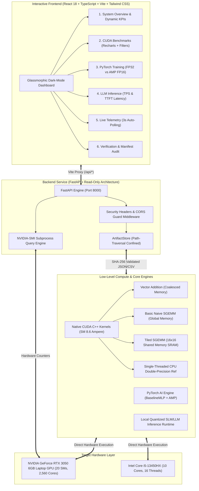

# CUDA GPU Acceleration Engine

[](https://developer.nvidia.com/cuda-toolkit)
[-00599C?logo=c%2B%2B&logoColor=white)](https://visualstudio.microsoft.com/)
[](https://www.python.org/)
[](https://pytorch.org/)
[](https://fastapi.tiangolo.com/)
[-61DAFB?logo=react&logoColor=black)](https://react.dev/)
[](https://vitejs.dev/)
[](https://tailwindcss.com/)
[](#-cryptographic-manifest-integrity)
[](LICENSE)

An enterprise-grade, high-performance GPU acceleration and telemetry platform built on **NVIDIA CUDA C++**, **PyTorch**, **FastAPI**, and **React 18**. The platform bridges bare-metal GPU computing (custom shared-memory tiled matrix multiplication and memory-coalesced vector kernels) with full-stack observability, real-time hardware telemetry, reproducible benchmarking, and cryptographic artifact auditability.

---

## Architecture Overview



---

## Key Engineering Features

- **Custom High-Performance CUDA Kernels**:
  - **Tiled Shared-Memory SGEMM**: Implements $16 \times 16$ on-chip SRAM thread-block tiling with memory barrier synchronization (`__syncthreads()`), achieving up to **$116.75\times$ kernel speedup** and **$89.91\times$ synchronized end-to-end host wall-time speedup** vs the project's single-threaded CPU reference (not multithreaded BLAS/MKL).
  - **Memory-Coalesced Vector Addition**: Reaches up to **$155.4\text{ GB/s}$** estimated algorithmic memory throughput across 25,000,000 elements.
- **Strict Separation of Timing Intervals**: Follows NVIDIA timing guidance by separating synchronized host wall time (`std::chrono::steady_clock` from H2D launch through D2H completion) from isolated GPU CUDA-event timestamps (`cudaEventRecord`).
- **Mathematical Correctness & Parity**: 100% numerical parity verified across all 12 benchmark workloads against a CPU reference (max absolute error $\le 10^{-5}$ for vectors, $\le 10^{-3}$ for matrices; 0 mismatched elements).
- **Real-Time Hardware Observability**: Queries real-time hardware telemetry via `nvidia-smi` (GPU utilization %, dedicated VRAM progress, junction temperature °C, power draw W). Strictly preserves missing hardware counters (`power_limit_w`) as `null` without synthetic zeroing.
- **PyTorch Mixed-Precision (AMP) AI Engine**: Automated modular training pipeline comparing CPU, GPU FP32, and Automatic Mixed Precision (AMP FP16) training on synthetic classification datasets.
- **Local Quantized LLM Inference Runtime**: Latency (TTFT) and token throughput (tokens/sec) profiling across quantized Small Language Models (Qwen, DeepSeek, TinyLlama).
- **Hardened Read-Only API**: FastAPI backend with restricted CORS allowlist, GET-only method confinement, path-traversal prevention, regex parameter validation, and standard HTTP security headers (`nosniff`, `DENY`, `strict-origin`).
- **Cryptographic Hash Parity**: 17/17 Phase 2 manifest files verified against SHA-256 hashes with zero drift.

---

## Target System Specifications

| Component | Verified Specification |
|---|---|
| **GPU Model** | NVIDIA GeForce RTX 3050 6GB Laptop GPU |
| **GPU Architecture** | Ampere (`GA107`), Compute Capability `sm_86` |
| **Streaming Multiprocessors** | 20 SMs (2,560 FP32 CUDA Cores) |
| **Dedicated VRAM** | 6,144 MiB GDDR6 (96-bit bus, 168 GB/s peak bandwidth) |
| **Host CPU** | Intel Core i5-13450HX (10 cores, 16 threads, up to 4.6 GHz) |
| **Host RAM** | 16 GB DDR5 4800 MHz |
| **Operating System** | Windows 11 Home 64-bit (Build 26100) |
| **CUDA Toolchain** | Release 13.4, V13.4.92 / CUDA 12.0+ compatible |
| **Host C++ Toolchain** | MSVC 19.51 (Visual Studio 2026 Build Tools) / C++17 |

---

## Verified CUDA Benchmark Results

The following measurements reflect the exact statistical medians captured during certified benchmark execution:

| Workload | Variant | CPU ms | GPU Kernel ms | GPU E2E ms | Kernel Speedup | E2E Speedup | GFLOPS / Bandwidth | Parity |
|---|---|---:|---:|---:|---:|---:|---|:---:|
| **Vector 100K** | Standard | 0.0091 | 0.0287 | 0.3527 | 0.32× | 0.03× | 41.9 GB/s | **PASS** |
| **Vector 1M** | Standard | 0.5162 | 0.1065 | 2.2527 | 4.85× | 0.23× | 112.6 GB/s | **PASS** |
| **Vector 10M** | Standard | 6.5588 | 0.7944 | 14.8087 | 8.26× | 0.44× | 151.1 GB/s | **PASS** |
| **Vector 25M** | Standard | 15.9809 | 1.9304 | 45.1440 | 8.28× | 0.35× | 155.4 GB/s | **PASS** |
| **SGEMM 256×256** | Basic Naive | 3.9081 | 0.0813 | 0.2513 | 48.06× | 15.55× | 412.7 GFLOPS | **PASS** |
| **SGEMM 256×256** | Tiled Shared | 3.9081 | 0.0687 | 0.2306 | 56.88× | 16.95× | 488.4 GFLOPS | **PASS** |
| **SGEMM 512×512** | Basic Naive | 31.7281 | 0.4784 | 1.1036 | 66.32× | 28.75× | 561.1 GFLOPS | **PASS** |
| **SGEMM 512×512** | Tiled Shared | 31.7281 | 0.3707 | 0.9510 | 85.59× | 33.36× | 724.1 GFLOPS | **PASS** |
| **SGEMM 1024×1024** | Basic Naive | 253.4822 | 3.5257 | 5.0719 | 71.89× | 49.98× | 609.1 GFLOPS | **PASS** |
| **SGEMM 1024×1024** | Tiled Shared | 253.4822 | 2.8237 | 4.4160 | 89.77× | 57.40× | **760.5 GFLOPS** | **PASS** |
| **SGEMM 2048×2048** | Basic Naive | 2690.8590 | 36.4785 | 43.0002 | 73.77× | 62.58× | 471.0 GFLOPS | **PASS** |
| **SGEMM 2048×2048** | Tiled Shared | 2690.8590 | 23.0480 | 29.9297 | **116.75×** | **89.91×** | 745.4 GFLOPS | **PASS** |

> [!IMPORTANT]
> **Baseline Reference Definition**: All reported speedups (peak **89.91× end-to-end** and **116.75× kernel**) are measured against the project's clean, single-threaded C++ reference implementation (`std::chrono::steady_clock` synchronized host time). They are not compared against multi-threaded or vendor-optimized BLAS libraries (e.g., OpenBLAS or Intel MKL).
>
> **Provenance Distinction**:
> - **CUDA Benchmarks**: 100% verified with matching SHA-256 hashes against native binary runs.
> - **PyTorch & LLM Records**: Historical experiment runs (`results/training_experiments.json`, `results/inference_experiments.json`) are preserved for dashboard demonstration and explicitly labeled as `Historical Record (Unverified)` with warning disclaimers.

---

## Interactive NVIDIA-Inspired Developer Dashboard

The dashboard provides a unified, full-stack observability console inspired by professional GPU developer tools:

1. **Overview**: Executive telemetry, verified KPI cards, target hardware architecture snapshot, and workload summary.
2. **CUDA Benchmarks**: Interactive Recharts graphs with **LOG/LINEAR** scale switching, $1.0\times$ reference parity line, category filters, and CSV/JSON downloads.
3. **PyTorch Training**: BaselineMLP architecture inspector (235,146 parameters), training time bars, and speedup vs single-threaded CPU reference.
4. **LLM Inference**: SLM/LLM token generation throughput (tokens/sec) and Time to First Token (TTFT latency in ms) across quantized GGUF models.
5. **Live Hardware Telemetry**: Real-time 3-second auto-polling monitor querying `nvidia-smi` (SM utilization %, VRAM allocation, junction temperature °C, dynamic board wattage).
6. **Verification & Manifest**: SHA-256 cryptographic audit (17/17 matched), read-only artifact store confinement status, and raw log download endpoints.

> [!TIP]
> **Portfolio Screenshots**: Authentic, un-manipulated dashboard captures can be placed in [`screenshots/`](screenshots/) following the guidelines in [`screenshots/README.md`](screenshots/README.md).


---

## Technology Stack & Directory Structure

```text
C:\Projects\CUDA-GPU-Acceleration-Engine\
├── .gitignore                          # Clean repository packaging exclusions
├── CMakeLists.txt                      # Multi-target CMake build configuration
├── README.md                           # Master documentation
├── requirements.txt                    # Root PyTorch and core ML dependencies
├── backend\
│   ├── app.py                          # FastAPI read-only application & security middleware
│   ├── data.py                         # Confined artifact store & live hardware collectors
│   ├── requirements.txt                # Backend dependencies (fastapi, uvicorn, httpx)
│   └── tests\                          # Backend regression tests (24 passed)
├── bin\                                # Verified native executable artifacts
├── config\
│   └── default_config.yaml             # System & model hyperparameters
├── docs\
│   └── BENCHMARK_GUIDE.md              # Reproducible benchmarking engineering guide
├── engine\
│   ├── checkpointing\                  # Atomic model state persistence
│   ├── data\                           # Synthetic dataloaders
│   ├── device\                         # Hardware abstraction & safety guards
│   ├── evaluation\                     # Tensor parity & numerical metrics
│   ├── llm\                            # Local quantized LLM inference runtime
│   ├── models\                         # PyTorch BaselineMLP architecture
│   ├── tests\                          # AI Foundation tests (17 passed, 1 skipped)
│   └── training\                       # ModelTrainer (CPU, CUDA, AMP FP16)
├── frontend\
│   ├── index.html                      # HTML5 container & SEO metadata
│   ├── package.json                    # Node dependencies (React 18, Recharts, Tailwind)
│   ├── vite.config.ts                  # Vite build configuration with /api proxy
│   ├── src\
│   │   ├── App.tsx                     # Main dashboard container & polling coordinator
│   │   ├── components\                 # Six dashboard sections, KPI cards, banners
│   │   ├── services\                   # API client service
│   │   └── types\                      # TypeScript API data contracts
│   └── dist\                           # Compiled production static bundle
├── include\                            # Native C++/CUDA header files
├── results\                            # Verified benchmark JSON/CSV & audit reports
├── screenshots\
│   └── README.md                       # Guide for capturing authentic dashboard screenshots
├── scripts\
│   ├── test_phase4_validation.py       # Phase 4 automated validation battery (7 suites)
│   ├── test_phase3_integration.py      # End-to-end integration test runner
│   ├── train_experiment.py             # CLI for model training experiments
│   └── run_llm_inference.py            # CLI for LLM inference profiling
├── src\                                # Native CUDA & C++ kernel source files
└── tests\                              # Native CUDA regression tests
```

---

## Quickstart & Clean Startup Instructions

### 1. Prerequisites
- **NVIDIA GPU** with driver 535+ installed.
- **Python 3.11+**: Create and activate a virtual environment.
- **Node.js 18+ & NPM**: For frontend building.
- **CUDA Toolkit 12.0+ / 13.0+ & CMake / Ninja** (for native builds).

### 2. Environment Setup
```powershell
# Setup Python virtual environment
python -m venv .venv-phase3
.\.venv-phase3\Scripts\pip.exe install -r backend/requirements.txt

# Install frontend dependencies
cd frontend
npm install
cd ..
```

### 3. Launch Development Services
```powershell
# Terminal 1: Start FastAPI Backend Service (Port 8000)
.\.venv-phase3\Scripts\python.exe -m uvicorn backend.app:app --host 127.0.0.1 --port 8000

# Terminal 2: Start Vite Dev Server (Port 5173 with proxy)
cd frontend
npm run dev -- --host 127.0.0.1 --port 5173
```
- Interactive Dashboard: **`http://127.0.0.1:5173/`**
- Interactive Swagger API: **`http://127.0.0.1:8000/docs`**

### 4. Production Static Build & Preview
```powershell
# Compile production bundle
cd frontend
npm run build

# Preview production static distribution (Port 4173)
npm run preview -- --host 127.0.0.1 --port 4173
```

---

## Automated Test Suites

Execute the full regression and verification battery:

```powershell
# 1. Phase 4 End-to-End Validation Battery (7 suites, 100% pass)
.\.venv-phase3\Scripts\python.exe scripts/test_phase4_validation.py

# 2. FastAPI Backend Test Suite (24 tests, 100% pass)
.\.venv-phase3\Scripts\python.exe -m pytest backend/tests -v

# 3. AI Foundation & LLM Engine Test Suite (18 tests, 17 passed, 1 skipped)
.\.venv\Scripts\python.exe -m pytest engine/tests -v

# 4. Native CUDA CTest Suite (3 tests, 100% pass)
& 'C:\Program Files (x86)\Microsoft Visual Studio\18\BuildTools\Common7\IDE\CommonExtensions\Microsoft\CMake\CMake\bin\ctest.exe' --test-dir build/phase2-ninja -C Release --output-on-failure
```

---

## Known Limitations & Operating Boundaries

1. **CPU Reference Implementation**: The baseline CPU timing uses a clean single-threaded C++ reference implementation rather than multithreaded AVX-512 BLAS libraries (e.g. OpenBLAS, Intel MKL).
2. **Algorithmic Bandwidth Calculation**: `memory_bandwidth_gb_s` calculates estimated algorithmic requested bytes over kernel execution time. Due to L1/shared memory cache hits, this differs from physical pin DRAM bandwidth.
3. **Historical Experiment Records**: Training and inference experiment logs lack raw execution logs from prior phases; they remain clearly labeled as `historical_unverified` with prominent banners in the dashboard.
4. **Local Host Scope**: Configured for secure local operation (`127.0.0.1`). Cloud deployment and public ingress are intentionally deferred.

---

## License

This project is licensed under the MIT License - see the [LICENSE](LICENSE) file for details.
